# 🏭 foundry — Claude Code Plugin

OSS Claude Code configuration for Python/ML projects: 10 specialist agents, 11 skills, event-driven hooks, and repeatable audit and calibration workflows.

[Changelog](CHANGELOG.md) records version-by-version changes, including the plugin's earlier directory history.

Contributing or want internals? See [DEVELOPMENT.md](DEVELOPMENT.md).

> Optional integrations: `/oss:review` and `/oss:release` add release/review workflows (requires the `oss` plugin); `/develop:feature` and `/develop:fix` add implementation workflows (requires the `develop` plugin); `/research:run` and `/research:topic` add ML research workflows (requires the `research` plugin).

______________________________________________________________________

<details markdown="1">
<summary><strong>📋 Contents</strong></summary>

- [What is foundry?](#-what-is-foundry)
- [Why foundry?](#-why-foundry)
- [Install](#-install)
- [Quick start](#-quick-start)
- [Current boundaries](#-current-boundaries)
- [Git and GitHub approvals](#-git-and-github-approvals)
- [How foundry works](#-how-foundry-works)
- [Skills reference](#-skills-reference)
  - [`/foundry:setup`](#foundry-setup)
  - [`/foundry:audit`](#foundry-audit)
  - [`/foundry:calibrate`](#foundry-calibrate)
  - [`/foundry:manage`](#foundry-manage)
  - [`/foundry:brainstorm`](#foundry-brainstorm)
  - [`/foundry:investigate`](#foundry-investigate)
  - [`/foundry:profile`](#foundry-profile)
  - [`/foundry:distill`](#foundry-distill)
  - [`/foundry:session`](#foundry-session)
  - [`/foundry:create`](#foundry-create)
  - [`/foundry:humanizer`](#foundry-humanizer)
- [Agents reference](#-agents-reference)
  - [foundry:sw-engineer](#foundry-sw-engineer)
  - [foundry:solution-architect](#foundry-solution-architect)
  - [foundry:qa-specialist](#foundry-qa-specialist)
  - [foundry:linting-expert](#foundry-linting-expert)
  - [foundry:perf-optimizer](#foundry-perf-optimizer)
  - [foundry:doc-scribe](#foundry-doc-scribe)
  - [foundry:web-explorer](#foundry-web-explorer)
  - [foundry:curator](#foundry-curator)
  - [foundry:challenger](#foundry-challenger)
  - [foundry:creator](#foundry-creator)
- [Agent relationships](#-agent-relationships)
- [Rules installed](#-rules-installed)
- [Configuration](#-configuration)
- [Troubleshooting](#-troubleshooting)
- [Plugin structure](#-plugin-structure)
- [Bin helpers](#bin-helper-inventory)
- [Upgrade](#upgrade)
- [Uninstall](#uninstall)
- [Auto-allow audit log](#auto-allow-audit-log)
- [Development / testing](#-development--testing)
- [Contributing / feedback](#-contributing--feedback)

</details>

______________________________________________________________________

<a id="-what-is-foundry"></a>

## 🤔 What is foundry?

foundry is the configuration and workflow layer for Claude Code on Python/ML OSS projects. It gives Claude Code ten specialist agents, eleven namespaced skills, rules, and event-driven hooks for routing work, checking configuration, measuring instruction quality, and recording lessons for review.

The problem it solves is workflow drift: a generalist session can mix architecture, implementation, tests, docs, and tooling without clear ownership, while corrections disappear between sessions. Foundry provides explicit role boundaries, repeatable audits and calibration runs, and project-local state for the parts it supports. It does not replace application-code, release, or ML-research plugins.

<a id="-why-foundry"></a>

## 🎯 Why foundry?

**Without**: one model handles architecture, implementation, docs, linting, testing, performance — no boundary enforcement. Corrections evaporate per session. No way to know if agent accuracy drifted.

**With**:

- `/foundry:audit` catches config drift before it becomes debugging session
- `/foundry:calibrate` measures recall vs stated confidence — know exactly where agents fall short
- `/foundry:manage` creates, renames, deletes agents with full cross-reference propagation, one command
- `/foundry:brainstorm` turns vague idea into approved spec before any code written
- `/foundry:distill` converts accumulated corrections into durable rules + agent instruction updates
- Hooks keep lint, task tracking, teammate quality gates, and report checks running around Claude tool events (including Write/Edit operations)

Use `/foundry:audit` for structural checks, `/foundry:calibrate` for measured routing and agent behavior, and `/foundry:distill` to turn recurring corrections into proposed instruction updates.

<a id="-install"></a>

## 📦 Install

**Prerequisites**:

- Claude Code with plugin support
- Python 3.10+; `git` is needed only for setup's project-local permissions guide copy
- `jq` on PATH for audit/manage JSON work (setup uses Python only)
- Node.js for the plugin's hooks

Each hook runs `node` from PATH, then `/opt/homebrew/bin/node` or `/usr/local/bin/node`. When none exists, the hooks skip without blocking, and one `SessionStart` check reports once per session that they are inactive.

The plugin's `bin/python` and native Windows `bin/python.cmd` preserve the shipped `python` command and probe candidate runtimes for Python 3.10+ before executing the workload once. Plugin `bin/` follows system directories on PATH, so an eligible system `python` takes precedence; missing eligible runtimes produce a clear diagnostic.

```bash
claude plugin marketplace add Borda/AI-Rig
claude plugin install foundry@borda-ai-rig
```

Companion plugins for full workflow suite:

```bash
claude plugin install oss@borda-ai-rig
claude plugin install develop@borda-ai-rig
claude plugin install research@borda-ai-rig
```

**One-time setup** — run inside Claude Code after install, from any directory (the project repository root for the project-local permissions guide copy):

```text
/foundry:setup
```

Setup, in short:

- merges `statusLine`, `permissions.allow`, `permissions.deny` and the shipped `env` defaults into `~/.claude/settings.json`; enabling an installed bridge or promoting a project-pinned `advisorModel` requires explicit opt-in
- removes retired allow and deny entries (details under [`/foundry:setup`](#foundry-setup)), preserving every other existing entry
- symlinks all rule files into `~/.claude/rules/` as `foundry-<name>.md`, and `TEAM_PROTOCOL.md` into `~/.claude/`
- reports added and retired allow/deny counts, retained conflicts and actual timestamped backup paths in its summary
- is idempotent — safe to re-run

**After any plugin upgrade**, re-run `/foundry:setup` — auto-replaces stale foundry symlinks, removes rules gone from new version. No prompt for old-version symlinks.

<a id="-quick-start"></a>

## ⚡ Quick start

Run setup once, then check the installation from the project repository root:

```text
/foundry:setup
```

The first useful workflow is:

```text
/foundry:audit setup
```

It produces a structured report of system config checks (hooks, `settings.json`, `permissions-guide.md`, `MEMORY.md`, configuration README files, plugin integration, and symlinks). Treat any critical findings as blockers and resolve the report's suggested next action.

Follow with:

```text
/foundry:calibrate routing --fast
```

Quick routing benchmark — measures whether Claude Code dispatches synthetic tasks to the right agent. The calibration threshold is 90%; use the measured result to identify routing gaps rather than treating it as a guarantee.

<a id="-current-boundaries"></a>

## 🧭 Current boundaries

- Foundry manages Claude Code configuration and workflow guidance; it does not implement application code or provide release-management and ML-research workflows. For those workflows, install `develop` (requires the `develop` plugin), `oss` (requires the `oss` plugin), or `research` (requires the `research` plugin).
- Calibration uses synthetic problems with quasi-ground-truth. It is an instruction-quality signal, not a production benchmark or guarantee of agent correctness.
- Hooks are event-driven and depend on Claude Code loading the enabled plugin plus Node.js. Most report or nudge; selected guards intentionally gate unsafe pushes, direct agent self-grants of an approval record, or incomplete follow-up prompts.
- Setup intentionally leaves some state behind on uninstall: merged settings, `foundry-*.md` rule links, and `TEAM_PROTOCOL.md` need manual review or removal; see [Uninstall](#uninstall).
- Profile cost output is best-effort and uses public list rates, not an account billing statement; when transcripts are unavailable, the clock report can still run without the cost section.

These are current boundaries of the shipped plugin, not promises about future support.

<a id="-git-and-github-approvals"></a>

## 🔐 Git and GitHub approvals

Foundry alone ships the git/gh guards, approval records and one-time tokens. Each approval is recorded by the `approval-guard.js` hook from your actual answer to a question.

Commands naming git or gh that cannot be inspected within the parser's size, nesting or time bounds ask for permission. This includes lexer failures and dynamically built command words. Readable force pushes are blocked; the accepted limit is a slow-host branch-substitution inspection deadline that can downgrade that block to an ask. Alias-of-config inspection uses the same bounds. `gh config set` requires approval, and browser/watch flags are excluded from automatic read approval.

The blueprint hook matches exact command text from its manifest. For loader-rendered fragments it binds the source template to its recorded digest, renders only the validated owning-plugin bootstrap path, then matches the rendered command; altered commands still require permission. Each helper block resolves and exports `PLUGIN_ROOT` before calling `python "$PLUGIN_ROOT/bin/<helper>.py"`.

### Local Git operations

Operations that need authorization (commit, staging owned changes, a local merge and its merge commit, cherry-pick, branch/worktree prep) ask one question:

- **Approve** — this operation only
- **Approve always** — this operation, plus a standing grant for this project
- **Deny** — skip it and leave changes as they are

How the standing grant works:

- The hook records an Approve always answer in `claude-git-approval.json` inside git's own common directory (`git rev-parse --git-common-dir`): once per project, applies to every worktree, never tracked or checked out by git.
- The question's Approve always option tells you that it persists, what it covers and how to revoke it.
- While a grant passes the rule's check (`node <foundry>/hooks/commit-guard.js --check-grant`: a regular, non-linked file with the expected version, scope and answer, in the session project's own common directory), later sessions skip the question for task-scoped non-destructive local operations. Committing the agent's own completed task is then the default on completion.
- The reply that commits states `grant .git/claude-git-approval.json@<created_at>` or `no grant`.
- Without a grant or an active skill workflow, the question is asked.
- The hook blocks an agent tool call that names the grant file directly. It sees names, not contents, so a patch, script or archive that writes the file is not blocked and stays forbidden by the rule alone.
- Revoke with `rm "$(git rev-parse --git-common-dir)/claude-git-approval.json"`.

A grant never covers push (asked every time), force operations, history rewriting or destructive recovery. A checkout under review gains nothing from it. Your narrower instructions (no commit, leave unstaged, read-only, wait) still win. Spawned subagents, teammates and bridge children never use it.

### Push

Every push asks its own question, `git-push`: **Approve** (this push, once) or **Deny**. The question shows the branch, the target and the command the agent will run.

- Approve makes the hook record a single-use token, `claude-push-approval.json`, in the same common directory. It holds the current branch, HEAD and the id of the question you answered, and expires after 15 minutes. A later Approve replaces it; a later Deny removes it.
- `commit-guard.js` lets one push of that branch at that HEAD to a configured remote run (`git push`, `git push origin`, `-u`, `origin <branch>`, `origin HEAD:<branch>`, `git lfs push origin <branch>`), after checking that your Approve to that very question is in the session transcript, and consumes the token. Of parallel push calls only one runs; a spawned agent never spends it. Each shell-text inspection phase has a one-second budget that excludes Git discovery time, so slow Git subprocesses do not invalidate an otherwise readable push.
- The push must run from the checkout itself, be the only push in its command, and have no commit, reset or checkout beside it. A second push, a new commit or another branch needs a new Approve.
- No Approve covers deleting a remote branch, `--prune`, `--all`, `--tags`, another branch or ref, a URL, path or variable destination, `cd`, `send-pack`, `http-push` or `subtree push`: the agent gives you the command to run yourself.
- One exception to a question per push: `/oss:resolve` asks once at its start, `git-push-run` (**Approve** / **Deny**), naming one `git push <remote> <branch>` and the PR head commit id. Approve records `claude-push-run-approval.json`, valid 12 hours; one push of that branch to that remote then runs while HEAD descends from that head, so the run does not ask again. Every other rule above still holds.
- A dry run (`--dry-run`) needs no approval. Force pushes stay forbidden even with a token.
- A new session or `/clear` deletes a pending token — per project, so a second session in the same project clears the first one's. The former `! touch /tmp/claude-push-auth-…` sentinel no longer authorizes anything.

### GitHub writes through `gh`

GitHub reads through `gh` run without a question. Every GitHub write through `gh`, on any repository, asks its own question, `gh-write`: **Approve** (this exact command, once) or **Deny**.

- The question names the command once in an inline code span. Approve makes the hook record a single-use token, `claude-gh-write-approval.json`, holding that command for 15 minutes.
- `gh-write-guard.js` then lets exactly that text run once as the whole Bash command and spends the token; other text, a second run or a spawned agent's call stays blocked.
- A later Approve replaces the token, a later Deny removes it, and a new session or `/clear` deletes it.
- Outside a git repository nothing is recorded, so you run the command yourself.
- Claude Code still applies a settings deny rule after a hook allows a call, so the plugins no longer ship gh write deny entries. Re-run `/foundry:setup` once to remove the ones an earlier setup merged.

> Single-use approvals take an exclusive reservation in the git common directory while a token is validated, spent, replaced or revoked. Concurrent calls wait at most one second, then deny if it remains busy. If a hook crashes, stop active hooks before manually deleting `<token-file>.spent-lock` from the git common directory; Foundry also removes these reservations at SessionStart and `/clear`.

<a id="-how-foundry-works"></a>

## 🧩 How foundry works

Behaviors the shipped rules and skills apply across workflows.

### Review and challenge loops

- Review loops fix feasible authorized findings, investigate repeated signatures, and continue whenever the weighted score decreases; structural labels alone do not stop remediation.
- Each round challenges and collects findings, reports the cumulative old/new table, resolves feasible authorized findings, and escalates unfixable `security`/`critical`/`high` findings. It repeats until clean or plateau/non-convergence, subject to authority, evidence, recurrence and stricter caller budgets.
- The table is `Iteration | Security | Critical | High | Medium | Low | Nits | Weighted score`. Score weights are `20/10/6/4/2/1`. Before any completed round, no progress table is printed; pending reviews and unrelated status updates do not repeat it.
- Before the baseline review of a diff the parent or its resolver wrote, the author records an attestation (invariant, sibling routes, consumer, failing-before/passing-after check) and fixes the gaps it exposes. The reviewer never sees it, and it never counts toward scoring.
- Each open finding needs a recorded fix, escalation, or justified deferral. Each round's cost lands in an advisory `loop-metrics.jsonl`.
- Completion prompts ask only for a missing decision or authorization, regardless of report length, and already-authorized next steps continue. Concrete gates for fresh scope, paid execution, sensitive or destructive actions, and remote changes remain in force.
- Workflow audits and adversarial reviews trace producer guarantees through downstream consumers and the next ordinary user action, and report untested handoffs. Out-of-scope declines preserve mandated deliverable files and caller reply formats; `unsupported` envelopes surface a routing miss with `reason` and `owner`, never findings or a timeout.

### Planning and delegation

- Small implementation uses a concise plan, a brief parent self-challenge (not independent), and consolidation with independent result challenge and relevant verification. Medium/large work retains independent plan challenge before acceptance.
- Approval prompts only for actual missing authority or protected decisions; accepted parent plans are reused.
- Work is split into coherent bounded outcomes, completed depth-first with context limited to the active piece, its dependencies and interfaces. Required leaf challenge and verification finish before dependent work; unknown causes or design choices first become bounded investigation prerequisites.
- The context, coordination and rework benefit of this approach is expected, not measured.
- The always-loaded `~/.claude/CLAUDE.md` states the five delivery principles: consistent simple delivery, root cause not symptom, automatic correction and recovery, honest stops with real handoffs, and never reverting another owner's work without asking. They govern every change, including work done without any foundry skill.

### Codemap and QA

- Optional Codemap guidance ships locally with foundry. Codemap queries still require the `codemap-py` plugin, with file-read fallback when the CLI or local contract is unavailable.
- Specialist Codemap prompts reuse only matching, successful, fresh answers and preserve valid empty results. Source and independent-review reads remain allowed.
- QA distinguishes static test/mock relationships from measured line coverage and treats missing measurements as unknown.

### Shared quality stack

`skills/_shared/quality-stack.md` is the canonical quality-gate stack that `develop`'s feature/fix/refactor skills run at close.

- The flaky-test retry re-runs only the failing node-ids.
- Doctests fold into the main pytest run when a collection probe confirms it is safe. The report status is `not-merged`/`pass`/`fail`.
- A `pytest-xdist` capability probe runs the wide pass in parallel when available. A failure that reproduces only under that pass is reported `PARALLEL_FAIL_SERIAL_PASS` (likely a test-isolation bug), not marked flaky.

! BREAKING — the doctest report line changed from a binary pass/fail to the 3-state form above.

<a id="-skills-reference"></a>

## 🔧 Skills reference

<a id="foundry-setup"></a>

### `/foundry:setup`

Post-install setup. Merges settings, creates symlinks. Run once after install, again after any upgrade.

```text
/foundry:setup
/foundry:setup --approve      # non-interactive; keeps existing user-owned choices
```

What it does:

- Detects an existing Python 3.10+ runtime (`python` / `py -3` / `python3`); installs no global interpreter shim
- Parses `--approve` case-insensitively as an unquoted standalone token; quoted text stays data and a standalone `--` ends detection. The raw blob follows a literal `--`; parser or sentinel-read failure stops setup before settings changes.
- Backs up `~/.claude/settings.json` before touching
- Keeps existing user files by default and under `--approve`; explicit replacement writes a backup first. Custom statusLine replacement, bridge enablement and advisorModel promotion have separate gates. Step 12 handles `~/.claude/CLAUDE.md`; rule linking is repository-optional, and cleanup removes only verified Foundry hook registrations and owned legacy files.
- Merges `statusLine`, `permissions.allow`, `permissions.deny`; `enabledPlugins` bridge enablement and project-pinned `advisorModel` promotion require explicit opt-in and are skipped under `--approve`
- Removes the obsolete `Bash(gh api repos/*:*)` allow entry, the broad `Bash(claude:*)`, `Bash(find:*)`, `Bash(node:*)`, `Bash(sed:*)` and `Bash(eval:*)` allow entries (`permissions-allow-retired.json`), and the retired deny entries (gh writes, local branch/tag deletion; `permissions-deny-retired.json`), while preserving all other existing allow and deny entries
- Merges shipped `env` defaults from `.claude-plugin/env-defaults.json` — currently `CLAUDE_CODE_ENABLE_TODO_TOOLS=1`, without which Claude Code keeps the task tools disabled and every skill that mandates task tracking silently no-ops; existing values are never overwritten
- Copies `permissions-guide.md` to `.claude/` at a git repository root (only if absent — preserves project-local edits); skips this copy elsewhere and continues global setup
- Symlinks all `plugins/cc_foundry/rules/*.md` into `~/.claude/rules/` as `foundry-<name>.md`, plus `TEAM_PROTOCOL.md` into `~/.claude/`; on upgrade, auto-replaces stale foundry symlinks, removes rules gone from the current version, and migrates pre-namespace unprefixed links it provably owns
- Removes only verified stale Foundry hook registrations from settings, preserving user hooks; `--approve` keeps an existing block containing user hooks (hooks now register via plugin manifest)

Hooks (`hooks.json`) register automatically when the plugin is enabled. Setup cleans verified stale Foundry registrations from user settings only after its cleanup gate; it preserves user-owned registrations and does not rewrite the plugin manifest.

Codemap integration metadata uses the `codemap-py.integration.v2` managed-block body while retaining the `v1` sentinel format; use `codemap-py integrate audit` for read-only integration evidence.

<a id="foundry-audit"></a>

### `/foundry:audit`

Full-sweep quality audit of the project's `.claude/` config by default, or of all `plugins/*/` agent and skill files with `--local` (plugin source checkout).

- Installed plugins in `~/.claude/plugins/cache/` are not audited; a default run that finds no `.claude/` agents or skills reports them as `⚠ UNSCANNED` instead of a clean sweep.
- Catches broken cross-references, model-tier mismatches, description overlap, doc staleness.
- Command-rebinding checks keep a complete single-quoted first `grep` pattern as data while still reporting quoted commands, declaration targets, and concatenated operands.
- Reports findings by severity; asks for fix scope only when authorization is missing. Zero findings complete without a fix question; already-authorized fixes continue.
- Default mode checks declared handoff inputs and outputs within scope; adversarial mode adds deep producer/consumer tracing and independently challenges claims via `foundry:challenger` + Codex. Preflight validates configuration without rewriting sources, and Step 3 then Step 4 curators share bounded Opus waves alongside Bash checks and Sonnet docs lookup.

Combined efficiency runs place their report under `RUN_DIR/efficiency/` and stage rows in `summary.jsonl.efficiency.rec`; Step 5 alone writes the canonical summary. Run `--upgrade` as a separate invocation; the report follow-up does not switch the current audit into upgrade mode. Upgrade reuses only a completed same-project audit from the last four hours whose sources remain unchanged; otherwise it runs a fresh scoped audit. Each proposal snapshots exact pre-edit bytes, records its edited bytes and restores only while those bytes still match; concurrent changes require reconciliation.

**Execution architecture** — animated diagram of fans, joins and gates.



```text
/foundry:audit                      # full sweep; asks for fix scope only when authorization is missing
/foundry:audit --upgrade            # fetch latest Claude Code docs, apply improvements with A/B testing
/foundry:audit --adversarial        # adversarial review with foundry:challenger + Codex
/foundry:audit --consolidate        # advisory: propose merging narrow same-intent rules; edits nothing, standalone
/foundry:audit --efficiency         # cost/efficiency sweep: model tiers, effort, spawn patterns, token bloat; P1-4 plan + extraction candidates
/foundry:audit --efficiency --measured  # adds measured dollars for inline `model:` pins from this project's transcripts

# Tier 1 — group scopes
/foundry:audit agents               # all agents
/foundry:audit skills               # all skills
/foundry:audit rules                # all rules
/foundry:audit communication        # communication governance files
/foundry:audit setup                # system config: settings.json, hooks, plugin integration
/foundry:audit plugin               # foundry plugin integration checks only
/foundry:audit plugins              # deep audit of all installed plugins

# Tier 2 — plugin name (shorthand for 'plugins <name>')
/foundry:audit oss                  # oss plugin agents + skills only
/foundry:audit foundry              # foundry plugin only (same as 'plugins foundry')
/foundry:audit oss research         # oss + research plugins

# Tier 3 — specific agent or skill name
/foundry:audit shepherd             # single agent
/foundry:audit curator challenger   # two agents
/foundry:audit review resolve       # two skills

# Combine scope + flags
/foundry:audit oss --adversarial           # oss plugin, adversarial review
/foundry:audit agents --adversarial        # all agents, adversarial review

# Preserve key context across session compaction
/foundry:audit --keep "task-123, .reports/audit/2026-07-03T10-00-00Z"
```

`fix` and `upgrade` mutually exclusive — never combine.

`--efficiency` flags model-tier and effort mismatches, unbounded spawn patterns, token bloat, boilerplate duplication, ceremony turns, and text that outweighs its load class. With `--measured`, the dollar figures come from this project's own transcripts, with a baseline kept in `.notes/efficiency/`. The extraction gate offers EXTRACT / EXTRACT+RECOMMENDED / skip.

> **Behaviour change (0.40.1)**: the dead-model-spec check and Check 21 (skill frontmatter conflicts) were removed, and `--efficiency`'s missing-model check no longer exempts skills declaring `disable-model-invocation: true`.
>
> `disable-model-invocation: true` does not nullify a co-declared `model:` or `context: fork`: it blocks Claude-automatic invocation, subagent preloading, and scheduled dispatch, while a user-typed `/skill-name` still runs and still honours `model:`. The removed checks would have recommended deleting a field that has real effect.
>
> Dropping the exemption widens missing-model detection from 14 to 35 skills, so expect more findings under `--efficiency` than before.

**Sweep checks**, among them:

- README agent/skill tables vs files on disk
- Broken cross-references between agents and skills
- Hardcoded absolute user paths
- Model-tier appropriateness (reasoning vs execution roles)
- Agent description routing overlap (40%+ consecutive step overlap flagged)
- settings.json permissions vs Bash calls in skills
- Hook event names vs documented schema
- Claude Code docs freshness (spawns `foundry:web-explorer` for live docs)
- Plugin integration correctness (codex plugin, foundry plugin)
- File length, heading hierarchy, LLM context minimality
- Config token overhead: total always-loaded config >100 KB, single rules file >10 KB (rules/ loads at session start; agents/skills lazy-loaded)
- Codemap index guards: every file resolving a codemap index path must be MANIFEST-managed, declared in the guard registry with its shape, or call the provider CLI; registry entries whose file no longer holds a guard fail too

Outputs structured report. With fix level: delegates fixes to sub-agents (never edits inline), re-audits modified files to confirm fixes held. Convergence loop up to 5 passes.

<a id="foundry-calibrate"></a>

### `/foundry:calibrate`

Benchmarks agents and skills against synthetic problems with defined ground truth. Primary signal = calibration bias — gap between self-reported confidence and actual recall. Well-calibrated agent reports 0.9 when finds ~90% of issues.

Problems are checked before they count. A deterministic validator rejects any problem whose answer key the input does not support, and every high or extreme problem first goes to a weak solver (Haiku with no domain instructions): one it fully solves is regenerated or downgraded. Reports show the weak-solver recall per tier, so a perfect score on a tier the weak solver also aces reads as "does not discriminate", not as a strong target. With `--full`, a domain can add frozen real cases (public issue threads whose outcome a maintainer recorded, cut before the verdict, kept only when a weak solver missed them); they report as `recall_real`, and a domain whose generated problems stay too easy can take its verdict from them (`verdict_tier: real`). A domain whose answers follow from a rubric the skill ships, such as vitality scoring, skips the weak solver (it cannot answer without the rubric) and gets hard problems from band edges instead. A domain can pin the target's model to the tier the skill itself uses for that step (`solver_model:`), as the `/oss:analyse evolution` adjudication domain does with Sonnet, and can void every answer in a role where the response also names something wrong (`precision_gate: per-role`), so listing every candidate never scores.

With `--ab-test`, each target also runs against a `general-purpose` baseline and gets one verdict, first match wins: `significant`, `marginal`, `baseline-ahead`, `inconclusive` (both arms at ceiling), or `no-lift`. A mixed-sign result (one metric up, the other down) can still be `significant` or `marginal`; the report then describes the negative delta as a trade-off.

**Execution architecture** — animated diagram of fans, joins and gates.



```text
/foundry:calibrate all --fast              # quick benchmark across all modes (3 problems each)
/foundry:calibrate all --full              # thorough benchmark (10 problems each)
/foundry:calibrate routing --fast          # routing accuracy only — run after any agent description change
/foundry:calibrate agents --full --ab-test # agents + general-purpose baseline comparison
/foundry:calibrate all --fast --apply      # benchmark, then review the concrete edits and approve before they apply
/foundry:calibrate --apply                 # review the newest saved proposal per target and approve before it applies
/foundry:calibrate foundry:sw-engineer --fast  # single agent (tier 3 by full name)

# Tier 2 — plugin name
/foundry:calibrate oss --fast              # all oss plugin agents + calibratable skills
/foundry:calibrate oss research --fast     # oss + research plugins

# Tier 3 — specific agent or skill (bare name or plugin-prefixed)
/foundry:calibrate curator --fast          # single agent by bare name
/foundry:calibrate curator shepherd        # two agents (default --fast)

# Multiple targets
/foundry:calibrate agents skills --fast    # agents + skills in one run

# Preserve key context across session compaction
/foundry:calibrate --keep "task-456, .reports/calibrate/2026-07-03T10-00-00Z"
```

**Large fan-out gate**: broad scopes (`all`, `agents`, `skills`, `plugins`, `<plugin-name>`) always confirm via `AskUserQuestion` before spawning — they expand to dozens of agent/skill pipelines only inside Step 2, so no exact count is known upfront. Narrow scopes (single agent/skill) confirm only when exact spawn count exceeds 50. `--apply` no longer bypasses the gate alone; only `--skip-gate` does.

**Thresholds**:

- Routing accuracy: 90% (hard-problem accuracy: 80%)
- Recall per agent: 0.70 (below = instruction improvement needed)
- Calibration bias: within +/-0.15 (beyond = confidence decoupled from quality)

**Modes**:

- `agents` — all specialist agents
- `skills` — registered synthetic domains, including `/foundry:audit` and diagnostic-only `/foundry:investigate`; optional domains depend on their owning plugins. `/oss:review` is excluded because it requires a live GitHub PR
- `routing` — orchestrator dispatch accuracy for synthetic task prompts
- `communication` — team protocol compliance, file-handoff protocol violations
- `rules` — rule adherence across global + path-scoped rule files
- `plugins` / `<plugin-name>` — all agents + calibratable skills, one or all plugins
- `<agent-name>` / `<skill-name>` — single target, bare or plugin-prefixed name
- `all` — all above

Results saved to `.reports/calibrate/<timestamp>/<slug>/`, where the slug strips a leading `/` and replaces remaining `:`, `/` and spaces with `-` (`foundry-sw-engineer`, `oss-analyse-vitality`; the communication mode uses `communication`). Improvement proposals written to `proposal.md` per slug dir; `--apply` shows the exact edits for approval first and applies only the approved ones, and never trusts a proposal without that review. Agents and skills modes use dual-source evaluation: Claude + Codex generate problems and score responses independently, Claude 51% tiebreaker.

Target discovery uses installed plugin manifests and cache by default; `--local` selects plugin source in the current checkout. Pipelines use at most two categories together, four Sonnet coordinators per session (four in one category or two each), with child tier slots reserved before dispatch. Missing dependencies, unmeasured trigger fidelity and incomplete outcomes are reported explicitly; unmeasured values stay null rather than becoming scores. Edit approval still applies under `--skip-gate`. Availability checks distinguish absent plugins from resolver refusals or failures, and disclose each skipped target. Every expected target retains a persisted outcome; timeouts keep their reservations until the coordinator and children stop. Routing and rules run their children serially within the reserved tier budget.

<a id="foundry-manage"></a>

### `/foundry:manage`

Create, update, or delete agents, skills, and rules; update or delete hooks. Full cross-reference propagation. Keeps README and `settings.json` in sync automatically.

Resolution uses the current project’s `.claude/` configuration by default. `--local` supports content updates to plugin-source agents, skills and rules using a quoted directive or spec file; it rejects creation, rename, deletion, hooks and permission operations. Hook creation and rename are unsupported; content updates delegate to `foundry:sw-engineer`. Hook deletion deregisters only the selected hook before removing its file. Permission operations validate the requested rule and distinguish unavailable settings/tools from an absent entry; permission shipping applies only to operations that need it.

**Execution architecture** — animated diagram of fans, joins and gates.



```text
/foundry:manage create agent security-auditor "Vulnerability scanning specialist for OWASP Top 10 and supply chain threats"
/foundry:manage create skill benchmark "Benchmark orchestrator for measuring performance across commits"
/foundry:manage create rule torch-patterns "PyTorch coding patterns — compile, AMP, distributed"

/foundry:manage update my-agent "add a section on error handling patterns"
/foundry:manage update my-agent new-agent-name        # rename
/foundry:manage update my-agent docs/spec.md          # apply spec file as change directive

/foundry:manage delete old-agent-name

/foundry:manage add perm "Bash(jq:*)" "Parse and filter JSON" "Extract fields from REST API responses"
/foundry:manage remove perm "Bash(jq:*)"
```

- **Create**: fetches latest Claude Code agent/skill frontmatter schema, picks unused color, assigns model tier by role complexity, delegates agent/skill scaffolding to `foundry:sw-engineer`; rules are written inline. Checks overlap with existing agents first.
- **Update**: auto-detects type from disk. Rename writes and verifies the new file before deleting the old one. Content edits delegated to `foundry:curator` (agents/skills) or `foundry:sw-engineer` (hooks). Propagates description changes to cross-references when more than 3 files affected.
- **Delete**: confirms the target and affected references before removal, cleans broken references across `.claude/`, updates README; hooks are deregistered from project settings before their file is removed.
- **Permissions**: `add perm` / `remove perm` update both `settings.json` and `permissions-guide.md` atomically — never one without other; shipping an added permission in the plugin source list requires a separate choice when that list exists.

After any create or update: `/foundry:calibrate routing --fast` to confirm routing accuracy unaffected.

<a id="foundry-brainstorm"></a>

### `/foundry:brainstorm`

Turns fuzzy idea into approved exploration tree, then spec, then ordered action plan. Nothing implemented until user approves design.

```text
/foundry:brainstorm "add caching layer to the data pipeline"
/foundry:brainstorm "add caching layer to the data pipeline" --tight    # fewer questions and operations
/foundry:brainstorm "add caching layer to the data pipeline" --deep     # more exploration
/foundry:brainstorm "add caching layer to the data pipeline" --type workflow

/foundry:brainstorm breakdown .plans/blueprint/2026-04-01-caching-layer.md       # tree -> spec
/foundry:brainstorm breakdown .plans/blueprint/2026-04-01-caching-layer-spec.md  # spec -> action plan

# Preserve key context across session compaction
/foundry:brainstorm "add caching layer to the data pipeline" --keep "task-789, .plans/blueprint/2026-04-01-caching-layer.md"
```

**Idea mode** (default):

1. Scans codebase for relevant existing code + constraints
2. Asks up to 10 clarifying questions (5 with `--tight`, 15 with `--deep`) — the first call batches 2-3 orientation questions, the rest follow one at a time so each can adapt to the prior answer
3. Presents 3-5 initial branches: core idea, tension resolved, what it trades away
4. Interactive operations loop: deepen, reject, resolve, merge, add — up to 10 rounds
5. Saves tree to `.plans/blueprint/YYYY-MM-DD-<slug>.md` with `Status: tree`
6. Live tree viewer: Step 1 prints `python -m http.server 8080 --bind 127.0.0.1 --directory <dir>` with an isolated directory holding only `tree-viewer.html` and `tree.json`, never the project root. Run the printed command in a separate terminal and open `http://127.0.0.1:8080/tree-viewer.html?state=tree.json`.

**Breakdown mode** (`breakdown <file>`):

- `Status: tree` file: distillation questions, then section-by-section spec, saved `Status: draft`
- `Status: draft` file: resolves blocking open questions, produces ordered action plan with tagged invocations

`--type` hint (`application`, `workflow`, `utility`, `config`, `research`) shapes question framing + codebase scan patterns in idea mode.

<a id="foundry-investigate"></a>

### `/foundry:investigate`

Systematic diagnosis for unknown failures. Gathers signals, ranks hypotheses, probes top candidates, reports confirmed root cause + recommended next action.

```text
/foundry:investigate "hooks not firing on Save"
/foundry:investigate "CI fails but passes locally"
/foundry:investigate "codex agent exits 127 on this machine"
/foundry:investigate "/calibrate times out every run"
/foundry:investigate "hooks not firing" --keep "task-999"  # preserve across compaction
```

**Covers**: broken local setup, environment mismatches, tool misconfigurations, hook misbehavior, CI vs local divergence, permission errors, runtime anomalies.

**Not for**: known Python test failures with traceback (use `/develop:debug`); `.claude/` config quality sweep (use `/foundry:audit`).

Workflow: parse symptom -> gather signals in parallel (tool versions, PATH, recent git changes, config state, logs) -> rank hypotheses -> optional Codex adversarial review for ambiguous cases -> probe top hypotheses -> report root cause + recommended next skill.

Output always includes: confirmed root cause (or narrowed suspects), key evidence, what was ruled out, single recommended next action.

**Auto-invokes when (MAYBE):** unknown failure, no Python traceback — hook not firing, CI passes locally but fails remotely, behavior inconsistent with config; "not working but config looks right", "hook not triggering", "why isn't X running".

Investigation diagnostics print environment names and sanitized configuration projections, mask permission/hook strings and exclude MCP definitions. Credentials must not enter reports, contracts, probes or review prompts.

<a id="foundry-profile"></a>

### `/foundry:profile`

Buckets session **clock time** from `~/.claude/logs/{timings,invocations}.jsonl` into local-tool, agent-spawn, Skill, AskUserQuestion idle, and main-loop reasoning residual. It also reports session **tokens/cost** from Claude Code transcripts (`~/.claude/projects/**`, main-loop + subagent files), split into main vs subagent spend by model tier — merged into one report. Pure log/transcript read — no instrumentation, no LLM calls, no skill edits.

```text
/foundry:profile                          # last 24h, top 5 slowest calls + cost ranking
/foundry:profile --since 7d               # last 7 days
/foundry:profile --session-id 9c1bded7    # drill one session: clock breakdown + cost/agent-roster/cache-rebuild detail
/foundry:profile --top-n 20               # 20 longest single calls
```

**Covers**:

- Per-session clock breakdown (local% / agent% / skill% / reasoning% / idle), per-skill clock rollup (runs, total, mean, median, p90), top-N longest single calls, headline split over window.
- `## Tokens & cost` section: sessions ranked by cost (main $ / subagent $ / total $), per-command rollup. With `--session-id`: cost by main/sidechain × model tier, agent roster, top cache-rebuild calls, cold-start share. Subagent spend is read directly from each session's `subagents/agent-*.jsonl` transcripts, not inferred.

**Not for**: per-line Python perf (use `foundry:perf-optimizer`); known failure diagnosis (use `/foundry:investigate`); a real billing statement (prices are public list rates, not effective plan rates).

Notes:

- The clock side reads JSONL logs the `task-log.js` hook already writes (`bin/timing_analyzer.py`); the cost side reads Claude Code transcripts (`bin/cost_analyzer.py`).
- Agents run in the background, so a spawn-only row carries a false-zero `duration_ms`; the real span is recovered by joining the matching `started→completed` pair in `invocations.jsonl`.
- The cost side is best-effort: if no transcripts fall in the window, the `## Tokens & cost` section is omitted and the clock report still ships.

**Context composition** — `cost_analyzer.py --composition` writes a `## Context composition` section with per-window usage, injection bytes (including instructions), estimated tool-result tokens and duplicate bytes, and likely large-input triggers.

- Options: `--projects-root`, `--session-id` (full id or prefix), `--since`, `--output`, `--compactions-log` (override `~/.claude/logs/compactions.jsonl`). Main and subagent contexts are reported independently.
- Windows start at explicit compaction records when present; otherwise at a post-call context drop below 70%.
- `--runtime claude` (default) also reports repeated Read content flags, hook counts and sizes per prompt, large cache-write triggers, the 5-minute/1-hour cache-write split, and a timestamp-ordered table of logged compaction events with gate estimates versus realised calls and first-call context. Missing timing or a matching window is reported as unavailable; missing logs add a note; malformed rows warn and are skipped.
- `--runtime codex` reports tokens only, without prices, from `$CODEX_HOME/sessions` (default `~/.codex/sessions`); `--projects-root` overrides discovery. It deduplicates usage records, reports subagent shares across linked rollout threads, flags attempted code edits, and estimates each thread's AGENTS.md bytes × calls. Historical event-only usage in mixed-format threads is unavailable.

**Auto-invokes when (MAYBE):** user asks where wall-clock time or tokens/cost go, why a skill is slow or expensive, what dominates session runtime or spend; "where does time go", "why so slow", "what did this cost", "token spend", "profile last session", "clock breakdown", "session timing", "which skill burns tokens".

<a id="foundry-distill"></a>

### `/foundry:distill`

Extracts patterns from work history + corrections, distills into durable improvements — new agent/skill suggestions, roster quality review, memory pruning, promoting lessons into rules, or analysing external plugins/agentic resources for adoption.

**Execution architecture** — animated diagram of fans, joins and gates.



```text
/foundry:distill                                     # analyze project patterns, suggest new agents/skills
/foundry:distill prune                               # prune current-project memory files and their MEMORY.md index links
/foundry:distill prune --project                     # interactive picker: select which project(s) to prune
/foundry:distill memory                              # promote current-project patterns into rules/agents/skills
/foundry:distill memory --project                    # interactive picker: select which project(s) to distill from
/foundry:distill "external https://..."              # analyse external plugin/skill/agent resource, produce adoption proposal
/foundry:distill "external ./path/to/plugin"         # same — local path or directory
/foundry:distill "I keep doing X manually"           # use description as context for suggestions
/foundry:distill --keep "task-111"                       # preserve key context across compaction
```

- `--project` triggers an interactive project picker — lists slugs under `~/.claude/projects/*/memory/` with MEMORY.md size in tokens; select one or more. Without `--project`, `prune` and `memory` use only the current project's memory; an absent current entry stops `prune`, while `memory` continues with `.notes/lessons.md` alone rather than selecting another project.
- Both run parallel across selected projects (one agent per project), then consolidate for confirmation; `memory` mode's Review first path approves or skips each proposal. `memory` mode also enriches each project's feedback with project-level context (CLAUDE.md, recent git log, active plans) for better classification.
- **`memory` mode** selects memory files by `type: feedback` frontmatter and includes a legacy `.notes/lessons.md` when present: clusters by domain, classifies each entry as `→ rule`, `→ agent update`, `→ skill update`, `→ already covered`, or `→ too narrow`, and generates proposals. Before applying, a conflict pre-check greps each target file and flags cross-proposal collisions with ⚠. Each proposal names its concrete target and edits for approval; confirmed changes are snapshotted and applied, followed by a `git diff` review before committing. Pruning evaluates memory bodies, including unlinked files, and updates approved memory files and their MEMORY.md index links together; failed index updates restore only the affected memory snapshot.
- **`external` mode** reads the source (URL, file, directory), extracts its mental model and standout implementation details, and compares against the live local setup.
  - Candidates split into *Align + improve* (maps onto existing agents/skills/rules) and *Differentiated highlights* (novel, larger work).
  - Each is scored and assigned a lane: adopt-as-is / tweak / discuss / skip.
  - When the first group is thin or cumulative edit effort is large, it recommends installing the source as a standalone plugin instead of cherry-picking.
  - Nothing is written until confirmed.

After applying: update or reinstall the plugin so the new rule files ship; `/foundry:setup` then only links rules into `~/.claude/rules/` and merges settings.

Executable cleanup is Python-only: `foundry:sw-engineer` extracts logic into `bin/` with narrowly scoped consumer edits, while Markdown instruction design remains with `foundry:curator`.

Run monthly or after any correction burst.

<a id="foundry-session"></a>

### `/foundry:session`

Session state that outlives a context reset — a handover document plus a parking lot for open loops. `dump` sweeps the live conversation and composes goal, decisions + why, lessons, standing instructions, a files-touched table, outstanding items and an artifacts table, writes it to `.claude/state/session/<slug>.md`, and ends by printing `/clear` as the last line of the reply. The `session-restore.js` hook injects that document back on the other side, so restore costs nothing.

```text
/foundry:session dump [name]     # sweep, write the handover doc, then print /clear
/foundry:session recall [name]   # print a stored handover back into context (named, or latest)
/foundry:session list            # handovers (slug / age / consumed) + open parked items
/foundry:session park <idea>     # stash one open loop without derailing the current task
/foundry:session sweep           # audit the conversation for unlanded ideas and questions
/foundry:session drop <item>     # close a parked item and log the closure
```

**Auto-invokes when:** user says "dump the session", "handover before clear", "save state before clearing", "carry this over", "park this for later", "what did we defer", "anything unfinished before I close".

- Runs **inline, not forked** — the conversation history is the authoritative source for what changed, what was decided, and what never landed. Implementation detail (diffs, tool output, exploration transcript, abandoned approaches) is dropped on purpose.
- The hook auto-restores only an **unconsumed** handover **under 30 minutes old**, so an old dump never ambushes an unrelated session; anything outside that window is reachable via `recall`, which has no age gate. Over ~8000 chars the hook injects `## Goal` + files table + `## Next step` + a pointer instead of the whole doc.
- Handover docs older than 14 days list as `⚠ stale`; only consumed handovers older than 30 days are swept during `list`. Unconsumed handovers are retained.
- Parked items live in `.claude/state/session/PARKED.md`, are copied into every dump rather than consumed by it, and have **no TTL** — only `drop` removes one, appending an audit line to `dropped.jsonl`. Parking is an explicit command, not an automatic behaviour.
- The mode is `recall`, not `resume`, to stay clear of Claude Code's native `/resume` — which revives a whole past conversation and is the better tool whenever it applies.
- **Not** auto-compact survival (the skill contract in `.temp/state/skill-contract.md`, per `rules/compaction.md`) — the two are distinguished in a boundary table in the skill.

<a id="foundry-create"></a>

### `/foundry:create`

Interactive outline co-creation for developer advocacy content. Collects format, audience profile, four-beat arc, voice/tone via structured questions; detects out-of-scope requests; surfaces editorial conflicts; writes approved outline for `foundry:creator` to execute.

```text
/foundry:create "tracing Python microservices with OpenTelemetry"
/foundry:create "why your CI pipeline is lying to you"
/foundry:create                   # no topic — skill asks interactively
```

- **Supported formats**: blog post, Marp slide deck (conference/meetup talk), social thread (Twitter/LinkedIn), talk abstract (CFP submission), lightning talk (5–10 min), animated SVG (SMIL, plays inside ``), short video (up to 60 s, written as a [HyperFrames](https://github.com/heygen-com/hyperframes) HTML composition).
- **Short video prerequisites**: Node 22 or newer, npm/npx and network access to npm/scaffold dependency sources are required; `ffmpeg` is needed later for rendering, so a missing `ffmpeg` only triggers a warning. Choosing generation authorizes downloading/executing the latest package and installing project dependencies; only then does the skill run `npx hyperframes@latest init --skip-skills` with telemetry turned off (`HYPERFRAMES_NO_TELEMETRY=1 DO_NOT_TRACK=1`) to scaffold `.plans/content/<slug>-video/`. It renames the `CLAUDE.md` and `AGENTS.md` that the scaffold copies in to `HYPERFRAMES-*.txt`, so no agent loads them as instructions. `foundry:creator` then writes the scenes into the project and lists the media files you need to copy into `assets/`. Check, preview and render stay user-run, and the skill prints the commands: `npm run check`, `npm run dev` and `npm run render -- --quality delivery --fps <fps> -o <slug>.mp4`. These use the CLI version pinned at scaffold time, run with the same telemetry opt-out, and come with optional `ffmpeg` GIF/WebM conversion. The skill never runs HyperFrames sign-in, skill installs, publish or cloud renders. If you stop before generating, the skill prints subshell-wrapped commands to resume later without redoing the outline.
- **Out-of-scope detection**: refuses FAQs, comparison tables, reference docs at Step 1, redirects to `foundry:doc-scribe`. Pure media processing (download, transcode, trim, transcribe existing media) is redirected to `ffmpeg`, Whisper or `yt-dlp` run directly. Their outputs, such as a transcript of your own talk, can be passed as source paths in the outline `## Constraints`. Remotion is not supported.
- **Editorial conflict detection**: brief implies expert-level topic for beginner audience (or reverse) — skill surfaces mismatch explicitly before writing.
- Writes `.plans/content/<slug>-outline.md`. Hand off to `foundry:creator` after approval: `@foundry:creator`.
- Max 5 `AskUserQuestion` interactions for well-specified brief (format, audience, arc, voice). Skips interactive steps if all choices in initial brief.

<a id="foundry-humanizer"></a>

### `/foundry:humanizer`

Strips AI-writing tells from human-facing prose — docs, PR/commit bodies, reports, release notes, blog posts. Removes LLM-vocabulary clichés, banned constructions (rule-of-three triads, "not just X but Y"), formatting tells (title-case headings, em-dash overuse). Final pass — preserves meaning + structure; no rewrite from scratch.

```text
/foundry:humanizer <text or file path>    # humanize in place
/foundry:humanizer check <file>           # report tells without editing
```

Primarily model-initiated self-review pass: foundry may invoke before finalizing substantial prose artifact drafted during task. Best-effort, not guaranteed intercept. Skips code, config, machine-parsed envelopes, inter-agent handover files. Commit-message edits preserve the commit rules, including omission of a scope that repeats the type.

Ordinary document frontmatter is preserved verbatim while the prose body is edited. `check` remains read-only; confidence and findings stay in the response rather than being inserted into the target artifact.

<a id="-agents-reference"></a>

## 🤖 Agents reference

All ten agents available by full plugin-prefixed name. In spawn directives and `subagent_type` values, always use full prefix (`foundry:sw-engineer`, not `sw-engineer`).

| Agent                                                        | Model    | Purpose                                                          |
| ------------------------------------------------------------ | -------- | ---------------------------------------------------------------- |
| [`foundry:sw-engineer`](agents/sw-engineer.md)               | `opus`   | Senior engineer: implements, fixes and refactors Python          |
| [`foundry:solution-architect`](agents/solution-architect.md) | `opus`   | System design: ADRs, API contracts, migration plans              |
| [`foundry:qa-specialist`](agents/qa-specialist.md)           | `sonnet` | Writes and reviews pytest tests; OWASP review for auth/PII scope |
| [`foundry:linting-expert`](agents/linting-expert.md)         | `sonnet` | ruff, mypy, pre-commit; final code sanitization                  |
| [`foundry:perf-optimizer`](agents/perf-optimizer.md)         | `opus`   | Profile-first CPU/GPU/memory/I/O optimization                    |
| [`foundry:doc-scribe`](agents/doc-scribe.md)                 | `sonnet` | Docstrings, API references, README content                       |
| [`foundry:web-explorer`](agents/web-explorer.md)             | `sonnet` | Fetches live docs, changelogs and version info                   |
| [`foundry:curator`](agents/curator.md)                       | `opus`   | Audits agent, skill and rule config files                        |
| [`foundry:challenger`](agents/challenger.md)                 | `opus`   | Read-only adversarial review of plans and code                   |
| [`foundry:creator`](agents/creator.md)                       | `sonnet` | Blog posts, slide decks, threads from an approved outline        |

Details per agent follow.

<a id="foundry-sw-engineer"></a>

### foundry:sw-engineer

**Role**: senior software engineer — writing/refactoring Python.

**Use for**: implementing features, fixing bugs, TDD/test-first, SOLID, type safety, production-quality Python for OSS libraries.

**Model**: `opus`

**Not for**:

- docstrings (`foundry:doc-scribe`), ruff/mypy config (`foundry:linting-expert`)
- system design (`foundry:solution-architect`), test quality analysis (`foundry:qa-specialist`), perf profiling (`foundry:perf-optimizer`)
- ML paper implementations (`research:scientist`), `.claude/` config edits (`foundry:curator`)
- CI/CD pipeline config — GitHub Actions and CI YAML (`oss:cicd-steward` — requires `oss` plugin); pre-commit hook configuration belongs to `foundry:linting-expert`
- read-only third-party release impact questions without a fix request (general-purpose)

Bug-finding reviews remain in scope and leave source, tests, configuration and the index unchanged. Compatibility review of the project's own public API belongs to `foundry:solution-architect`. Implementation handoffs to QA and lint review are recommendations the caller may decline; lint fix mode needs explicit authorization.

**Auto-invokes when:** user asks to implement, build, write, modify, fix code across 3+ files; phrases: "implement", "build", "write the code for", "add feature", "fix this bug".

Runs in the caller's working tree by default, so its edits and reports land where the calling skill reads them.

Worktree isolation is chosen per spawn, not by the agent: a caller passes `isolation="worktree"` only for parallel or speculative writers whose changes it transplants back — `/foundry:distill executables` extraction, and `/oss:resolve` Phase 2 (requires `oss` plugin). An isolated run cannot write into the main checkout or another worktree, so its caller hands it a temporary path or reads the result from its return envelope.

<a id="foundry-solution-architect"></a>

### foundry:solution-architect

**Role**: system design specialist — ADRs, API surface design, interface specs, migration plans, coupling analysis.

**Use for**: architectural trade-offs, public API contracts, deprecation strategies, assessing architectural feasibility of AI-generated hypotheses against codebase constraints.

**Model**: `opus`

**Not for**: implementation code (`foundry:sw-engineer`), release management (`oss:shepherd`), perf profiling or DataLoader throughput tuning (`foundry:perf-optimizer`).

**Auto-invokes when (MAYBE):** architecture questions involving 3+ components; "how should I structure this", "ADR for", "migration plan for". Not for simple design questions.

Produces documentation — ADRs, interface contracts, migration plans, component diagrams — not production code. Hands off to `foundry:sw-engineer` for execution. Spec with multiple unresolved decision branches: resolves one at a time via `AskUserQuestion` with recommended answer each, not one bulk ask. Review and analysis/mapping asks return findings without a confirmation wait or standalone design artifacts. Subagents return `needs_decision` with the concern and question only when a decision is required; callers ask and re-spawn with the answer.

The agent loads its finding methodology, boundary checks and design antipatterns from `references/solution-architect/` with `cat` before the corresponding analysis or report.

<a id="foundry-qa-specialist"></a>

### foundry:qa-specialist

**Role**: QA specialist — writing, reviewing, fixing tests. Rigorous black-box end-user tester: public API surface by default, expectations from docs/type hints — not implementation, tests represent realistic user workflows.

**Use for**: new pytest tests, public-API coverage gaps, edge-case matrices, fixing failing tests, integration test design. Auto-embeds OWASP Top 10 security review when task scope includes auth, payment flows, or PII — all modes.

**Model**: `sonnet`

**Not for**: linting, type checking, annotation fixes (`foundry:linting-expert`), production implementation (`foundry:sw-engineer`), slow test suite profiling (`foundry:perf-optimizer`), testing private/internal methods or mocking internals **by default** — opt-in only when the caller explicitly asks, or when a bug is unreachable through any public path.

**Auto-invokes when:** user asks to write tests, assess coverage, define test strategy; "write tests for", "add unit tests", "test coverage for".

Writes deterministic, parametrized, behavior-focused tests. Progression: happy path → edge cases → error cases → boundary values → adversarial inputs. Applies public-API coverage checklist before done; edge-case coverage findings require documented or code-explicit contracts, while unspecified behavior goes under `Contract questions:`.

Caller execution scope, test command and budget control verification. Review-only work leaves source unchanged; coverage comparisons distinguish the supplied baseline from unexecuted behavior, and unsupported requests preserve the caller's required file/envelope.

The agent loads test validation, test patterns, review assertions and antipatterns from `references/qa-specialist/` with `cat` before the corresponding activity, plus the teammate protocol when operating in Agent Teams.

<a id="foundry-linting-expert"></a>

### foundry:linting-expert

**Role**: static analysis + tooling specialist for Python.

**Use for**: ruff rules, mypy strictness, pre-commit hooks, fixing lint/type violations, missing type annotations, lint/type content of quality gates. Final code sanitization before handover.

**Model**: `sonnet` (effort: medium)

**Not for**: CI pipeline structure or runner strategy (`oss:cicd-steward`), test logic (`foundry:qa-specialist`), implementation beyond annotation/style (`foundry:sw-engineer`), docstrings or API reference (`foundry:doc-scribe`).

**Auto-invokes when:** after code edits when user asks "is this clean", "any lint issues", "check formatting", "check types"; lint or type errors visible in output.

Always downstream of `foundry:sw-engineer` — never lints unimplemented code.

Review mode reports findings without source edits and runs rewriting checks in a disposable copy. Fix mode requires an explicit fix request. Pinned tools use targeted pre-commit hooks; unpinned tools use a verified project runner. Missing required tools return a blocked envelope. Python docstrings/examples and lint/type configuration are in scope; Markdown prose formatting belongs to `foundry:doc-scribe` and the project formatter.

<a id="foundry-perf-optimizer"></a>

### foundry:perf-optimizer

**Role**: performance engineer — profiling + optimizing CPU, GPU, memory, I/O bottlenecks.

**Use for**: profiling Python/ML workloads, DataLoader bottlenecks, mixed precision, vectorizing loops, PyTorch throughput tuning.

**Model**: `opus`

**Not for**: general refactoring (`foundry:sw-engineer`), architectural redesign (`foundry:solution-architect`), DataLoader correctness or reproducibility audits (`research:data-steward` — requires `research` plugin), doc writing (`foundry:doc-scribe`), annotation fixes (`foundry:linting-expert`).

**Auto-invokes when:** user asks to profile, benchmark, optimize Python/ML workload; mentions slow training, GPU underutilization, DataLoader bottleneck; phrases: "why is this slow", "profile this", "optimize training speed". Not for general code changes (`foundry:sw-engineer`).

Strictly profile-first: measure before change, change one thing, measure again. Optimization order: algorithm -> data structure -> I/O -> memory -> concurrency -> vectorization -> compute -> caching. Never GPU tuning before checking I/O.

Advisory and research-plan reviews remain static: no workload, metric, profiler or benchmark execution, and no implementation edits. Executable work uses a concrete representative script or temporary harness; optimization rollback checks candidate hashes and restores only the iteration's owned files. Static estimates are labelled unconfirmed, and optional redesigns remain separate from active defects.

<a id="foundry-doc-scribe"></a>

### foundry:doc-scribe

**Role**: documentation specialist — docstrings, API references, README files.

**Use for**: auditing missing docstrings, writing Google-style (Napoleon) docstrings from code, README content, doc/code inconsistencies.

**Model**: `sonnet`

**Not for**: independent CHANGELOG entries or release notes (`oss:shepherd` for lifecycle/format decisions, `/oss:release` for automated generation), linting code examples (`foundry:linting-expert`), implementation (`foundry:sw-engineer`), outward-facing narrative artifacts — blog posts, talk slides, social threads (`foundry:creator`). Mechanical CHANGELOG/contributor cross-checks delegated by `/oss:release` remain in scope under the caller's guards; towncrier/commitizen direct CHANGELOG edits route to `oss:shepherd` (requires `oss` plugin).

**Auto-invokes when:** user asks for documentation; "write docs for", "add docstrings to", "update the README", "document this function".

Read-only documentation audits remain in scope. Audit category restrictions and documentation standards explicitly set as acceptance criteria filter findings; background style mentions do not narrow a broad audit. Always downstream — documents finalized code, never shapes design. After `foundry:doc-scribe` produces content, follow with `foundry:linting-expert` to check Python docstrings/examples under the selected review/fix mode. Doc-scribe owns Markdown prose formatting.

<a id="foundry-web-explorer"></a>

### foundry:web-explorer

**Role**: web fetch + content extraction specialist.

**Use for**: fetching live library docs, API references, changelogs, migration guides, package version lookups, GitHub release extraction. Used internally by `/foundry:audit upgrade` and `/foundry:manage create`.

**Model**: `sonnet`

**Not for**: local code analysis — local code reading with a fix request or implementation (`foundry:sw-engineer`), read-only impact questions (general-purpose); ML paper analysis (`research:scientist`), README/docstring writing (`foundry:doc-scribe`), dependency upgrade lifecycle decisions (`oss:shepherd`), perf profiling or benchmarking recommendations (`foundry:perf-optimizer`).

Dependency-pin lookup in local package/lock files and fetching or checking external README content remain in scope. Documentation build failures route to `oss:cicd-steward` (requires `oss` plugin); local source behavior comes from the caller.

**Auto-invokes when:** user asks about library docs, external API, URL content; "what does X docs say", "look up", "find the docs for", "latest version of"; user pastes URL + asks question about it.

Feeds `research:scientist` — fetches current docs + papers; scientist interprets.

<a id="foundry-curator"></a>

### foundry:curator

**Role**: quality guardian of Claude config markdown files — agents, skills, rules. Plugin-layout audits require new executable helpers to use Python and treat legacy shell helpers as portability debt.

**Use for**: auditing `.claude/` config files — verbosity creep, cross-agent duplication, broken cross-references, structural violations, outdated content, roster overlap. Used internally by `/foundry:audit` and `/foundry:manage`.

**Model**: `opus`

**Not for**: hook files (`*.js`) — belong to `foundry:sw-engineer`. Not for creating/scaffolding new agents or skills (`/foundry:manage create`). Not for routing new tasks to other agents.

**Auto-invokes when (MAYBE):** user explicitly references specific agent/skill config file by path; "audit this agent", "check this skill file", "is this config valid". Narrow trigger — see description.

Generally not invoked directly. `/foundry:audit` spawns it in batches across all config files; `/foundry:manage` delegates content generation + editing to it.

<a id="foundry-challenger"></a>

### foundry:challenger

**Role**: adversarial reviewer — implementation plans, architecture proposals, significant code reviews.

**Use for**: red-teaming plan before committing, challenging architectural decisions before ship, adversarial code review on security-sensitive or irreversible ops. Every claim unproven until backed by evidence.

- Attacks across 6 dimensions (Assumptions, Missing Cases, Security Risks, Architectural Concerns, Complexity Creep, Root Cause).
- Drills to bedrock per standing challenge: keeps asking "why?" until root cause, not surface symptom.
- Mandatory refutation step keeps it objective: accepts refutation when evidence warrants.

**Model**: `opus`

**Not for**: designing plans or ADRs (`foundry:solution-architect`), writing tests or coverage review (`foundry:qa-specialist`), config file quality review (`foundry:curator`).

**Auto-invokes when:** user asks to challenge, stress-test, critique design or plan; "challenge this", "what are the weaknesses", "devil's advocate", "poke holes in", "second opinion on".

- Read-only — never writes or edits files. Runs by default in all `/develop:*` skills and `/oss:review` — skip with `--no-challenge`.
- When `bridge@borda-ai-rig` is installed and enabled, challenger calls the read-only Codex adversarial review track for the same target and aggregates its findings. Pass `--no-codex` to skip. An absent or disabled bridge is surfaced rather than silently falling back.
- Inside an adversarial review → fix loop, challenger labels findings in the loop's six tiers (security to nit) so each round can be scored, and delivers its findings in its final reply rather than through a report file or a message. It runs only the evidence commands the caller's brief names, always in the foreground.
- For a security filter it reviews the filter logic first, runs the open-ended bypass search through its Codex cross-check, checks Codex's candidates (and any generator the caller supplies) against the filter's own functions, and counts the reproduced ones in its own findings.
  - It also delivers a coverage table built from the filtered language's own grammar (every construct class against every reader that judges it: admitted by spec, refused or unmodeled).
  - It never writes bypass candidates itself, and `--no-codex` does not apply to such a review.
- Each finding is named after the invariant it breaks, so a new route to a known gap counts as a repeat. A search that could not run returns `status: blocked` with its reason, never a clean verdict. The Codex Cross-Check section is always present, stating a skip or failure rather than omitting it.

<a id="foundry-creator"></a>

### foundry:creator

**Role**: developer advocacy content specialist — outward-facing narrative artifacts.

**Use for**: complete blog posts, Marp slide decks, social threads, talk abstracts, lightning talk outlines, animated SVGs and short-video HyperFrames compositions (source only; it never renders) in one autonomous pass. Imagines ideal reader experience first, works backwards to structure + form — questions status-quo conventions, pushes for fresh angles. Reads approved outline file (`.plans/content/<slug>-outline.md`) from `/foundry:create`. Applies four-beat story arc (Problem→Journey→Insight→Action) calibrated to target audience level.

**Model**: `sonnet`

**Not for**: in-code documentation, docstrings, API references (`foundry:doc-scribe`), release notes/changelogs (`oss:shepherd` — requires `oss` plugin), structured reference content — FAQs, comparison tables (redirect to `foundry:doc-scribe`), media processing of existing files (run `ffmpeg`, Whisper or `yt-dlp` directly).

**Auto-invokes when:** outline file `.plans/content/<slug>-outline.md` approved; user asks for blog post, Marp slide deck, social thread, talk abstract, lightning talk outline, animated SVG, short video. Skip when: outline file not found (run `/foundry:create` first); code documentation (`foundry:doc-scribe`); release notes (`oss:shepherd`).

Always downstream of `/foundry:create` — reads approved outline, generates full artifact. Two-phase system: `/foundry:create` (interactive intake → outline) then `foundry:creator` (autonomous generation → artifact). Outline format constraints override house defaults during generation and review; `critical` covers unusable or harmful output and outline violations that mislead readers.

<a id="-agent-relationships"></a>

## 🔗 Agent relationships

Agents = directed pipeline, not flat pool:

- `foundry:linting-expert` always **downstream** of `foundry:sw-engineer` — never lints unimplemented code
- `foundry:doc-scribe` always **downstream** — documents finalized code, never shapes design
- `foundry:qa-specialist` runs **parallel** to `foundry:sw-engineer` during review, or downstream after implementation
- `foundry:challenger` is **pre-implementation** — challenges plans + proposals before any code; use before `foundry:sw-engineer`
- `foundry:curator` is **orthogonal** — audits `.claude/` config files, not user code
- `foundry:web-explorer` **feeds** `research:scientist` — fetches current docs + papers; scientist interprets
- `foundry:creator` always **downstream** of `/foundry:create` — reads approved outline file; never generates without prior outline

**Model tiering**:

- reasoning agents (`foundry:sw-engineer`, `foundry:perf-optimizer`) use `opus`
- adversarial reasoning (`foundry:challenger`) uses `opus`
- high-stakes design/config roles (`foundry:solution-architect`, `foundry:curator`) use `opus`
- execution agents (`foundry:doc-scribe`, `foundry:web-explorer`, `foundry:creator`, `foundry:qa-specialist`, `foundry:linting-expert`) use `sonnet`

Agent and skill frontmatter uses aliases only, never a pinned model ID, so each follows the newest release.

- On the Anthropic API the aliases resolve to the 5.5 family (`opus`→Opus 5.5, `sonnet`→Sonnet 5.5, `haiku`→Haiku 5.5); third-party providers map `haiku` to Haiku 4.5. Haiku 5.5 accepts `effort`.
- `opusplan` as subagent frontmatter runs `sonnet` (subagents never enter plan mode) — use `opus` or `sonnet` explicitly.
- `fable` is the reserve tier for demanding long-horizon reasoning, with no standing agent assignment.
- Within the 5 family the tiers sit closer together than the 4.x tiers did, so **effort is the primary cost knob and tier the blunt one** — tune effort before moving an agent's tier, and prove any downgrade with `/foundry:calibrate <agent> --full --ab-test` rather than a generation-level parity claim.

`/foundry:audit`'s fix dispatch overrides per-call to `haiku` for findings that are pure transcription of an already-known replacement, regardless of the spawned agent's own frontmatter tier — judgment-bearing and cross-file fixes keep the agent's default.

<a id="-rules-installed"></a>

## 📋 Rules installed

`/foundry:setup` symlinks all 18 rule files from `plugins/cc_foundry/rules/` into `~/.claude/rules/`, each renamed to `foundry-<source-name>.md`. They govern Claude behavior globally, in all sessions after install.

- `~/.claude/rules/` is one flat directory shared by every installed plugin, and four of this marketplace's plugins ship a `rules/quality-gates.md`, so source basenames would silently overwrite one another. Each plugin therefore namespaces its own rules with its plugin name: `quality-gates.md` installs as `foundry-quality-gates.md`, alongside `develop-quality-gates.md`, `oss-quality-gates.md`, and `research-quality-gates.md`.
- The prefix is inert — verified against Claude Code 2.1.220 that it changes neither unconditional rule loading nor `paths:` frontmatter matching.
- Re-running setup after an upgrade migrates any pre-namespace unprefixed link, but only when that link provably belongs to foundry; a link into another marketplace, a source checkout, or a dotfiles tree is preserved and reported as a conflict instead.
- Confidence describes the correctness of the delivered result and how it was produced and checked within scope. Report completion separately; a high score does not pass an unmet gate.

> **Stub + on-demand split (token diet):** several rules retain their constraints in installed stubs (`debugging.md`, `external-data.md`, `artifact-lifecycle.md`, `quality-gates.md`, `communication.md`, `claude-config.md`, `public-github.md`, `task-lifecycle.md`, `notebooks.md`, `agent-spawn.md`, `python-code.md`, `python-testing.md`). Detailed contracts and worked examples live in `rules/_full/` (resolved from plugin cache, not symlinked or injected); each stub requires reading its binding detail before the corresponding activity and stops that activity if the detail is unavailable.
>
> Sections that matter only while touching one kind of file sit behind a narrower `paths` glob (`markdown.md`, `python-code.md`). Rules that matter only during one activity are injected by `hooks/rule-inject.js`: `agent-spawn.md` on the first `Agent()` call, `git-commit.md` on the first commit-creating git call of each session and subagent (again after compaction or `/clear`).
>
> Zero constraint loss: every named rule survives in the stub or its `_full/` body. **Rule edits take effect only after `make sync-claude` propagates them to the plugin cache** — `~/.claude/rules/*.md` are symlinks into a version-pinned cache directory.

| Rule file                                              | Applies to                                                                                    | Governs                                                                                                                                      |
| ------------------------------------------------------ | --------------------------------------------------------------------------------------------- | -------------------------------------------------------------------------------------------------------------------------------------------- |
| [`communication.md`](rules/communication.md)           | all                                                                                           | Re: anchor format, progress narration, tone, output routing, breaking-findings format, confidence display, no-hard-wrap stub                 |
| [`quality-gates.md`](rules/quality-gates.md)           | all                                                                                           | Confidence block, independent adversarial review/fix loop, link verification and complexity-limit stubs, long-output routing                 |
| [`git-commit.md`](rules/git-commit.md)                 | injected after the first commit-creating git call; `**/.git/COMMIT_EDITMSG`, `**/.gitmessage` | Commit message format, diff-gathering before writing, co-author trailers, branch + push safety (hard bans stay in `claude-config.md`)        |
| [`claude-config.md`](rules/claude-config.md)           | all                                                                                           | Bash timeouts (3x P90), turn batching, directory navigation, no hardcoded absolute paths, spawn discipline, pinned lint hooks, git hard bans |
| [`artifact-lifecycle.md`](rules/artifact-lifecycle.md) | all                                                                                           | Artifact layout (`.plans/`, `.reports/`, `.temp/`), run directory naming, TTL policy, plans and benchmarks kept out of shipped content       |
| [`external-data.md`](rules/external-data.md)           | all                                                                                           | Pagination rules (GitHub CLI, REST, GraphQL, Cloud APIs) — never work on a partial result set                                                |
| [`debugging.md`](rules/debugging.md)                   | all                                                                                           | Root-cause discipline: confirm the mechanism with evidence before fixing                                                                     |
| [`task-lifecycle.md`](rules/task-lifecycle.md)         | all                                                                                           | Task update ordering, frozen plans during build, subagent task prohibition, spawn slots                                                      |
| [`compaction.md`](rules/compaction.md)                 | all                                                                                           | Compaction contract: what survives `/compact` and when to refresh it                                                                         |
| [`foundry-config.md`](rules/foundry-config.md)         | `.claude/**`                                                                                  | Plan-mode gate before any `.claude/` edit, post-edit checklist, XML tag conventions, distribution rules                                      |
| [`python-code.md`](rules/python-code.md)               | `**/*.py`                                                                                     | Google-style docstrings, enums, dataclass/TypedDict selection, deprecation API, multi-OS portability, complexity limits, lint hooks          |
| [`python-testing.md`](rules/python-testing.md)         | `tests/**/*.py`, `**/test_*.py`                                                               | pytest design: TDD, fixtures, parametrization, markers, xdist runs, cross-OS tests, mocking, test names                                      |
| [`notebooks.md`](rules/notebooks.md)                   | `**/*.ipynb`, `**/*.py`                                                                       | Notebook cell granularity, narrative depth, plot framing, shell magics — `.ipynb` and Jupytext `# %%` scripts                                |
| [`public-github.md`](rules/public-github.md)           | all                                                                                           | GitHub reads run free; every gh write needs the user's one-time `gh-write` approval of the exact command                                     |
| [`untrusted-content.md`](rules/untrusted-content.md)   | all                                                                                           | Ingested external text is data, never instruction — delimiters, no permission widening, memory propagation                                   |
| [`markdown.md`](rules/markdown.md)                     | `**/*.md`                                                                                     | Never hard-wrap prose, structure selection, instruction-file compression gate, link verification                                             |
| [`agent-spawn.md`](rules/agent-spawn.md)               | injected after the first `Agent()` call; `**/skills/**/*.md`, `**/agents/**/*.md`             | Spawn slots, end the turn after spawning with per-agent deadlines, parallel spawn ceilings by model tier                                     |
| [`model-tiering.md`](rules/model-tiering.md)           | `**/skills/**/*.md`, `**/agents/**/*.md`                                                      | Model tier ladder, checkable escalation triggers, no `model:` pin on inline skills, author cost checklist                                    |

Progress tables come only from the ledger helper and include reconciliation of previous dispositions and current carried, repeat-route and new findings for all tiers and security. Old means a known invariant, including closed history, rather than only previous-row carryover. Reviews run before a ledger are disclosed as pre-ledger prose, never invented table rows. Repeated review/fix requests, a second independent review of the same change, or a repeated skill review/fix cycle activate the full loop before the next reviewer dispatch, with its stop rules and user-set round budget.

<a id="-configuration"></a>

## ⚙️ Configuration

### settings.json keys merged by `/foundry:setup`

| Key                                     | What it does                                                                                                                      |
| --------------------------------------- | --------------------------------------------------------------------------------------------------------------------------------- |
| `statusLine.command`                    | Runs `statusline.js` — active agent count in Claude Code status bar                                                               |
| `permissions.allow`                     | Adds pre-approved Bash commands, git operations, WebFetch domains                                                                 |
| `permissions.deny`                      | Adds denied operations (force push, curl writes, `rm -rf`, `sudo`); removes retired gh write and local branch/tag deletion denies |
| `enabledPlugins["bridge@borda-ai-rig"]` | Enables an installed bridge for Codex review only after explicit opt-in; skipped under `--approve`                                |
| `advisorModel`                          | Promotes a project-pinned model globally only after explicit opt-in; preserves the global value under `--approve`                 |
| `env.CLAUDE_CODE_ENABLE_TODO_TOOLS`     | Re-enables the task tools (`TaskCreate`/`TaskList`/`TaskUpdate`/`TaskGet`), off by default                                        |

Env defaults ship in `.claude-plugin/env-defaults.json` and merge per key with `settings_json.py` — a key already present in `~/.claude/settings.json` keeps the user's value, including a deliberate `"0"`. All setup JSON reads, probes and writes use Python; writes replace a complete temporary file atomically without a Write-tool prompt.

Setup uses `settings_json.py filter-foundry-hooks ~/.claude/settings.json --root "$PLUGIN_ROOT" --dry-run` to report foundry/user hook counts, then `--apply` only after selecting removal. It removes only shipped foundry commands and preserves user hooks, matcher metadata, unrecognized shapes and unrelated settings. `settings_json.py statusline-owned ~/.claude/settings.json --root "$PLUGIN_ROOT"` proves ownership from an executed shipped-hook path before updating a stale entry; custom status lines require explicit replacement consent and remain unchanged under `--approve`.

### Optional flags and knobs

- **`--approve`** on `/foundry:setup`: skips all interactive prompts, auto-accepts recommended choices. For scripted or CI setups.
- **`--skip-audit`** on `/foundry:manage`: skips Step 9 audit validation (the `foundry:curator` check and the printed `/foundry:audit --skip-gate` command; `/foundry:audit` and `/foundry:calibrate` are `disable-model-invocation`, so manage prints them for the user to run). Use inside audit-initiated fix sessions to avoid recursion.
- **Calibration pace**: `--fast` (3 problems per target, default) vs `--full` (10 per target). `--fast` for routine checks after agent edits; `--full` for thorough benchmarks before releases or after major instruction changes.
- **Brainstorm ceremony**: `--tight` (5/5/1 caps, well-scoped ideas), default (10/10/2), `--deep` (15/15/3, genuinely ambiguous problems).

### Environment

No environment variables required. foundry reads `~/.claude/settings.json` + plugin's installed cache path, both resolved automatically by `/foundry:setup`.

<a id="-troubleshooting"></a>

## 🔍 Troubleshooting

**`/foundry:audit` reports broken symlinks (Check I3)**

Symlinks in `~/.claude/rules/` point to previous plugin cache path after upgrade. Re-run `/foundry:setup` — Step 10 auto-replaces verified stale Foundry links; conflicting user files are kept by default.

**Hooks not firing**

Run `/foundry:investigate "hooks not firing on Save"`. Most common cause: `hooks` block still in `~/.claude/settings.json` from pre-plugin-migration install (hooks now register via plugin manifest, not `hooks` key). `/foundry:setup` Step 3 offers selective removal of verified stale Foundry registrations and preserves user hooks.

**`/foundry:calibrate` times out**

Each pipeline has a 52-minute fast deadline (139 minutes when Codex is active); `--full` and `--ab-test` use a computed allowance for serial children, real fixtures and Codex work. Timeouts are reported as incomplete with null metrics, and reservations remain until the pipeline and its children stop. Target consistently times out: run in isolation: `/foundry:calibrate foundry:sw-engineer --fast`. Persistent: `/foundry:investigate "/calibrate times out every run"`.

**`/foundry:manage create` picks wrong model tier**

Model tier chosen by role complexity at creation: `opus` for high-stakes quality review and complex reasoning (e.g. `foundry:curator`, `foundry:sw-engineer`), `sonnet` for focused execution, `haiku` for mechanical high-frequency work. `opusplan` as subagent frontmatter runs `sonnet` (subagents never enter plan mode) — use `opus` or `sonnet` explicitly. Fix after creation: `/foundry:manage update <name> "change model to sonnet"`.

**`foundry:curator` returns low confidence during `/foundry:audit`**

Audit re-runs agent with specific gap named in `Gaps:` field. Confidence still below 0.7 after one retry: gap surfaced with warning in final report for manual review. Recurring gaps: add to `foundry:curator` antipatterns section: `/foundry:manage update foundry-curator "add gap X to antipatterns-to-flag"`.

**`jq` not found warning during `/foundry:audit setup`**

Check 4 (permissions-guide drift) requires `jq`. Install: `brew install jq` on macOS, `apt install jq` on Linux. Audit continues without — only Check 4 skipped.

**`/foundry:audit`'s fix-level question is denied**

The guard blocks only audit's fix follow-up until `aggregate.md` and a valid `summary.jsonl` exist and Step 7 delivers the Audit Report, exact Total, and every finding. A valid empty summary permits a zero-finding audit. Recovery questions remain available. Finish the producer, print the required current output, then retry the workflow follow-up. Existing sentinel expiry remains unchanged; it is not a completion receipt.

**`/foundry:profile`'s drill-down question is denied**

The guard blocks only the profile follow-up until its report exists and the follow-up call's first question text is a short plain summary (report path, `Title`, `Outcome`/`Verdict`; at most 1,500 characters, no table). Diagnostic and recovery questions remain available. Print the required report header, then retry the follow-up.

<a id="-plugin-structure"></a>

## 🏗️ Plugin structure

```text
plugins/cc_foundry/
├── .claude-plugin/    plugin.json (version + metadata), env-defaults.json, permissions-{allow,deny}[-retired].json merged by /foundry:setup
├── agents/            10 specialist agent files (flat — a nested `agents/<x>/y.md` would register as a dispatchable agent)
├── references/        agent sidecar fragments (`references/<agent>/*.md`), loaded on demand; outside `agents/` so never scanned as agents
├── skills/            11 skill directories (audit, brainstorm, calibrate, create, distill, humanizer, investigate, manage, profile, session, setup)
├── rules/             18 rule files symlinked to ~/.claude/rules/foundry-*.md by /foundry:setup (+ on-demand bodies in rules/_full/)
├── hooks/             hooks.json registrations + Node hook scripts and hooks/lib/
├── bin/               Python helpers used by skills and hooks (see Bin helpers below)
├── assets/images/     animated SVG execution diagrams embedded in this README
├── CLAUDE.src.md      workflow rules + the five delivery principles; /foundry:setup Step 12 copies → ~/.claude/CLAUDE.md
├── TEAM_PROTOCOL.md   AgentSpeak v2 inter-agent protocol
└── permissions-guide.md  annotated allow/deny reference (copied to .claude/ by /foundry:setup)
```

Hooks register through [`hooks/hooks.json`](hooks/hooks.json) (`${CLAUDE_PLUGIN_ROOT}` paths). All hooks fail open unless noted: a hook that crashes grants nothing and falls back to normal permission handling.

Activity state for task logging, the statusline and batch nudges lives under owner-private `claude-state-user-<uid>/claude-state-<session>/` in TMPDIR or the OS temp directory; absent session IDs do not share activity state. Router caches and stale-plugin warning markers are owner-private, and warning writes are exclusive. Report-header sentinels are checked for owner, type and links before reading. Restored repository contracts and handovers carry fresh untrusted-content fences; PreCompact saves only owner-verified contracts.

Automatic linting requires user-set absolute `FOUNDRY_LINT_CONFIG` before Claude starts; repository config alone does not opt in. External routing requires `AGENT_ROUTER_ALLOW_EXTERNAL=1`. Markdown normalization runs after Edit on regular in-project files, refuses symlinked targets, and grants no permission. Bash and Monitor share the rewritten-command and approval checks; RTK rewrites do not allow a command by themselves. Native PowerShell hook behavior remains unverified.

Session-end artifact cleanup preserves files when Git cannot reliably enumerate tracked paths, including damaged repository metadata.

`gh api --allow-escape-sequences` is recognized by the write guard as an output-display flag, including `=true` and `=false`; write detection and single-use approval stay unchanged. The read allow hook intentionally excludes it, so each use reaches normal permission handling before terminal escape sequences enter the session.

| Hook                                                           | Purpose                                                                                                                      |
| -------------------------------------------------------------- | ---------------------------------------------------------------------------------------------------------------------------- |
| [`agent-router.js`](hooks/agent-router.js)                     | PreToolUse `Agent`: 3-tier fallback routing when an agent name does not resolve                                              |
| [`allow-dispatch.js`](hooks/allow-dispatch.js)                 | PreToolUse Bash: the one registered auto-allow hook; asks the decision modules in rank order and logs the verdicts           |
| [`approval-guard.js`](hooks/approval-guard.js)                 | Records your Approve answers as grants/tokens; blocks agent writes to approval records                                       |
| [`artifact-guard.js`](hooks/artifact-guard.js)                 | Feedback on `.reports/` and `.temp/` Markdown size and density; never blocks                                                 |
| [`audit-close.js`](hooks/audit-close.js)                       | Appends completion and session-boundary rows to the auto-allow audit log                                                     |
| [`batch-nudge.js`](hooks/batch-nudge.js)                       | Reminds an agent after 4 consecutive single read-only tool calls to batch them                                               |
| [`blueprint-allow.js`](hooks/blueprint-allow.js)               | Decision module: allows a Bash command that exactly matches a shipped skill blueprint                                        |
| [`commit-guard.js`](hooks/commit-guard.js)                     | Blocks force pushes; spends the single-use push token; `--check-grant` reports the local Git grant                           |
| [`enforce-audit-header.js`](hooks/enforce-audit-header.js)     | Blocks audit's fix follow-up question until the Audit Report is delivered                                                    |
| [`enforce-profile-header.js`](hooks/enforce-profile-header.js) | Blocks the profile follow-up question until the report header is delivered                                                   |
| [`gh-write-guard.js`](hooks/gh-write-guard.js)                 | Blocks every `gh` write without a single-use approval of the exact command                                                   |
| [`github-read-allow.js`](hooks/github-read-allow.js)           | Decision module: allows commands made only of allowlisted `gh` reads                                                         |
| [`lint-on-save.js`](hooks/lint-on-save.js)                     | Runs pre-commit after Write/Edit; async, cross-session lock, 15 s timeout, skips `.temp/`                                    |
| [`md-compress.js`](hooks/md-compress.js)                       | Normalizes Markdown whitespace and table padding on Edit                                                                     |
| [`report-header-table.js`](hooks/report-header-table.js)       | Shared check that report headers and follow-up questions carry the required summary                                          |
| [`rtk-rewrite.js`](hooks/rtk-rewrite.js)                       | Transparently rewrites CLI calls for token compression                                                                       |
| [`rule-inject.js`](hooks/rule-inject.js)                       | Injects `agent-spawn.md` and `git-commit.md` on first use; restores the skill contract after compaction                      |
| [`rules-check.js`](hooks/rules-check.js)                       | SessionStart: names missing `foundry-*.md` rule links when setup never ran                                                   |
| [`sentinel-read-allow.js`](hooks/sentinel-read-allow.js)       | Decision module: allows sentinel reads and date stamps in read-only compounds                                                |
| [`session-restore.js`](hooks/session-restore.js)               | On `/clear`, injects an unconsumed handover under 30 minutes old                                                             |
| [`stale-plugin-check.js`](hooks/stale-plugin-check.js)         | SessionStart: warns when the loaded plugin copy is orphaned or not the installed one                                         |
| [`statusline.js`](hooks/statusline.js)                         | Status bar agent and tool counts                                                                                             |
| [`task-log.js`](hooks/task-log.js)                             | Agent/task tracking, timings log, compaction logging, skill-contract preservation, stale worktree sweep                      |
| [`teammate-quality.js`](hooks/teammate-quality.js)             | TaskCompleted/TeammateIdle teammate output quality gate                                                                      |
| [`write-guard.js`](hooks/write-guard.js)                       | Asks before writing untracked `CLAUDE.md`/`AGENTS.md`, `.claude/settings*.json`, `.pre-commit-config.yaml`, `pyproject.toml` |
| [`lib/approval-grants.js`](hooks/lib/approval-grants.js)       | Approval-record scope table, store and single-use spend shared by the guards                                                 |
| [`lib/audit-log.js`](hooks/lib/audit-log.js)                   | Append-only audit record writer used by `allow-dispatch.js` and `audit-close.js`                                             |
| [`lib/shell-git.js`](hooks/lib/shell-git.js)                   | Quote-aware shell lexer used by the git and `gh` guards                                                                      |

For per-hook detail see the header comment of each script in `hooks/`; the repository-level [`.claude/README.md`](../../.claude/README.md) summarizes the rule and hook inventory.

<a id="bin-helper-inventory"></a>

## 🧰 Bin helpers

`bin/` holds Python helpers (Python 3.10+, no shell scripts) that skills and hooks call; they are workflow support, not additional slash-command skills. Invoke them through the owning skill or with the installed plugin root. Main groups:

- **Audit and document checks** — the deterministic Layer-1 checks behind `/foundry:audit` (cross-reference, layout, fence/tag symmetry, plugin version sync, README drift via `check_readme_drift.py`, orphaned helpers via `check_orphaned_bin.py`, efficiency signals).
- **Session, install and state** — path and plugin-root resolvers, settings merge (`settings_json.py`), run-directory creation, append-only ledgers, review-loop recording, compaction gate, spawned-agent deadline reporting (`agent_watch.py`), stale lock and worktree cleanup, symlink guard.
- **Ledger confinement** — without `--run-root`, `append_ledger.py` authorizes only `.reports/`, `.temp/`, `.notes/`, `.experiments/` and `.developments/` directly under the ledger's nearest `.git` ancestor, falling back to cwd. Optional `--run-root` replaces those defaults with an existing run directory; `--history-root` adds ledger destinations and `--source-root` adds read-only sources. Linked paths, parent traversal and combined inputs above 64 MiB are refused before appending or deleting staged records.
- **Reporting, sync and transforms** — profile analyzers (`timing_analyzer.py`, `cost_analyzer.py`), blueprint manifest builder, cross-plugin shared-file propagation (`propagate_shared.py`), code-block extraction, flag parsing.
- **Auto-allow audit** — `verify_blueprint_audit.py` verifies and prunes the audit log (see [Auto-allow audit log](#auto-allow-audit-log)).

Status labels printed by `propagate_shared.py` and `check_orphaned_bin.py` are ASCII, so they work with legacy console encodings such as Windows cp1252.

Plugin manifests accept numeric `X.Y.Z` versions: unchanged or one patch, minor, or major bump from committed HEAD.

<a id="upgrade"></a>

## 🔄 Upgrade

```bash
claude plugin install foundry@borda-ai-rig
```

Then, inside Claude Code:

```text
/foundry:setup
```

Re-run `/foundry:setup` after upgrade required — symlinks point to versioned cache path, go stale after reinstall.

<a id="uninstall"></a>

## 🗑️ Uninstall

```bash
claude plugin uninstall foundry
```

Claude Code runs no cleanup hook on uninstall, so nothing `/foundry:setup` created is removed by `claude plugin uninstall` or by `make clear-all`. Remove by hand:

- Settings keys merged into `~/.claude/settings.json` (`statusLine`, `permissions.allow`, `permissions.deny`, `enabledPlugins`, `advisorModel`, `env`), if desired.
- The `~/.claude/rules/foundry-*.md` symlinks and `~/.claude/TEAM_PROTOCOL.md`, which dangle once the plugin cache version is gone.

<a id="auto-allow-audit-log"></a>

## 🧾 Auto-allow audit log

The blueprint and sentinel classifiers treat command-table names inside fixed ordinary quoted search operands as inert data. Command substitutions, variable writes and existing arithmetic-expression refusals remain checked. JavaScript classifiers also reject executing Git configuration and environment overrides consistently with the Python manifest generator. The sentinel module retains its narrower command whitelist.

`allow-dispatch.js` and `audit-close.js` append one JSON line each per Bash call to `~/.claude/logs/audit/`: one file per session (`s-<key>.jsonl`, the key being a hash of the session id) plus a shared `_no-session.jsonl` for calls that arrive without one.

- A record names the deciding plugin and hook, the session and tool-call ids, the working directory, the effective decision with its lane and provenance, and both decision modules' own verdicts.
- Command text is never written — only a digest, and for a provenance allow the manifest `src` it matched. The limit: `task-log.js` already writes the first 200 characters of every Bash command into `timings.jsonl` under the same `tool_use_id`. That text is masked first (env assignments, credential-named values and flags, URL credentials, Bearer values, well-known token prefixes), and `task-log.js` tightens the log directory to `0700` and log files to `0600`.
- With several plugins installed each writes its own rows and nothing coordinates them, so one completed call yields one row per plugin at each end. That is corroboration, not duplication.
- `RIG_AUDIT=0` disables audit writing without changing any permission decision.

```bash
PLUGIN_ROOT=$(python "${CLAUDE_PLUGIN_ROOT}/bin/resolve_plugin_root.py" --plugin-name foundry) || exit $?; export PLUGIN_ROOT
python "$PLUGIN_ROOT/bin/verify_blueprint_audit.py" verify
python "$PLUGIN_ROOT/bin/verify_blueprint_audit.py" prune --older-than 30 --dry-run
```

- `verify` exits 1 only when a record's own hash fails to verify; torn framing from concurrent appends and every classification are warnings. `record_hash` detects a record that changed after it was written — it is not tamper-evidence, because the same user owns the log, the hooks and the checker.
- Read the classifications as observations rather than proof: a call with a decision row and no completion row is reported as `completion-unobserved` when the session later ended and `in-flight-or-hard-kill` when it did not, and neither distinguishes a refusal at the prompt from a deny rule elsewhere or a closer that died. That a tool ran never establishes that a human approved it.
- `prune` is the only component that deletes a log file, is never run by a hook, and never prunes `_no-session.jsonl` by age — a growing one means the host stopped sending a session id. Nothing schedules `prune`.

Records follow the twelve mandatory fields of ["Agent Audit Trail: A Standard Logging Format for Autonomous AI Systems"](https://datatracker.ietf.org/doc/draft-sharif-agent-audit-trail/), an active individual-submission Internet-Draft that is not endorsed by the IETF and has no standing in its standards process. Deliberate deviations:

- `outcome` adds `pending`, because a decision that has not executed yet has no outcome in the draft's vocabulary.
- `trust_level` is `plugin`/`unknown` rather than the draft's `L0`–`L4`, because what is observed is which component proposed an allow, not an authentication level.
- `agent_id` is `<plugin>/<hook>` rather than a URI; `session_id` is the host's id verbatim rather than a UUID.
- `parent_record_id` and `prev_hash` are always null, because this log is not chained — lineage is derived on read instead.

<a id="-development--testing"></a>

## 🧪 Development / testing

One runner (pytest) covers both Python `bin/` scripts and JS hooks. Current test count: `grep -rc 'def test_' plugins/cc_foundry/tests/*.py | awk -F: '{s+=$2} END{print s}'`.

Apply pytest markers and conditional skips directly to test functions or existing test classes, as described in the [bin authoring guide](skills/_shared/bin-authoring-guide.md#bash-script-testing).

**Run locally** (requires Python ≥ 3.10 and Node ≥ 18 — run from repo root):

```bash
pip install pytest pytest-cov
pytest plugins/cc_foundry/tests/ -v
```

JS hook tests only:

```bash
pytest plugins/cc_foundry/tests/ -v -k "js"
```

- **JS hook tests** are subprocess, black-box contract tests: each spawns a real `node <hook>.js` with a JSON payload on stdin and asserts filesystem side-effects (under the owner-private temporary state root) and exit codes. The `run_hook` and `state_dir` fixtures live in `conftest.py`. Python is only the orchestrator, so no `package.json` or `node_modules` is needed. Tradeoff: these tests cover the hook *interface* contract, not individual JS function internals.
- **Python `bin/` script tests** cover the helpers directly, one test module per script under `plugins/cc_foundry/tests/`.
- Tests are grouped in topic subfolders (`audit/`, `hooks/`, `paths/`, `analysis/`, …); the hooks suite includes the guards, auto-allow decision modules, audit log, and the shell lexer.

CI runs full test suite on every push to `main` and on PRs touching `plugins/` (see `.github/workflows/ci-tests.yml`).

## 📝 Related articles

- [Executed, Not Retyped: What 27 Runs Taught Me About Bash Inside Agent Skills](https://levelup.gitconnected.com/executed-not-retyped-what-27-runs-taught-me-about-bash-inside-agent-skills-72f273fdb341) (Level Up Coding, Sep 2026): why a model's retyped bash block can differ from the skill's original, measured on AI-Rig's own skills.
- [Reviewed Plugin Code Shouldn't Ask Permission](https://levelup.gitconnected.com/reviewed-plugin-code-shouldnt-ask-permission-aad049906e14) (Level Up Coding, Sep 2026): the blueprint-manifest auto-allow and the provenance fix for reviewed plugin code.

<a id="-contributing--feedback"></a>

## 🙏 Contributing / feedback

foundry = part of Borda-AI-Rig repository. Suggest improvement or report bug:

1. Run `/foundry:brainstorm "your idea"` to develop idea before filing
2. File issue on repository — include output of `/foundry:audit setup` + Claude Code version
3. Plugin updates reach users via `claude plugin install foundry@borda-ai-rig` (update or reinstall); `/foundry:setup` afterwards only links rules and merges settings

New agent or skill: use `/foundry:manage create` — handles scaffolding and README sync automatically.

Review and evidence expectations in the shipped `rules/quality-gates.md`:

- Before `bridge:implement`, provide the exact finding, target paths, evidence, permitted edits, result, stop condition and proof command. A dirty tree blocks delegation unless the invoking skill explicitly documents a combined-change exception with bounded owned paths, a recorded starting snapshot, combined-diff review and proof commands; only that invocation may use the exception. The parent reads the full returned diff and runs the proof before committing; the bridge never commits. Repeated fix rounds on the same issue (2+) stay with the parent; a review-and-fix loop counts every round on one component as the same issue, so continuing past the second delegated round needs one recorded user decision naming the component.

- Cited proof for factual, causal and completion claims; a representative real case alongside TDD; user-authorized behavior unchanged. Mocks are supplementary polishing after real behavior is validated; unavailable real acceptance stays explicit.

- Review limits remain factual process evidence; an out-of-scope extra review needs one explicit user decision with its gap, expected output and stop condition. Declined optional reviews are omitted from findings and action items while factual limits remain disclosed.

- The shared cross-validation protocol requires parent validation at every severity before findings publication, then capped independent critical verification. Review presentation uses role names only and square-bracketed scores, such as `Software engineer [3]`. Static proof may settle a claim; unavailable evidence never refutes it, and incomplete feasible work never becomes unconditional approval.

- Review outcomes follow the final findings' concrete impact and required repair. Minor changes include bounded correctness, test and compatibility fixes; Major revision requires evidenced material behavioral impact or substantial repair. The verdict cites the controlling finding IDs, while finding counts, CI status and reviewer votes do not set it automatically. Required fixes remain actionable under Minor, and source approval stays separate from verification readiness. Documentation-only corrections and missing or additional tests normally remain Minor unless concrete material consequences or a substantially incomplete required deliverable justify more; missing tests alone do not establish a production bug. These factors inform one combined judgment: high-impact findings can control the verdict and are never diluted by minor items. Use the strongest confirmed consequence as the baseline, account for proven joint effects, and keep severity, source disposition and verification separate. Missing tests no longer receive an automatic High rating; numeric topic discounts require independent calibration before they can determine verdicts.
