# 🌱 oss — Claude Code Plugin

OSS workflow plugin for Python/ML open-source projects. Four agents (two user-facing, two internal pipeline) and five slash-command skills: issue analysis, parallel code review, PR resolution, release artifacts/readiness, and post-install rule setup.

[Changelog](CHANGELOG.md) records version-by-version changes, including the plugin's earlier directory history.

> Works standalone — `foundry` not required. Without it, agent dispatches fall back to `general-purpose` with role descriptions and less specialization. Installing `foundry` unlocks the specialized agent roster.

**Core guarantees**

- Public actions stay maintainer-owned: replies, merges, pushes, tags, and releases are drafted or prepared here, never posted or published automatically.
- Review reports carry the full reviewed PR commit SHA and separate source judgment from verification readiness.
- Review → fix loops keep fixing feasible authorized findings while the weighted score decreases, and print the cumulative old/new progress table after each validated round. Completion prompts ask only for a missing decision or authorization.
- Concrete gates for fresh scope, paid execution, sensitive or destructive actions, and remote changes always remain in force.

______________________________________________________________________

<details markdown="1">
<summary><strong>📋 Contents</strong></summary>

- [What is oss?](#-what-is-oss)
- [Why oss?](#-why-oss)
- [Install](#oss-install)
- [Quick start](#-quick-start)
- [Skills reference](#-skills-reference)
  - [/oss:analyse](#oss-analyse)
  - [/oss:review](#oss-review)
  - [/oss:resolve](#oss-resolve)
  - [/oss:release](#oss-release)
  - [/oss:setup](#oss-setup)
- [Agents reference](#-agents-reference)
  - [oss:gh-scraper](#gh-scraper)
  - [oss:repo-warden](#repo-warden)
  - [oss:shepherd](#oss-shepherd)
  - [oss:cicd-steward](#oss-cicd-steward)
- [Configuration](#-configuration)
- [Bin helper inventory](#bin-helper-inventory)
- [Troubleshooting](#troubleshooting)
- [Contributing / feedback](#contributing--feedback)

</details>

______________________________________________________________________

<a id="-what-is-oss"></a>

## 🤔 What is oss?

`oss` = Claude Code plugin for Python/ML open-source maintainers. Five slash-command skills — analyse, review, resolve, release, and setup — plus four agents for contributor communication, CI health, and vitality data collection/scoring. It covers recurring maintainer work: triaging GitHub threads, multi-perspective PR review, organizing review feedback into fixes, and preparing release artifacts with readiness checks.

______________________________________________________________________

<a id="-why-oss"></a>

## 🎯 Why oss?

Maintaining OSS = three competing demands: review code carefully (catch regressions), respond to contributors fast (keep engaged), ship releases confidently (users upgrade). Each = context-switch tax. `oss` targets that tax:

- **Less review context switching.** `/oss:review` classifies the PR, runs relevant review dimensions in parallel, and writes a ranked report. The default fan-out is capped at four scope-selected dimensions; `--full` runs every dimension selected by scope. An optional Codex integration can add a co-review, and missing optional agents fall back gracefully.
- **Contributors get a usable response draft.** The `--reply` flag drafts a welcoming comment in project voice, citing project conventions. The draft is written for maintainer review; the plugin does not post it.
- **Review feedback becomes traceable action items.** `/oss:resolve` reads live PR comments, a saved review report, or both; deduplicates sources; resolves conflicts semantically; and implements selected items with `[resolve No.N]` attribution, using isolated worktrees for specialist batches.
- **Release communication stays grounded in the diff.** `/oss:release` classifies changes, checks documentation/version consistency, writes release notes and optional changelog/summary/migration artifacts, credits human and automated contributors distinctly, and audits readiness. It does not edit package versions, create tags, or publish packages.
- **Triage with structure.** `/oss:analyse vitality` produces a repo vitality scorecard with duplicate issue clustering and stale-PR detection. A specific thread becomes a structured summary with next actions.

Contributor credits combine Git authors/coauthors with verified in-range PR authors, including PR-only authors lost from squash metadata. Identity reconciliation uses verified login/email links, never name similarity; missing PR identity or range evidence remains a coverage warning. Bots share one automated-contributions line.

______________________________________________________________________

<a id="oss-install"></a>

## 📦 Install

```bash
claude plugin marketplace add Borda/AI-Rig
claude plugin install oss@borda-ai-rig
```

After installation, run `/oss:setup` once to link this plugin's rules into `~/.claude/rules/`; use `/oss:setup --approve` for the non-interactive path. Re-run it after an upgrade. In this repository, `make sync-claude` invokes that setup path for managed installs.

Recommended setup:

```bash
claude plugin install foundry@borda-ai-rig   # specialized agents; optional
```

`oss` requires Claude Code, Python 3.10+, and an authenticated GitHub CLI (`gh auth login`) for GitHub-backed workflows. The plugin can run without `foundry`, but agent calls then use `general-purpose` fallbacks with lower specialization.

**Optional integrations** (unlock extra capabilities inside `oss` skills):

| Plugin                | What it unlocks                                                                                                                                                                        |
| --------------------- | -------------------------------------------------------------------------------------------------------------------------------------------------------------------------------------- |
| `foundry`             | Specialized review and implementation agents instead of `general-purpose` fallbacks                                                                                                    |
| `bridge@borda-ai-rig` | Optional Codex co-review in `/oss:review` and Codex action-item dispatch in `/oss:resolve`; a CodeQL alert a dispatched item links is fetched by the calling session and sent to Codex |
| `codemap-py`          | `rdep_count` in `/oss:review` risk assessment; stale-symbol detection in `/oss:analyse` triage; Open-PR Overlap + Structural Constraints in `/oss:analyse vitality`                    |

All `oss` skills degrade gracefully when optional plugins are absent — reduced capability, not broken commands. Install the optional pieces only if you need them:

```text
/plugin install bridge@borda-ai-rig
/reload-plugins
```

```bash
claude plugin install codemap-py@borda-ai-rig
```

For local-file review, install `develop` and use `/develop:review` (requires `develop` plugin); `/oss:review` is for GitHub pull requests.

> **Note:** Skills always use the `oss:` prefix: `/oss:analyse`, `/oss:review`, `/oss:resolve`, `/oss:release`, and `/oss:setup`.

### Upgrade

```bash
claude plugin install oss@borda-ai-rig
```

### Uninstall

```bash
claude plugin uninstall oss
```

> Uninstall leaves the `~/.claude/rules/oss-*.md` symlinks behind (see [/oss:setup](#oss-setup)); delete them by hand.

______________________________________________________________________

<a id="-quick-start"></a>

## ⚡ Quick start

```text
# Morning: understand what needs attention
/oss:analyse vitality

# Review top PR and draft a contributor-facing response
/oss:review 55 --reply

# Apply selected review feedback
/oss:resolve 55 report

# Prepare release artifacts
/oss:release prepare v2.1.0
```

______________________________________________________________________

<a id="-skills-reference"></a>

## 🔧 Skills reference

<a id="oss-analyse"></a>

### /oss:analyse

Analyse GitHub threads + repo vitality. Accepts issue/PR number, keyword `vitality`, keyword `ecosystem`, or path to saved report file.

**Execution architecture** — animated diagram of fans, joins and gates.



**Purpose:** Structured actionable summary of any GitHub thread, or broad view of open work. No need to read every comment yourself.

**Auto-invokes when:** user gives GitHub issue/PR number (`#N`) or `github.com` URL + asks analyze/summarize/triage; user asks "is this repo healthy" or vitality stats.

**Invocation:**

```text
/oss:analyse 123                # issue, PR, or discussion by number
/oss:analyse vitality           # repo vitality: 9-axis health scorecard, duplicate clustering, raw data JSONL
/oss:analyse vitality --quick   # fast daily scorecard: core scoring only, skips codex + adversarial passes
/oss:analyse ecosystem          # dependency health, upstream compatibility
/oss:analyse path/to/report.md  # re-analyse a saved report
```

**Flags:**

| Flag               | Effect                                                                                                                                                                                 |
| ------------------ | -------------------------------------------------------------------------------------------------------------------------------------------------------------------------------------- |
| `--reply`          | Draft contributor-facing response after analysis (routed through `oss:shepherd` for voice consistency)                                                                                 |
| `--quick`          | Vitality only: fast daily scorecard — skips Codex independent review + adversarial rework loop, reduces to 4 spawns. Full (reviewed) mode = default; confidence is lower in quick mode |
| `--keep "<items>"` | Append quoted string to compaction contract's `preserve:` line — items survive auto-compact mid-run (advanced; long multi-agent sessions)                                              |

**What it does:**

- **Thread number:** fetches issue/PR, reads all comments, classifies thread type (bug report, feature request, question, duplicate, stale), produces a structured summary: what asked, current state, action needed from you, and — with `--reply` — a draft response.
  - With a codemap index, symbols/modules named in the thread are existence-checked; identifiers that no longer resolve flag the issue as referencing stale code (with a likely rename target when codemap suggests one).
  - PR mode reads review bodies and inline code comments, expands findings a bot collapsed into a `<details>` block, and merges the same finding when it recurs across review rounds.
- **`vitality`:** pulls open issues + PRs, scores the repo across 9 axes (Axes 1–8 plus Axis 9 Trajectory), clusters duplicates, flags threads stale beyond the project threshold, and gives a prioritised triage list with a weighted Health Score %. All raw API data is saved to a JSONL file beside the report.
  - With a codemap index the report gains an Open-PR Overlap note (pairwise changed-file overlap plus tightly-coupled-module conflict candidates) and a Structural Constraints block (highest-blast-radius modules, collision/degraded/stale index signals).
  - Every codemap signal is optional — no index or plugin absent → GitHub-only behavior, gap flagged inline, never blocks.

**Sample vitality scorecard (terminal output):**

```text
# Repo Vitality — example/mylib
**Skill:** oss:analyse v0.7.0 · **Generated:** 2026-05-11T10-00-00Z

---

## Executive Summary

Project is in healthy condition (73%) with strong CI/CD and documentation.
Bus factor of 2 is the primary risk. Dependency update config absent.

**Health Score:** 73% 🟡 · 5 healthy · 4 warning · 0 critical · 0 unavailable (⚪)
**Top Risk:** Axis 3 bus factor = 2 — one departure stalls merges

---

| # | Axis                 | Score  | Status | Key Signal                           |
|---|----------------------|--------|--------|--------------------------------------|
| 1 | Responsiveness       | 10.0   | 🟢     | median issue 1.2d, PR 0.8d; 94% ≤7d |
| 2 | Maintenance activity | 10.0   | 🟢     | last commit 3d, 18 commits/30d       |
| 3 | Contributor health   |  6.0   | 🟡     | bus factor 2, retention 67%          |
| 4 | Issue & PR health    |  5.0   | 🟡     | stale 18%, close 0.71, review 62%    |
| 5 | CI/CD & code quality | 10.0   | 🟢     | 5/5 checks, CI pass 95%              |
| 6 | Documentation        |  7.0   | 🟢     | 7/9 checkpoints                      |
| 7 | Governance           |  8.0   | 🟢     | 6/7 files, active maint 3/3          |
| 8 | Security posture     |  5.0   | 🟡     | dep-config: no, alerts: 403          |
| 9 | Trajectory           |  5.0   | 🟡     | pool -40%, TTM 2d->3d, P90 45d, dep 12% |
|   | **Total Score**      | **73%** |       |                                      |
```

**Output locations:**

- Thread analysis: `.reports/analyse/thread/`
- Vitality report: `.reports/analyse/vitality/`
- Ecosystem report: `.reports/analyse/ecosystem/`

GitHub API responses are cached in `.cache/gh/` by number and date (30-day TTL) — repeated calls on the same thread are fast.

______________________________________________________________________

<a id="oss-review"></a>

### /oss:review

Scope-aware parallel review of a GitHub PR. Input is a PR number or a saved review report for reply drafting.

**Execution architecture** — animated diagram of fans, joins and gates.



**Purpose:** Review architecture, tests, performance, docs, linting, and security in parallel. Produce a ranked findings report and, optionally, a welcoming contributor comment.

**Invocation:**

```text
/oss:review 55                # scope-aware review — saves findings report
/oss:review 55 --reply        # review + draft contributor-facing comment
```

> Local files or current git diff without PR → use `/develop:review` from `develop` plugin.

**Report contents**

- Aggregate prose summary, verdict, confidence and detailed findings.
- Header table adds `Reviewers: Software engineer [3], QA specialist [2], Documentation reviewer [1].` Each rating sits in square brackets after the role name; skipped roles are omitted.
- Rating legend: 1 = Approve · 2 = Minor changes · 3 = Major revision · 4 = Insufficient, but a good initiative · 5 = Block. Ratings are the actual reviewers' scoped judgments, never an averaged verdict.
- The findings overview has an `Author` column listing all contributors to each deduplicated finding.
- Reviewer names and finding authors show roles only, without execution-origin labels.
- Terminal rejection reports `Not assessed` when no source review ran.
- Every candidate is validated before publication; only confirmed findings become automatic `/oss:resolve` items. Open concerns are kept in `review-validation.json`.
- Minor changes include bounded, low-impact correctness, test and compatibility fixes with localized repair and verification. Major revision requires evidenced material behavioral impact or substantial repair, even if a serious defect needs only a small patch. The verdict cites final finding IDs, impact and repair scope; finding counts, CI status and reviewer votes do not set it automatically. Required fixes remain actionable under Minor, and no unresolved required source change normally means source approval with readiness reported separately. Documentation-only corrections and missing or additional tests normally remain Minor unless concrete material consequences or a substantially incomplete required deliverable justify more; missing tests alone do not establish a production bug. These factors inform one combined judgment: high-impact findings can control the verdict and are never diluted by minor items. Use the strongest confirmed consequence as the baseline, account for proven joint effects, and keep severity, source disposition and verification separate. Missing tests no longer receive an automatic High rating; numeric topic discounts require independent calibration before they can determine verdicts.

**How the pipeline works**

1. **Scope detection** (`git diff --stat`) — exits only if no Python or doc files changed.
2. **Acceptance gate** — Stage 1 (reject, terminal) then Stage 2 (block, non-terminal); reads PR description and known CI status before any agent spawns. Criteria: "Review stages" below.
3. **Optional Codex co-review** — runs when `bridge@borda-ai-rig` is installed and enabled; otherwise skipped.
4. **Parallel review dimensions** — PR metadata, diff and checks are fetched once per run and reused by every stage.
   - Scope selects spawn units; paired dimensions share one agent (performance + architecture in one opus spawn, docs + lint in one sonnet spawn). Each writes its own finding file and confidence block.
   - Default ranks units under a cap; `qa-specialist` is pinned outside the cap (security scan runs on every code PR). `--full` runs every unit selected by scope.
   - FEATURE/MIXED scope adds a blind-solve pass outside the cap: one isolated agent sketches its own blueprint from the PR title/body/linked issues without seeing the diff. The report's `### Design Divergence` section lists where the PR diverges from it, flagging divergences the agent may have lacked context for as questions.
   - Failing CI is noted in the report header; review always proceeds. With codemap, `rdep_count > 20` flags a high-risk change.
5. **Consolidation** — the selected consolidator merges findings into a ranked report.
6. **`--reply`** — `oss:shepherd` drafts the contributor-facing comment from the consolidated report (written to `.temp/`; you post it).

Before the final follow-up gate the skill refreshes its compaction contract and prints a `/compact` hint, so a long wait can be spent compacted; resolve later reads the report file, not the transcript. If `/oss:resolve` for the same PR is already running in the session, the gate is skipped and the suggestion is printed as plain text.

Without `foundry`, selected dimensions fall back to `general-purpose` agents with role descriptions — functional, but less specialized.

**Review stages (acceptance gate).** The report's `Gate:` header has two states beyond `PASS`. Reject is terminal (skips every tier, no agent spawned); block is not (the full fan-out still runs and the report surfaces the fixable gap up front). Test: *could revising the code, not the goal, resolve this?* Yes → block. No → reject.

#### Stage 1 — Reject (terminal, 8 grounds)

Aligned with close-without-merge practice in K8s/CPython/Rust/Django contributing docs. Every ground needs affirmative evidence, never suspicion alone.

| Ground              | Test                                                                                                                                                                                                                   |
| ------------------- | ---------------------------------------------------------------------------------------------------------------------------------------------------------------------------------------------------------------------- |
| `REJECT_GOAL`       | Stated goal factually/technically wrong regardless of diff quality — e.g. "raise this [0,1]-bounded metric above 1.0". Disagreeing with the approach is a normal review finding, not this.                             |
| `REJECT_CONDUCT`    | By-design adversarial/malicious contribution or Code of Conduct violation. Confirmed via a shared `foundry:challenger` check before rejecting — accidental (or confidence \<0.7) falls through as a normal finding.    |
| `REJECT_SCOPE`      | Out of project scope / against roadmap. Evidence: a `wontfix`/`invalid`/`declined`/`out-of-scope` label already applied, or an explicit "out of scope" statement in `CONTRIBUTING.md`/an ADR the PR directly matches.  |
| `REJECT_LICENSE`    | Incompatible license copied in, or plagiarized source with no right to submit it. Not the same as a missing CLA/DCO signature (Stage 2, fixable). Confirmed via the same shared `foundry:challenger` check as conduct. |
| `REJECT_DUPLICATE`  | Another PR already merged solving this, or the linked issue already fixed upstream. Evidence: the linked issue is closed by a different, already-merged PR.                                                            |
| `REJECT_REVERTED`   | Reintroduces a previously reverted change without addressing why it was reverted. Evidence: a matching revert commit exists **and** the PR body doesn't reference or address it.                                       |
| `REJECT_SPAM`       | Spam/low-effort/AI-slop — no real change, hacktoberfest-farming pattern. Needs both a trivially low-value diff **and** a generic/templated description — either alone isn't enough.                                    |
| `REJECT_PHILOSOPHY` | Contradicts a documented design principle, not just a style preference — e.g. adding a GUI to a project whose docs state "CLI-only by design". Requires a citable doc line.                                            |

#### Stage 2 — Block (non-terminal, full review still runs)

Default `[blocking]` tag per finding category — judgment still required, not automatic:

| Category                                                                   | Default                                        | Nuance                                                                                                                             |
| -------------------------------------------------------------------------- | ---------------------------------------------- | ---------------------------------------------------------------------------------------------------------------------------------- |
| CI red / failing check                                                     | blocking                                       | Only a **major**/required-check failure. A single flaky-looking rerun blip is noted, not auto-blocking.                            |
| Missing test coverage for new/changed logic                                | blocking                                       | —                                                                                                                                  |
| Accidental security bug (careless, not by-design)                          | blocking                                       | By-design version is Stage 1 `REJECT_CONDUCT`, not this.                                                                           |
| Breaking API change, no deprecation/migration path                         | blocking                                       | —                                                                                                                                  |
| Missing docs for new/changed public behavior                               | blocking                                       | Missing CHANGELOG entry alone is **not** blocking — can land in a follow-up (`/oss:release`).                                      |
| Perf regression                                                            | contextual                                     | Bad when a regression vs recent releases has no offsetting reason; not blocking when it is the cost of fixing a correctness bug.   |
| Merge conflicts                                                            | **not** blocking                               | `/oss:resolve`'s job — review doesn't gate on it.                                                                                  |
| Incomplete implementation (TODOs in changed paths, missing error handling) | blocking                                       | —                                                                                                                                  |
| Missing CLA/DCO signature                                                  | blocking, **only if the project requires one** | Check first — CLA-assistant/DCO-check bot status, or a signing mandate in `CONTRIBUTING.md`. No such requirement → not applicable. |

**Typical scenarios:**

| PR type                       | Agents that run                                                            | Skipped                                          |
| ----------------------------- | -------------------------------------------------------------------------- | ------------------------------------------------ |
| Docs-only (.md, .rst)         | doc-scribe, plus challenge/Codex when enabled/available                    | Code, test, performance, architecture dimensions |
| Docs + CI/CD                  | oss:cicd-steward, doc-scribe, plus challenge/Codex when enabled/available  | Code, test, performance, architecture dimensions |
| Tests only                    | qa-specialist, linting-expert                                              | Other dimensions                                 |
| GitHub Actions only           | oss:cicd-steward, sw-engineer, plus challenge/Codex when enabled/available | Test, performance, architecture, docs dimensions |
| Annotation-only Python        | linting-expert                                                             | Other dimensions                                 |
| Notebook/manifest/config only | code lineup (qa-specialist kept)                                           | Units ruled out by scope                         |
| Code PR                       | Pinned qa-specialist + top three ranked units (`--full` removes the cap)   | Units ruled out by scope or the default cap      |

**Review depth follows the code path, not the diff size.** A few lines in a private helper on the main feature path can break the main user story. With codemap, the review traces every changed function's transitive callers and sets an `Impact:` tier in the report header.

- `FULL` — the change reaches a public function outside tests and leaf modules such as visualization, plotting, examples or docs.
- `LIGHT` — it stays off that path. Only a `LIGHT` fix may skip the performance and architecture dimensions.
- Without codemap, or when impact cannot be traced, the tier is `FULL`. The challenger, Codex and the pinned qa-specialist run at either tier; the orchestrator never reviews code alone.

**A missing package is closed, not documented.** When a reviewer needs to run a claim and the PR's declared dependency (for example a raised `pyproject.toml` floor) is absent or at the wrong version locally, the review unpacks the matching wheels into a run-local overlay directory and runs the targeted tests against it, instead of reporting "not installed".

- Only a package the base branch already declares qualifies, with the plain version range the PR gives it. A package the PR newly adds is reported as a `new dependency` finding; a direct reference, URL or path becomes a `non-index dependency reference` finding and is never fetched.
- A name routed to a private or other non-default index (via `[tool.uv.sources]`, a non-explicit `[[tool.uv.index]]`, requirements index options, a `Pipfile` source, a lock-file registry, or your `uv`/pip index environment variables and config files), or whose routing cannot be determined, is never fetched and keeps the gap `non-default index dependency <name>`. Your index settings are never stripped to reach the public index.
- A wheel-only dry-run on the default index checks support first; nothing is built from source, and the project environment must be identical before and after.
- Downloading the wheels and running the tests are separate commands, each behind its own permission prompt, so approving a download never approves running PR code.
- The report's `Review Confidence` section records each overlay run (package, version, wheel, declaring `file:line`, fetch and run commands, result) or the concrete reason it could not run.

**Output locations:**

- Per-agent handover files (intermediate): `.temp/review/<timestamp>/`
- Consolidated report: `.reports/review/pr-<N>/run-<NNN>/review-report.md`
- Structured findings for `/oss:resolve`: `findings.jsonl` beside the report — one record per finding with a stable id (section slug plus a hash of file and title, so it survives line drift), the reviewer's evidence file and any verifier verdict
- Reply draft (with `--reply`): `.temp/output-reply-<PR#>-<date>.md`

**Flags:**

| Flag                                                                        | Effect                                                                                                                                                                                                                                                                                                                                    |
| --------------------------------------------------------------------------- | ----------------------------------------------------------------------------------------------------------------------------------------------------------------------------------------------------------------------------------------------------------------------------------------------------------------------------------------- |
| `--reply`                                                                   | After consolidation, `oss:shepherd` drafts a welcoming two-part PR comment (positive framing first, then specific actionable asks)                                                                                                                                                                                                        |
| `--no-challenge`                                                            | Skip the adversarial challenge pass                                                                                                                                                                                                                                                                                                       |
| `--codemap` / `--no-codemap`                                                | Require or disable codemap structural context; default is automatic when available                                                                                                                                                                                                                                                        |
| `--full`                                                                    | Run every dimension selected by scope instead of the default cap                                                                                                                                                                                                                                                                          |
| `--fill-gaps <report>` with `--roles "<a,b>"` and/or `--candidates "<ids>"` | Re-run only the named reviewer roles and candidate checks of a prior run whose PR head is unchanged; everything else is carried into a new run that must pass the publication gate. Unknown ids, a moved head, or a failing carried record stop with `! BLOCKED`                                                                          |
| `--worktree`                                                                | Opt-in. Review in an isolated git worktree (base: HEAD) so no dimension agent can mutate main sources. Report is written to the **main tree**. PR-review mode only (not `--reply`/direct-report). Leaked-worktree cleanup is offered only if creating its own worktree still fails after one retry, and nothing is deleted without asking |
| `--keep "<items>"`                                                          | Append quoted string to compaction contract's `preserve:` line — items survive auto-compact mid-run (advanced; long multi-agent sessions)                                                                                                                                                                                                 |

```text
! BREAKING — `--semble` is gone from `/oss:review`. The semble semantic-search companion is no longer consulted by any review agent; passing the flag now trips the unknown-flag prompt. Measured on the blast-radius benchmark, semble lost to both the plain and codemap arms on cost, input tokens, and recall, so the companion carried cost without evidence of value.
Fix: drop `--semble` from saved invocations; codemap structural context (`--codemap` / default auto-detect) covers the importer lookups the companion used to supplement.
```

**Existing-report guard:** right after the PR snapshot — before codemap gates, worktree entry, or CI checks — `/oss:review` checks whether a report for this PR is already on disk. If one exists it asks rather than re-reviewing: reuse it, re-run the full review, or draft a reply from it. Each run records its reviewed head commit beside the report (`head-sha.txt`), so the question states whether the existing report covers the current head or predates it.

______________________________________________________________________

<a id="oss-resolve"></a>

### /oss:resolve

Apply review findings to codebase. Reads live PR comments, a saved review report, or both — deduplicates, resolves conflicts, implements fixes.

**Execution architecture** — animated diagram of fans, joins and gates.



**Purpose:** Close the gap between "reviewer said X" and "X in code." One command: open findings → committed fixes.

**Reject-gate interlock:** if the newest `/oss:review` report for this PR carries `Gate: REJECT_<GROUND>` (any of the 8 grounds above), resolve refuses to start unless the PR's head commit has changed since that review — a rejected premise isn't something a code fix resolves. `Gate: BLOCK` (e.g. red CI) and everything else proceed normally.

**Invocation:**

```text
/oss:resolve 55                # pr mode — apply fixes from live GitHub PR comments
/oss:resolve report            # report mode — apply fixes from the saved /oss:review report
/oss:resolve 55 report         # pr + report mode — both sources, deduplicated (`report 55` works too)
/oss:resolve                   # review-handoff mode — picks up from the last /oss:review run
```

**Source modes:**

| Arguments        | Mode           | Source                            | When to use                                                 |
| ---------------- | -------------- | --------------------------------- | ----------------------------------------------------------- |
| `55` (PR number) | pr             | Live GitHub PR comments           | Apply feedback posted directly on GitHub                    |
| `report`         | report         | Saved `/oss:review` findings file | Apply findings from last review run                         |
| `55 report`      | pr + report    | Both, aggregated                  | Full close — deduplicates across both inputs                |
| _(none)_         | review-handoff | Review-handoff                    | Continues directly from last `/oss:review` run this session |

**Report handling**

- **Report source is PR-scoped.** The newest report *for this PR* is located once and reused, so two PRs under review can never mix findings. When no readable report exists, resolve asks before producing one — continue without report findings, stop with the `/oss:review <PR#>` command printed, or abort. It never silently falls back to GitHub comments only and never starts a review fan-out itself.
- **Discovery** looks in `.reports/review/pr-*/run-*/review-report.md` (and the legacy `.reports/review/*/review-report.md`). A Codex-native report (`.reports/codex/review/*/review-notes.md`) is detected and refused with an explicit message so a blocking finding never goes unactioned; pass the PR number explicitly instead.
- **Verdicts:** report `Outcome:` is `APPROVE`, `NEEDS_WORK` or `REQUEST_CHANGES`, optionally preceded by its verdict symbol. Intake tolerates case and word-separator variations; missing verdicts, placeholders and glued suffixes keep the report incomplete.
- **Findings are reused, not re-derived.** With `findings.jsonl` beside the report, resolve loads it directly; older reports are parsed once into the same shape. Merging never renumbers: GitHub items keep ids `1..G`, unmatched review findings are appended from `G+1`. A terse GitHub comment at the same `file:line` as a review finding (or judged the same target) inherits that finding's full text and evidence; a short comment no finding covers is reassessed from scratch.
- **Intake gate:** a report that fails intake is never repaired in place. Resolve prints a graded gap table and asks whether to proceed with the valid parts (only when no gap is critical), rerun review for selected gaps (`/oss:review <N> --fill-gaps <report> --roles … --candidates …`), rerun in full, or abort.
- Evidenced later fixes complete their selected tasks without a new commit; unverified items remain pending obligations.

**How it works** — three phases:

1. **Intelligence gathering** — `bin/fetch_pr_intel.py` fetches the full PR thread (conversation comments, reviews, inline comments with resolved-thread flags, commits, linked issues) into one deduplicated file without a model. A Haiku subagent then classifies each finding; the orchestrator reads a compact classified table.
2. **Conflict resolution** — merge conflicts are resolved semantically (read intent from both sides; never mechanical "take ours"/"take theirs"). Checkout and the trial merge start in the same turn as the intelligence subagent; conflict resolution is dispatched right after you answer, beside the first challenge wave. While files conflict, challengers read from the pinned PR head. Over 20 conflicted files → abort and report.
3. **Action item implementation** — three-phase parallel dispatch:
   - **Challenge** (read-only, grouped by domain, all groups concurrent): each challenger reads the reviewer's evidence file before the code. A finding the review's independent verifier already confirmed is not re-proven unless the PR head moved since the review. Challengers take at most 12 items each.
   - **Implementation** (grouped by specialist: `sw-engineer`, `qa-specialist`, `doc-scribe`, `linting-expert`, `perf-optimizer`, `solution-architect`): each group runs in its own isolated `git worktree` pinned to the PR head, at most 5 items per agent (8 with per-specialist dispatch).
     - `sw-engineer` groups whose highest effort is high or medium (no extra-high-effort item) run on the sonnet model; medium-only groups are included deliberately, since that work is smaller, never harder.
     - A single file with more items than the cap runs as a chain of agents, each building on the previous one's commits.
     - Two grouping tiebreaks cut merge conflicts: a file-ownership tiebreak gives every contested file to one specialist, and a soft import-coupling merge keeps a rename and its callers in one worktree.
   - **Merge-back**: the orchestrator cherry-picks every item's commit onto the PR branch sequentially, most-central group first. Conflicts that slip through use the same semantic resolution as step 2. A branch mutex blocks a second concurrent resolve run, and a HEAD fingerprint flags any external write that lands mid-flight.
   - Items of medium/high effort touching a single file with a code, test, docs, style, config, or CI change may instead route through `bridge:implement` one at a time from a clean worktree; `--agent <name>` overrides routing.
   - Per-item verdicts and `[resolve No.N]` attribution remain. Every selected item runs in one pass, so a large selection never needs a rerun. After a review report is consumed, each finding's outcome (`fixed`, `self-resolved`, `rejected`, `skipped`, `pending`) is appended to `resolution.jsonl` beside it, and a later `/oss:review` of the PR re-checks earlier fixes and rejected findings.

**Item selection.** Between gathering and implementation, resolve lists every pending item as a plain `#<id> [<type>] <summary>` line in the bulk question's text, most severe first, within a 1,500-character budget.

- Past the budget it lists the top items, pending counts by type and the path of the run's `action-items-table.md`; closed items are named by count.
- The full table is written before the call and printed once as the last text of the message that issues the picker.
- Every selection call opens with the bulk-action page: `+All [req]`, `+All [suggest]`, `ALL (req + suggest)`, `Skip all`. To pick items yourself, tick them on the item pages; a bulk choice adds to your ticks and never discards them (`Skip all` applies only when you tick nothing).
- Items are split into checkbox questions of two or three items each; past 18 items per-item checkboxes are replaced by the saved table plus the bulk, commit, grouping and dispatch questions. Resolved/addressed IDs can be typed explicitly in the bulk menu.
- Commit mode and (for "By topic group") the grouping strategy — by change domain, by file, by specialist, or your own `<id>=<topic>` labels — ride in the same call. Topic-group commits get Conventional Commits subjects.
- Report mode uses the same selection and commit-mode gate before checkout or implementation.

**Dispatch granularity** (asked at the same gate):

| Choice           | Effect                                                                                                            |
| ---------------- | ----------------------------------------------------------------------------------------------------------------- |
| `Auto` (default) | Pool-capped waves, at most 5 items per agent                                                                      |
| `Sequential`     | One worktree at a time                                                                                            |
| `Per specialist` | Up to 8 items per agent, so most specialists get a single worktree (a specialist with more than 8 is still split) |
| `Custom`         | Asks again at the Phase 1 → Phase 2 boundary, showing the formed groups                                           |

The answer changes wave width and sub-group size only — specialist routing and the grouping tiebreaks are unaffected.

**Tests run where they pay off.**

- Implementation and QA agents run only tests covering their changed files (codemap test-impact when available, name/import heuristics otherwise).
- The repository's full-suite command runs in the background at the end of the lint/QA gate — once when it passes, again after each fix (within the gate's 3-iteration cap) — so a green full suite is the last test evidence before push.
- Every resolve cycle closes with parallel `foundry:linting-expert` + `foundry:qa-specialist` passes before the final report.

**Fewer turns while it runs.** Progress tasks ride along with real work, git state is read with one `git_state_snapshot.py` call, and background agents are never polled: each spawn gets a deadline, and an agent that stops without its deliverable is reported as timed out immediately.

**Almost everything is asked up front.** The gate also asks whether you intend to push after lint/QA passes and whether to open the PR in the browser afterwards. After you answer, conflict commit, implementation and lint/QA proceed without another question, so you can walk away.

- Before pushing, resolve asks you to confirm with the diff stat and commit count in front of you — unless you chose "don't push".
- The target branch is merged early and re-checked before lint/QA and before the push confirmation; if it advanced, resolve re-merges it (up to 2 times) and offers a re-sync before pushing.
- A push you did not authorize never happens. A rejected (non-fast-forward) or blocked push is not retried or forced. With no upstream tracking, resolve hands you the exact command instead.
- The final report shows push status (`pushed`, `blocked-guard`, `blocked-permission`, `blocked-needs-manual-push`, `rejected-non-ff`, `skipped-by-user`) and, when blocked, ends with the lines to run.
- Resolve switches back to your starting branch only after a successful push; otherwise it stays on the PR branch holding the commits.

**Reuse after `/oss:review`.** The blast-radius check reuses per-module codemap answers review already computed. Reuse is fail-closed: the answer must match the current index commit, scan time and file stamp; otherwise (or with no review artifact or no codemap plugin) the module is queried live — no behaviour change.

**Severity → triage type mapping** (report mode):

| Review severity | Section                                                        | Resolve `type`                                                     |
| --------------- | -------------------------------------------------------------- | ------------------------------------------------------------------ |
| any severity    | `### [blocking] Critical`                                      | `[req]`                                                            |
| CRITICAL        | any                                                            | `[req]`                                                            |
| HIGH            | any                                                            | `[req]`                                                            |
| MEDIUM          | Architecture, Performance, API Design (code-related)           | `[req]`                                                            |
| MEDIUM          | Test Coverage, Documentation, Static Analysis, Codex Co-Review | `[suggest]`                                                        |
| LOW             | all other sections                                             | `[suggest]` — one row per finding the report prints, never dropped |

`[req]` items apply by default on bulk-action; `[suggest]` items need explicit selection. Security findings inherit severity from `/oss:review` (hardcoded secrets → CRITICAL, dep CVEs → HIGH) — there is no separate security category. LOW findings are never clustered; root-cause-merged rows fold into the survivor's item.

**Guard rails:**

- Any number of selected items dispatches in one pass — no cap question, no rerun for a remainder.
  - Challengers take at most 12 items each, all in parallel waves.
  - Implementation agents take at most 5 items each (8 with per-specialist dispatch) in pool-capped waves; sequential dispatch runs one worktree at a time, and a single file with more items than the cap runs as a serial chain of agents.
  - With more than 50 pending items, the bulk-action question's text warns that selecting more than 50 means one long run, so you see it while choosing; when more than 50 were selected, the final report repeats it in one line.
  - No dispatch silently drops a selected item
- More than 20 conflicted files → aborts, reports; you review manually
- Git push requires explicit confirmation before executing
- Core invariant: uses `git merge`, never `git rebase` — preserves history

**Flags:**

| Flag                         | Effect                                                                                                                                                                                                                                                        |
| ---------------------------- | ------------------------------------------------------------------------------------------------------------------------------------------------------------------------------------------------------------------------------------------------------------- |
| `--worktree`                 | Opt-in. Wrap the whole run in an isolated git worktree (base: HEAD) entered before `gh pr checkout`, so the checkout, per-specialist worktrees, and cherry-picks never touch your main tree/branch. Commits push to the fork only after explicit confirmation |
| `--no-challenge`             | Skip per-item challenge validation                                                                                                                                                                                                                            |
| `--agent <name>`             | Select the implementation/intelligence agent instead of the default Codex path                                                                                                                                                                                |
| `--codemap` / `--no-codemap` | Require or disable codemap structural context; default is automatic when available                                                                                                                                                                            |
| `--keep "<items>"`           | Append quoted string to compaction contract's `preserve:` line — items survive auto-compact mid-run (advanced; long multi-agent sessions)                                                                                                                     |

**Output location:** `.reports/resolve/<timestamp>/`

______________________________________________________________________

<a id="oss-release"></a>

### /oss:release

Release communication and readiness pipeline with four modes: notes, prepare, audit, and demo.

**Execution architecture** — animated diagram of fans, joins and gates.



**Purpose:** Prepare release artifacts from a verified change range and audit readiness before a human tags or publishes the release.

**Invocation:**

```text
/oss:release notes v1.2->HEAD                       # release notes from range
/oss:release notes --changelog                      # notes + CHANGELOG.md entry
/oss:release notes --summary                        # notes + internal summary
/oss:release notes v1.2->v2.0 --migration           # notes + migration guide
/oss:release notes --changelog --summary --migration  # all four outputs
/oss:release notes --append                         # integrate newly-landed commits into existing artifacts
/oss:release prepare v2.1.0                         # full pipeline: audit → all artifacts
/oss:release audit                                  # readiness check; does not tag or publish
/oss:release demo                                   # story-telling notebook for the release
/oss:release demo v1.2->v2.0                        # demo scoped to explicit range
```

Range notation: `v1->v2` (e.g. `v1.2->v2.0`). Omit range → defaults to `last-tag..HEAD`. When newer stable tags exist off the branch's ancestry (patch releases cut from a maintenance branch such as `release/latest`), commits they already shipped are detected by patch equivalence and left out of notes, counts, contributors and breaking-change checks; commits matched only by PR number are kept and flagged for verification. Pre-release tags (`rcN`, `devN`, `alphaN`, `betaN`) are excluded from tag detection automatically.

**Modes and flags:**

| Mode / Flag   | What it produces                                                                                                                                                                                                                                           |
| ------------- | ---------------------------------------------------------------------------------------------------------------------------------------------------------------------------------------------------------------------------------------------------------- |
| `notes`       | Release notes (`DRAFT.md`); add flags for extra outputs                                                                                                                                                                                                    |
| `--changelog` | CHANGELOG.md entry (no shepherd review)                                                                                                                                                                                                                    |
| `--summary`   | Internal summary saved to `.temp/`                                                                                                                                                                                                                         |
| `--migration` | Migration guide for breaking changes saved to `.temp/` (shepherd review)                                                                                                                                                                                   |
| `--append`    | Rerun the pipeline scoped to newly-landed commits; integrate results into existing artifacts instead of a full regenerate                                                                                                                                  |
| `prepare`     | Full pipeline: audit → project `CHANGELOG.md` entry plus `HIGHLIGHTS.md`, `MIGRATION.md`, `SUMMARY.md`, `DRAFT.md`, `demo.py`, and `waived-changes.md` under `releases/<version>/`                                                                         |
| `audit`       | Readiness checklist: tests green, changelog present, version bumped, no uncommitted changes, doc proportionality for new features, no blocking upstream `/oss:review` verdict, changelog scope check, Codex adversarial pass (if `codex` plugin installed) |
| `demo`        | Story-telling jupytext notebook (`demo.py`) highlighting the most significant contributions, following the repo-wide notebook standard in `skills/_shared/notebook-style.md`                                                                               |

**What each mode does:**

| Primitive                                    | `notes`       | `prepare` | `audit` | `demo` |
| -------------------------------------------- | ------------- | --------- | ------- | ------ |
| Read git log + PRs                           | full          | diff      | full    | full   |
| Classify changes                             | ✓             | ✓         | -       | ✓      |
| Explore codebase                             | full          | diff      | full    | diff   |
| Shepherd voice review                        | ✓             | ✓         | -       | -      |
| DRAFT.md                                     | write         | write     | -       | -      |
| CHANGELOG.md                                 | `--changelog` | write     | -       | -      |
| SUMMARY.md                                   | `--summary`   | write     | -       | -      |
| MIGRATION.md                                 | `--migration` | write¹    | -       | -      |
| HIGHLIGHTS.md                                | -             | write     | -       | -      |
| waived-changes.md                            | -             | write     | -       | -      |
| demo.py                                      | -             | write²    | -       | write² |
| Release mode (informational, never blocking) | -             | ✓         | ✓       | -      |
| Working tree                                 | -             | ✓         | ✓       | -      |
| CI status                                    | -             | ✓         | ✓       | -      |
| Open issues / PRs                            | -             | ✓         | ✓       | -      |
| Docs alignment                               | -             | diff      | full    | -      |
| Version consistency                          | -             | ✓         | ✓       | -      |
| CVEs                                         | -             | ✓         | ✓       | -      |
| Upstream review verdict                      | -             | ✓         | ✓       | -      |
| Codex adversarial pass                       | -             | ✓         | ✓       | -      |

Flag mark = output produced only when flag passed. ¹ Full guide when breaking changes detected; single-line stub otherwise. ² Jupytext percent-format Python script with `# %%` code cells and `# %% [markdown]` narrative cells; self-contained with references to additional resources.

**Boundaries**

- The skill does not choose or write a package version, create a git tag, or upload to PyPI/another registry; perform those project-specific steps yourself after reviewing the artifacts.
- Version consistency is checked in every flow. `notes` also classifies public breaking changes when codemap evidence is available; delegated `prepare` and `audit` use their gather classification without a codemap pass.
- Classification confidence drops when the Truth check is skipped with any Removed or Breaking Changes item.
- Shepherd review applies to release notes and migration guides; CHANGELOG entries and summaries are written directly.

**Breaking-change classification in `notes` mode** (codemap-gated):

- After the truth check, each diff-derived public symbol runs through `fn-rdeps --exclude-tests`. A caller outside the symbol's top-level package proposes a move to ⚠ Breaking Changes, with external call sites as evidence.
- The proposal needs a separate baseline check and item approval before the category or migration guide changes. Symbols with only same-package callers keep their human label.
- Requires a codemap v3 index — no index skips the phase. Partial coverage (`query_complete:false`) is labeled possibly incomplete, never treated as exhaustive.

**CHANGELOG section ordering** (strict, enforced):

```text
Added → Breaking Changes → Changed → Deprecated → Removed → Fixed → 🔒 Security
```

**Deprecation tracking:** uses `pyDeprecate` for the deprecation lifecycle. Migration guides include a before/after table with argument mapping for all renamed/removed parameters.

**Waived changes.** Every ⚠️ Breaking Changes / ❌ Removed / rename claim is checked against `$LAST_TAG` (the last published tag). A claim found to never have shipped under the claimed name is dropped from the public artifacts and logged instead — never silently discarded.

- Reclassified or removed Breaking claims, and codemap promotions from Added/Changed to Breaking, need item-by-item approval before artifacts are written.
- A valid ❌ Removed claim stays when the old name existed at `$LAST_TAG` and is absent at `HEAD`.
- Python truth checks need the claim's exact module path; unknown paths, class methods, unmatched or unsupported forms stay inconclusive until source review.
- Each invocation gets its own `.temp/release-waived-<branch>-<date>-<suffix>` ledger. `prepare` requires it and checks its claim count against the gather result before producing `releases/<version>/waived-changes.md`; other modes leave the ledger in `.temp/`.

**`--append`** assumes an earlier `notes` run already produced `DRAFT.md` (and `CHANGELOG.md`/`SUMMARY.md`/`MIGRATION.md` when their flags were used) and reruns the pipeline for only the commits landed since then, tracked by a per-branch marker under `.temp/release-state-v2/<branch-key>/`.

- Results merge (never overwrite) into every existing artifact: DRAFT.md's Summary/Spotlights/Migration-guide/Notable-changes/Contributors, plus root-level `SUMMARY.md`/`MIGRATION.md` when their flags are set. A collapse guard fails closed (exit 1) against an accidental whole-file wipe.
- Purely additive — except when a commit reverts or materially changes something a prior cycle wrote: that stale entry is struck or superseded, never left beside a contradicting new one. A genuine `git revert` is resolved deterministically from a per-branch, patch-id-keyed provenance store (survives rewords, rebases and cherry-picks); a pivot with no revert commit relies on semantic judgment.
- After merging, a re-validation pass re-runs the truth check, highlight ranking, migration-doc and docs validation against the final merged content.
- Routine `--append` adds increment bullets to DRAFT.md's Summary (and a paragraph to internal SUMMARY.md), re-folds the Summary to the top five wins with a one-line `New since last draft` pointer, and re-derives the release-wide upgrade-call line.
- With no marker and no legacy state, the default `$LAST_TAG..HEAD` range and a full overwrite establish a new baseline. An ambiguous legacy marker, provenance file, or journal stops `notes` and `--append` before writes; migration needs an explicit decision and preserves the legacy bytes.

**Notes publication safety**

- Plain `notes` and `notes --append` freeze the checked-out branch, HEAD, range endpoints and local tag refs at gather. State is keyed by the exact raw branch ref and its SHA-256, so refs that once shared a slug have separate state. A tag change anywhere in the local repository requires a fresh gather.
- Edits go to candidate copies of DRAFT.md, the changelog, provenance and the range marker; the flow seals the candidate bytes and repeats the full truth gate on the sealed set before publishing. A source change before staging or publishing stops publication; one during promotion triggers rollback to the exact original bytes.
- A per-branch journal resumes an interrupted multi-file promotion. An unknown live edit blocks recovery instead of being overwritten.
- Publication across files is not atomic: interruption can leave partial files with a pending journal. The marker publishes last, so a successful retry cannot repeat the same Summary increment.
- On POSIX, staged candidates, originals and each live replacement are synced before the journal is removed. Native Windows has no portable directory sync, so recovery from a host crash there is not guaranteed; ordinary interruption recovery still applies.

**Output location:** `releases/<version>/` for `prepare` artifacts (the project `CHANGELOG.md` is updated at its discovered path and linked from the release directory); `.temp/` for individual modes and demo on non-release branches. Prepare checks the selected release paths before delegated changelog editing and rechecks them before publication; linked source artifacts and linked append markers stop before writes.

______________________________________________________________________

<a id="oss-setup"></a>

### /oss:setup

**Purpose**: Deliver this plugin's `rules/*.md` into Claude's user-level rule namespace. Maintenance command, not part of any OSS workflow.

**When to use**: after installing oss on a new machine, or after upgrading it. `make sync-claude` runs it automatically for every installed managed plugin that ships a setup skill, so a normal sync needs no manual step.

**Invocation**:

```text
/oss:setup            # interactive — asks before replacing anything it does not own
/oss:setup --approve  # non-interactive — used by make sync-claude
```

- Each rule installs as a symlink at `~/.claude/rules/oss-<source-name>.md`. The `oss-` prefix keeps the flat rule namespace collision-free.
- Only one quality-gates variant is installed, at `oss-quality-gates.md`: when a foundry-owned `foundry-quality-gates.md` is already delivered it links `rules/quality-gates-delta.md` (review-loop scope and output-routing only, shared obligations read from foundry's copy); otherwise it links the complete `rules/quality-gates.md`, so a standalone install loses no rule.
- Only links this plugin provably owns are replaced or removed. A real file, a link into another marketplace, a source checkout, or a dotfiles tree is reported as a conflict and left alone unless you approve replacing it.

> **Uninstall leaves rule links behind.** Claude Code runs no cleanup hook on uninstall, so `~/.claude/rules/oss-*.md` survives both `claude plugin uninstall` and `make clear-all`. Delete those symlinks by hand — once the plugin cache version is gone they dangle.

______________________________________________________________________

<a id="-agents-reference"></a>

## 🤖 Agents reference

| Agent                                        | Model  | Purpose                                                                                     |
| -------------------------------------------- | ------ | ------------------------------------------------------------------------------------------- |
| [`oss:shepherd`](agents/shepherd.md)         | sonnet | Public voice: contributor replies, issue triage, release notes, changelog, migration guides |
| [`oss:cicd-steward`](agents/cicd-steward.md) | sonnet | GitHub Actions health: CI failures, build times, caching, SHA pinning, flaky tests          |
| [`oss:gh-scraper`](agents/gh-scraper.md)     | haiku  | Internal: fetches raw GitHub data for `/oss:analyse vitality`                               |
| [`oss:repo-warden`](agents/repo-warden.md)   | haiku  | Internal: scores vitality axis groups from the scraped data                                 |

### gh-scraper

**Role:** Raw GitHub data fetcher for `/oss:analyse vitality`. Fetches all GitHub API data (REST + GraphQL) in two parallel groups and writes the raw JSONL consumed by `oss:repo-warden`. Internal — spawned by vitality Step 1 only.

**Model:** `haiku` (mechanical data collection; every fetch, the assembly and the coverage check are `bin/` scripts it runs verbatim)

**What gh-scraper does:**

- Runs all independent fetches in parallel (Group 1), then Group 2 on the repository's real default branch: README, CONTRIBUTING and SECURITY (root, `.github/` or `docs/`), the changelog's dated headings, workflow files, CODEOWNERS, branch protection flag and CI runs.
- Scopes lists to what scoring reads: closed issues and PRs since the 30-day cutoff (truncated lists are flagged as lower bounds; GitHub search returns at most 1000 issues), one page of 100 completed default-branch CI runs, and the `archived` flag.
- Assembles `raw-data-{owner}-{repo}-{date}.jsonl` with one record per dataset, truncation flags, `"403"` for unreadable security alerts and `202_pending` for contributor stats GitHub is still computing (no retry). Admin-only branch protection is expected to be absent and never lowers confidence.
- Checks the file against the expected dataset list: a missing required dataset returns `status: "partial"` with `missing_required` and confidence capped at 0.70.

**What gh-scraper does NOT do:**

- Off-shape requests (missing `GH_OWNER`, `GH_REPO` or `DATA_FILE`, or non-fetch requests) stop before any command and return only the error envelope
- Axis scoring → `oss:repo-warden`
- Report generation, terminal output, adversarial review → `oss:analyse vitality` Steps 4–7
- Direct user invocation — always spawned by the vitality skill

______________________________________________________________________

### repo-warden

**Role:** Axis scorer for `/oss:analyse vitality`. Reads pre-fetched raw JSONL from `oss:gh-scraper`, scores its assigned group of vitality axes per the scoring rubric, and writes a partial scores JSON for assembly. Spawned 3× in parallel by vitality Step 2 — not for direct user invocation.

**Model:** `haiku` (copies the extractor-computed band, score and confidence, then writes the signal and notes)

**What repo-warden does:**

- Scores one axis group (A: Axes 1,2,5,6 / B: Axes 4,7,8 / C: Axes 3,9) from `DATA_FILE`.
- Extracts metrics with `vitality_extract.py` (counts, dates, presence flags, ratios, bot filtering, and a met / unmet / indeterminate state per checkpoint). The extractor also computes each axis's band, in-band score and confidence, which repo-warden copies — two scorer models on the same data report the same numbers. It never opens the multi-megabyte JSONL directly.
- Checkpoint axes score strictly: an unconfirmable checkpoint counts as unmet and its upper bound goes in the notes. Band-only axes put a boundary value in the better band, compared on unrounded metrics. Axis 9 (Trajectory) is capped at the band maximum in 🟡/🔴 (🟡 6, 🔴 3).
- CI test-step and security-scan detection counts only recognised test runners/scanners (tox, nox, hatch, npm/yarn/pnpm test, `python -m unittest`, `make test`; zizmor, osv-scanner, gitleaks, trufflehog, pip-audit and similar) — never lint, docs, typing, build, publish or report environments.
- The Axis 2 ⛔ abandonment override needs an archived repository or an explicit discontinuation statement about the repository itself (README banner, description, or the repo name as sentence subject) — never a bare keyword or a statement about something else (a branch, module, feature or flag).
- Axis 8 without Dependabot alert access: partial score from config signals, capped at the 🟡 maximum 6, confidence 0.4. Axis 3 without contributor stats: bus factor = distinct non-bot `commits_50` authors capped at 3, confidence 0.5.
- Writes `partial-{group}-{owner}-{repo}-{ts}.json` for vitality Step 3 assembly.

**What repo-warden does NOT do:**

- Off-shape requests (missing `AXIS_GROUP=A|B|C`, or `DATA_FILE` not an existing raw JSONL) stop with only a `declined` envelope and the reason; vitality surfaces it and stops before assembly
- Raw data fetching → `oss:gh-scraper`
- Report generation, terminal output, adversarial review → `oss:analyse vitality` Steps 4–7
- Direct user invocation — always spawned by the vitality skill

______________________________________________________________________

<a id="oss-shepherd"></a>

### oss:shepherd

**Role:** Public voice of the project. Owns all external-facing communication — PR replies, issue responses, release notes, changelog entries, migration guides. Never writes implementation code. When severity tiers overlap, picks the lower tier and names the trigger that would raise it.

**Model:** sonnet

**Tools:** includes `Skill`, used to invoke the `humanizer` skill; drafts stay draft-only and any GitHub write needs the user's `gh-write` approval.

**When to use shepherd directly:**

```bash
use shepherd to draft a response for issue #88, citing the contributing guide
use shepherd to review this changelog entry for tone before I post it
use shepherd to write a migration guide for the v3.0 breaking changes
```

**What shepherd does:**

<!-- policy-sibling: plugins/cc_oss/agents/shepherd.md, plugins/cc_oss/skills/_shared/semver-rules.md, plugins/cc_oss/README.md -->

- **Issue triage:** Classifies every issue into one of seven archetypes (bug confirmed, feature request, question/support, duplicate, stale, out of scope, breaking change), drafts a response fitting each
- **Close-scenario replies:** Seven close archetypes — fixed in release, fixed on `develop`, superseded by architecture change, external/wrong repo, self-resolved/stale, keep open + relabel, superseded PR
- **PR review response:** Two-part format — leads with what is genuinely good, then specific actionable asks with line references; never adversarial
- **SemVer validation:** Reads the actual diff, flags an incorrect bump type and breaking changes in a report block — the invoking skill or human decides whether to act before release
- **Release pipeline:** Writes release notes, changelog entries, migration guides in consistent project voice
- **Deprecation lifecycle:** Works with `pyDeprecate`; tracks deprecated APIs, writes migration guides, flags deprecation → warning → removal timeline violations

**What shepherd does NOT do:**

- Inline docstrings or API reference docs → use `foundry:doc-scribe`
- CI pipeline configuration or GitHub Actions YAML structure for publish/release workflows → use `oss:cicd-steward`
- Implementation code of any kind

**Voice principles:** lead with what's good; treat contributors as partners, never supplicants; cite specific conventions (contributing guide, coding style) when asking for changes; never adversarial or dismissive of effort.

______________________________________________________________________

<a id="oss-cicd-steward"></a>

### oss:cicd-steward

**Role:** GitHub Actions health specialist. Owns CI configuration quality: workflow topology, runner strategy, caching, branch protections, flaky test detection. Reports `ubuntu-latest` drift only when the prompt names runner reproducibility.

**Model:** Sonnet (fast iteration on workflow YAML)

**When to use cicd-steward directly:**

```bash
use cicd-steward to reduce the build time in .github/workflows/ci.yml
use cicd-steward to diagnose the failing test matrix on PR #72
use cicd-steward to add SHA pinning to all actions in the workflow
```

**What cicd-steward does:**

- Diagnoses CI failures by failure type (linting, type errors, test failures, import errors, timeouts, OOM)
- Audits GitHub Actions workflow files for antipatterns (unpinned actions, missing concurrency groups, broken caching, wrong parallelism)
- Optimises build time toward targets: unit tests < 5 min, full CI < 15 min
- Enforces cache hit rate > 80% using `astral-sh/setup-uv` with `uv.lock`-keyed caching
- Detects + quarantines flaky tests (target: 0% flakiness)
- Configures test matrices, reusable workflows, nightly upstream CI, performance regression benchmarks

**SHA pinning enforcement** (flagged as primary findings):

| Severity  | Pattern              | Example                                                           |
| --------- | -------------------- | ----------------------------------------------------------------- |
| Critical  | Branch/named refs    | `uses: actions/checkout@main`                                     |
| High      | Mutable version tags | `uses: actions/checkout@v4`                                       |
| Compliant | Full 40-char SHA     | `uses: actions/checkout@11bd71901bbe5b1630ceea73d27597364c9af683` |

Short SHAs (fewer than 40 hex chars) are treated as unpinned — they can collide and are not cryptographically safe.

**What cicd-steward does NOT do:**

- ruff/mypy rule selection or `.pre-commit-config.yaml` authoring → use `foundry:linting-expert` (IS for CI workflow steps that invoke pre-commit, e.g. `pre-commit/action@SHA`)
- PyPI release management, release notes, CHANGELOG entries, contributor communication → use `oss:shepherd`
- PyPI project registration, OIDC trusted publisher setup on pypi.org dashboard, GitHub environment configuration → use `oss:shepherd`

**Health targets:**

| Metric          | Target                                         |
| --------------- | ---------------------------------------------- |
| Main branch     | Green 100% of the time                         |
| Unit test suite | < 5 minutes                                    |
| Full CI         | < 15 minutes                                   |
| Cache hit rate  | > 80%                                          |
| Flaky tests     | 0% — any flaky test is quarantined immediately |

______________________________________________________________________

<a id="-configuration"></a>

## ⚙️ Configuration

`oss` needs no required configuration — it reads project structure automatically.

**Model and cost:** `analyse`, `review`, `resolve` and `release` carry no `model:` pin and run on the session model. A pin on an inline skill swaps the model for one turn and back, which rewrites the whole cached prompt prefix twice — measured at about $1.4 to $1.5 per `/oss:resolve` run in an Opus session. Start these sessions on Sonnet for the cheap path; an Opus session now saves about $0.4 per resolve run and keeps Opus quality. Measure a skill with `/foundry:audit --efficiency`.

**GitHub authentication:** skills use the `gh` CLI. Run `gh auth login` once if not already.

**Permission manifests:** `.claude-plugin/permissions-allow.json` lists the tool calls the skills expect to be pre-approved; `.claude-plugin/permissions-deny.json` lists operations that stay denied no matter how broad the allow list becomes.

- Deny covers destructive shell and git commands (`rm -rf`, `sudo`, `ssh`, `chmod 777`, force-push, `claude --dangerously-skip-permissions`) and the `curl` write verbs the broad `Bash(curl:*)` allowance would otherwise reach. Deny entries are prefix matches, so they stop the documented command forms rather than every possible flag ordering.
- `/oss:setup` (Step 5) merges both files into `~/.claude/settings.json` additively and idempotently. It also removes allow entries earlier oss versions shipped (listed in `.claude-plugin/permissions-allow-retired.json`, applied through `--drop-allow-file`): `Bash(gh api repos/*:*)`, `Bash(uv pip install:*)` and the broad `Bash(claude:*)`, `Bash(find:*)`, `Bash(node:*)`, `Bash(sed:*)` and `Bash(eval:*)`, plus the former PR-number `sed -nE` grant whose regex `*` read as wildcards (`bin/extract_review_pr.py` replaces it). Every other existing allow and deny entry is preserved.
- No shipped allow entry matches `uv pip install`, `uv run --with`, `pip install` or `pip download`, so the review's dependency overlay downloads each reach their own permission prompt.

**Git/GitHub permissions**

- oss ships no git/gh guard; the guard ships only in `foundry` (requires `foundry` plugin).
- The OSS allow list omits `Bash(gh api repos/*)`, `Bash(gh api graphql:*)`, `Bash(git branch:*)` and `Bash(git tag:*)`, so a fresh standalone install leaves API writes and local branch/tag deletion to normal permission handling.
- Existing settings keep these four allow entries after an upgrade: `/oss:setup` preserves them because foundry also ships them.
- Without foundry, remove those entries from your settings to restore normal prompts for these operations.
- Stale gh deny entries from older versions are scrubbed only by `/foundry:setup` (requires `foundry` plugin).

**Codemap behaviour:**

- Structural queries need the `codemap-py` plugin; an unavailable CLI or local contract falls back to plain file reads. Codemap index-gate guidance ships inside oss itself.
- Missing or stale index preparation follows the active provider contract automatically by default; explicit `LAZY_CODEMAP` (confirm-first) and `SCAN_NO_AUTOBUILD=1` (frozen index) preferences stay controlling.
- Review and resolve reuse a prior fresh, matching structural answer instead of re-querying. Source and test-quality review is still always performed.
- `--no-codemap` disables structural lookup but keeps heuristic test plans and required verification.

**Optional plugin integrations** are detected automatically at runtime. Install any from [Install](#oss-install) — skills use them next invocation, no config changes.

**Rules** ship in [`rules/`](rules) and are linked into `~/.claude/rules/` by `/oss:setup`:

| Rule                                                           | Purpose                                                                                          |
| -------------------------------------------------------------- | ------------------------------------------------------------------------------------------------ |
| [`quality-gates.md`](rules/quality-gates.md)                   | Complete quality gates (evidence, confidence, review loop, output routing); installed standalone |
| [`quality-gates-delta.md`](rules/quality-gates-delta.md)       | Review-loop scope and output routing only; installed when foundry's quality gates are present    |
| [`_full/adversarial-loop.md`](rules/_full/adversarial-loop.md) | Detailed review → fix loop procedure the quality gates require                                   |

**Hooks** register automatically from `hooks/hooks.json` when the plugin is enabled — no `settings.json` edits needed.

- Each hook runs `node` from PATH, then `/opt/homebrew/bin/node` or `/usr/local/bin/node`; when none exists, the hooks skip without blocking and one `SessionStart` check reports once per session that they are inactive.
- The plugin's `bin/python` (native Windows `bin/python.cmd`) probes for a Python 3.10+ runtime before executing a workload; an eligible system `python` takes precedence, and a missing runtime produces a clear diagnostic.

| Hook                                                           | Event                                                  | Purpose                                                                                                                                       |
| -------------------------------------------------------------- | ------------------------------------------------------ | --------------------------------------------------------------------------------------------------------------------------------------------- |
| [`agent-router.js`](hooks/agent-router.js)                     | `PreToolUse` (`Agent`)                                 | Reroutes `Agent()` calls when the requested agent is not installed: exact → semantic match → `general-purpose`                                |
| [`allow-dispatch.js`](hooks/allow-dispatch.js)                 | `PreToolUse` (`Bash`)                                  | Sole Bash auto-allow hook; asks the two decision modules below and emits the first allow, with an audit record                                |
| [`blueprint-allow.js`](hooks/blueprint-allow.js)               | decision module of `allow-dispatch.js`                 | Allows verbatim bash blocks shipped in this plugin's skills (exact match against its blueprint manifest)                                      |
| [`sentinel-read-allow.js`](hooks/sentinel-read-allow.js)       | decision module of `allow-dispatch.js`                 | Allows pre-canned sentinel-read and `$(date +FMT)` idioms in read-only commands, so no "Contains expansion" prompt                            |
| [`audit-close.js`](hooks/audit-close.js)                       | `PostToolUse`, `PostToolUseFailure`, session start/end | Records Bash completions in the auto-allow audit log                                                                                          |
| [`audit-log.js`](hooks/lib/audit-log.js)                       | shared module                                          | Append-only record writer behind the audit hooks; `RIG_AUDIT=0` disables writing                                                              |
| [`write-guard.js`](hooks/write-guard.js)                       | `PreToolUse` (`Edit`, `Write`, `NotebookEdit`)         | Confirms writes to untracked protected files (`CLAUDE.md`/`AGENTS.md`, `.claude/settings*.json`, `.pre-commit-config.yaml`, `pyproject.toml`) |
| [`stale-plugin-check.js`](hooks/stale-plugin-check.js)         | `SessionStart`                                         | Warns when the session runs a replaced oss version and asks whether to restart or continue                                                    |
| [`enforce-review-header.js`](hooks/enforce-review-header.js)   | `PreToolUse`/`PostToolUse` (`AskUserQuestion`), `Stop` | Holds the review follow-up until the report exists and its header table is shown                                                              |
| [`enforce-analyse-header.js`](hooks/enforce-analyse-header.js) | `PreToolUse`/`PostToolUse` (`AskUserQuestion`), `Stop` | Same gate for `/oss:analyse` reports                                                                                                          |
| [`enforce-resolve-table.js`](hooks/enforce-resolve-table.js)   | `PreToolUse` (`AskUserQuestion`)                       | Blocks the resolve bulk picker until it lists every pending item (or top items plus counts and table path)                                    |
| [`report-header-table.js`](hooks/report-header-table.js)       | shared module                                          | Matches workflow questions and report headers for the two header gates                                                                        |

**Cache location:** `.cache/gh/` at project root. Cached responses: 30-day TTL. Force a fresh fetch by deleting the relevant cache file or the whole `.cache/gh/` directory.

**Artifact directories** created by `oss` skills (all gitignored):

| Directory             | Created by             | Contents                                         |
| --------------------- | ---------------------- | ------------------------------------------------ |
| `.reports/analyse/`   | `/oss:analyse`         | Thread, vitality, ecosystem reports              |
| `.temp/review/`       | `/oss:review`          | Per-agent handover files (intermediate, per-run) |
| `.reports/resolve/`   | `/oss:resolve`         | Resolve run outputs                              |
| `.temp/`              | All skills             | Long-form output files                           |
| `.cache/gh/`          | `/oss:analyse`         | GitHub API response cache                        |
| `releases/<version>/` | `/oss:release prepare` | Release artefacts                                |

**Auto-allow audit log.** `allow-dispatch.js` and `audit-close.js` append one JSON line each per Bash call to `~/.claude/logs/audit/` (one file per session, plus `_no-session.jsonl` for calls without a session id). A record names the deciding plugin and hook, the effective decision and its lane, and both decision modules' verdicts. Command text is never written — only a digest. With several plugins installed each writes its own rows, so one call yields one row per plugin.

```bash
python "${CLAUDE_PLUGIN_ROOT}/bin/verify_blueprint_audit.py" verify
python "${CLAUDE_PLUGIN_ROOT}/bin/verify_blueprint_audit.py" prune --older-than 30 --dry-run
```

- `verify` exits 1 only when a record's own hash fails; torn framing from concurrent appends and every classification are warnings.
- `record_hash` detects a record changed after writing; it is not tamper-evidence. A call that ran never establishes that a human approved it.
- `prune` is the only component that deletes log files, is never run by a hook, and nothing schedules it.
- `RIG_AUDIT=0` disables audit writing without changing any permission decision.

Records follow the twelve mandatory fields of ["Agent Audit Trail: A Standard Logging Format for Autonomous AI Systems"](https://datatracker.ietf.org/doc/draft-sharif-agent-audit-trail/), an active individual-submission Internet-Draft that is not endorsed by the IETF and has no standing in its standards process.

Deliberate deviations: `outcome` adds `pending`; `trust_level` is `plugin`/`unknown`; `agent_id` is `<plugin>/<hook>`; `session_id` is the host's id verbatim; `parent_record_id` and `prev_hash` are always null because the log is not chained.

______________________________________________________________________

<a id="bin-helper-inventory"></a>

## 🧰 Bin helper inventory

The plugin ships 67 deterministic helpers in `bin/`. They are installed workflow support, not additional slash-command skills: the skills own orchestration, the helpers handle bounded parsing, evidence collection, path resolution, scoring, and artifact preparation. Only the groups matter at user level:

| Group                    | What the helpers cover                                                                                                     | Examples                                                                                      |
| ------------------------ | -------------------------------------------------------------------------------------------------------------------------- | --------------------------------------------------------------------------------------------- |
| Analysis and vitality    | GitHub data fetching, vitality assembly/scoring, thread-type and PR-scope classification, codemap detection and batching   | `fetch_gh_data_group1.py`, `assemble_vitality_scores.py`, `classify_pr_scope.py`              |
| Review and resolve       | PR intel fetch, finding ids, action-item merge, commits, fork/remote handling, test planning, worktree cleanup, git state  | `fetch_pr_intel.py`, `merge_action_items.py`, `resolve_test_plan.py`, `git_state_snapshot.py` |
| Release and install      | Range/contributor extraction, release directory and marker handling, audit evidence, rule-link install, permission merge   | `release_append_publish.py`, `run_audit_checks.py`, `sync_rules.py`                           |
| Loop and session support | Review → fix loop ledgers, append-only ledgers, compaction contracts, agent deadline checks, auto-allow audit verification | `adversarial_loop.py`, `append_ledger.py`, `agent_watch.py`, `verify_blueprint_audit.py`      |

______________________________________________________________________

<a id="troubleshooting"></a>

## 🔍 Troubleshooting

**`/oss:review` skips Tier 2 agents**

Review dimensions are scope-selected and the default fan-out is capped. Install `foundry` for specialized agents; otherwise the selected work uses `general-purpose` fallbacks. Install `bridge@borda-ai-rig` only if you want optional Codex co-review.

**A question is blocked with "oss:review report gate" or "oss:analyse report gate"**

The gate holds only the owning workflow's follow-up until its report and matching current-turn header table are verified. Diagnostic/recovery questions remain available. Finish the producer, print the required current output, then retry the follow-up.

**`/oss:review` uses general-purpose agents instead of specialist agents**

`foundry` plugin not installed or not detected. Install: `claude plugin install foundry@borda-ai-rig`. All skills degrade gracefully to general-purpose agents when `foundry` is absent.

**`/oss:resolve` pauses mid-run asking for confirmation**

It should not on the normal path: every decision (items, commit mode, grouping, dispatch width, push intent, post-PR action) is asked at the item-selection gate, and the push itself is confirmed at the end unless you chose "don't push". A later question means one of:

- you chose `Custom` dispatch (group preview);
- an item's status could not be confirmed;
- you left the push question unanswered at the gate;
- the recorded push answer or typed labels were lost (for example after resuming in a fresh session).

A `git push` permission prompt or push-guard message comes from your harness or another plugin, not from resolve.

**`/oss:resolve` aborts with "too many conflicted files"**

More than 20 files have semantic conflicts. Resolve aborts rather than guessing intent at scale. Review the conflict list in the output, resolve the most complex manually, then re-run resolve on the remainder.

**`/oss:release` reports a version or release-state problem**

The readiness audit found a version-consistency or release-state gap. Review the audit table, update the project manifest/changelog as appropriate, and re-run `/oss:release audit [version]`; this skill does not edit package versions for you.

**`/oss:analyse` returns stale data**

Cached GitHub API responses are served from `.cache/gh/`. Delete the cache file for the thread number, or clear `.cache/gh/`, for a fresh fetch.

**Skills not found after install**

Run `claude plugin install oss@borda-ai-rig` again, then `/reload-plugins` in Claude Code.

______________________________________________________________________

<a id="contributing--feedback"></a>

## 🙏 Contributing / feedback

`oss` is part of the Borda-AI-Rig plugin suite. Contribute or report issues:

- **Bugs and feature requests:** open an issue in the Borda-AI-Rig repository
- **Plugin authoring rules:** see `plugins/CLAUDE.md` — file layout, naming conventions, cross-plugin references, README sync requirements, versioning policy
- **Voice and tone:** all contributor-facing text follows the same principles as `oss:shepherd` — welcoming, specific, treats contributors as partners

Contributing or want internals? See [DEVELOPMENT.md](DEVELOPMENT.md).

Editing `oss` skills or agents → update this README before commit (changed trigger, scope, NOT-for, or hook behaviour; added/removed agent or skill). Unsynced change = incomplete.
