# 🔬 research — Claude Code Plugin

`research` turns a vague ML improvement idea into a reviewable path: gather literature, write a measurable experiment contract, check the methodology, run bounded iterations, and inspect what changed. Experiment state and reports stay in the project so the next maintainer can see what was tried.

[Changelog](CHANGELOG.md) records version-by-version changes, including the plugin's earlier directory history.

> Value at a glance: research connects literature, code, metrics, guards, commits, ablations, and retrospective evidence in one namespaced plugin while leaving datasets, compute, credentials, and scientific judgment with the project owner.

> Current limits at a glance: the plugin does not provide data, GPUs, credentials, or companion plugins; `/research:run --codex` requires the installed and enabled `bridge@borda-ai-rig` plugin; unavailable explicit integrations stop the requested path rather than silently degrading; metric proxies still require human validation.

<details markdown="1">
<summary><strong>📋 Contents</strong></summary>

- [What research solves](#-what-research-solves)
- [Install](#-install)
- [Quick start](#-quick-start)
- [Workflow index](#-workflow-index)
  - [`/research:topic`](#research-topic)
  - [`/research:plan`](#research-plan)
  - [`/research:judge`](#research-judge)
  - [`/research:run`](#research-run)
  - [`/research:sweep`](#research-sweep)
  - [`/research:verify`](#research-verify)
  - [`/research:fortify`](#research-fortify)
  - [`/research:retro`](#research-retro)
  - [`/research:kaggle`](#research-kaggle)
  - [`/research:setup`](#research-setup)
- [Experiment contract](#-experiment-contract)
- [Workflow overview](#-workflow-overview)
- [Agents and optional integrations](#-agents-and-optional-integrations)
- [Hooks, rules, artifacts, and bin tools](#-hooks-rules-artifacts-and-bin-tools)
- [Current boundaries](#-current-boundaries)
- [Troubleshooting](#-troubleshooting)
- [Contributing and maintenance](#-contributing-and-maintenance)
- [Acknowledgments and license](#-acknowledgments-and-license)

</details>

<a id="-what-research-solves"></a>

## 🎯 What research solves

Without a contract, ML work often becomes intuition → experiment → unclear result → repeated effort. Baselines drift, proxy metrics go unquestioned, paper details are misimplemented, and GPU hours can be spent before a guard or split audit catches the design flaw.

With research, the evidence path is explicit:

1. `/research:topic` gathers literature and maps a recommendation to the current codebase.
2. `/research:plan` records the goal, metric, guard, scope, strategy, and budget in `program.md`.
3. `/research:judge` checks methodology, scientific rigor, and command executability before expensive work.
4. `/research:run` proposes one scoped change per iteration, commits before measurement, keeps guarded improvements, and reverts regressions.
5. `/research:retro` analyzes significance, dead iterations, suspicious jumps, and next hypotheses.
6. `/research:verify` checks whether an implementation matches a named paper across formulas, hyperparameters, evaluation, notation, and citations.
7. `/research:fortify` isolates components in worktrees to test which changes mattered.

Every step is explicit and reviewable. The chain is not a guarantee of scientific validity, and a user still decides whether a result is worth adopting.

<a id="-install"></a>

## 📦 Install

Prerequisites:

- Claude Code with plugin support.
- `jq` on PATH. Setup, `run` and `fortify` use it, and each stops with `! MISSING` when it is absent.
- Python 3.10+ available as the bare `python` command, which is the only interpreter setup probes.
- Git for `/research:run`, which starts only from a clean worktree.
- Datasets, project dependencies, compute, credentials, and optional companion plugins remain user-managed.

```bash
claude plugin marketplace add Borda/AI-Rig
claude plugin install research@borda-ai-rig
```

After installation, run `/research:setup` once to deliver this plugin's `rules/quality-gates.md` into the user rule directory. Run it again after an upgrade if the rule link is stale. The plugin is independently installable; most optional specialist paths degrade to `general-purpose` with a role prompt when Foundry is absent.

For companion development and release workflows:

```bash
claude plugin install foundry@borda-ai-rig
claude plugin install develop@borda-ai-rig
claude plugin install oss@borda-ai-rig
```

`/research:kaggle` requires `foundry:sw-engineer` from the `foundry` plugin and has no fallback. Other skills that request `foundry:*` agents use `general-purpose` with a role description when Foundry is unavailable, so review and implementation quality can be lower.

### Upgrade and uninstall

Upgrade from the marketplace and refresh delivered rules:

```bash
claude plugin install research@borda-ai-rig
```

```text
/research:setup
```

Uninstall the plugin with the Claude Code plugin manager:

```bash
claude plugin uninstall research
```

Uninstall does not remove created rule links. Delete only dangling `~/.claude/rules/research-*.md` links after confirming they target this plugin's former cache.

<a id="-quick-start"></a>

## ⚡ Quick start

Start with a measurable optimization goal:

```text
/research:plan "improve validation F1 from 0.82 to 0.87"
/research:judge program.md
/research:run program.md
```

- `/research:plan` scans the project, proposes metric and guard commands, and writes `program.md`.
- `/research:judge` checks completeness, methodology, scientific rigor, and (unless skipped) runs the commands once.
- `/research:run` asks a specialist agent for one scoped change per iteration, measures the configured metric, runs the guard, and keeps or reverts the change.

The metric and guard commands are supplied by you. Research can check that a metric emits a number and a guard exits successfully, but it cannot prove that a proxy metric represents the real goal.

<a id="-workflow-index"></a>

## 🔧 Workflow index

| Need                                        | Command                                                        | Result                                                                                 |
| ------------------------------------------- | -------------------------------------------------------------- | -------------------------------------------------------------------------------------- |
| Compare current AI/ML methods               | `/research:topic "<topic>"`                                    | Literature report and codebase-mapped recommendation in `.reports/research/`           |
| Convert a goal into an experiment contract  | `/research:plan "<goal>"`                                      | `program.md` or a requested output path                                                |
| Check a contract before spending compute    | `/research:judge [<program.md>]`                               | `APPROVED`, `NEEDS-REVISION`, or `BLOCKED` report                                      |
| Run a bounded improvement campaign          | `/research:run <program.md>`                                   | State, iteration log, diary, and report under `.experiments/` and `.reports/research/` |
| Run plan → judge → campaign in one command  | `/research:sweep "<goal>"`                                     | Contract, up to three judge/refinement passes, then a run                              |
| Check an implementation against a paper     | `/research:verify <paper>`                                     | Formula, hyperparameter, evaluation, notation, and citation-chain audit                |
| Test which changes mattered                 | `/research:fortify <run-id>` or `/research:fortify program.md` | Isolated-worktree ablations and component-importance report                            |
| Analyze a completed campaign                | `/research:retro [<run-id>]`                                   | Significance/descriptive statistics, dead-iteration analysis, and next hypotheses      |
| Generate a Kaggle notebook script           | `/research:kaggle <competition-name>`                          | Jupytext `# %%` Python script under `.experiments/kaggle/`                             |
| Install or refresh this plugin's rule links | `/research:setup [--approve]`                                  | Namespaced symlinks under `~/.claude/rules/`                                           |

All ten commands are Claude Code skills under the `research:` namespace. Their `SKILL.md` files are the source of truth for validation rules, output schemas, flags, and edge cases.

<a id="research-topic"></a>

### `/research:topic`

#### Literature search, report gating, and plan follow-up

Searches AI/ML literature, compares methods, recommends an approach for the current codebase, and can turn the recommendation into a phased plan. A broad survey uses the workflow; a named-paper deep dive belongs to `research:scientist`.

**Execution architecture** — animated diagram of fans, joins and gates.



```text
/research:topic "efficient fine-tuning methods"
/research:topic "efficient fine-tuning methods" --team
/research:topic plan
/research:topic plan path/to/topic-report.md
```

- `--team` runs competing method-family researchers in parallel and costs more context.
- `--keep "<items>"` preserves named context through compaction.
- `plan` consumes the most recent or supplied topic report and writes a plan report under `.reports/research/topic-<branch>-<date>.md`.

> The workflow follow-up question is blocked only until the report exists and its matching header table is shown in the current turn. Diagnostic and recovery questions remain available. Finish the producer, print the required current output, then retry the follow-up.

<a id="research-plan"></a>

### `/research:plan`

#### Experiment wizard and profile-first mode

Builds a `program.md` contract from a measurable goal. A runnable Python file can be supplied instead to run `cProfile` before the wizard asks what to optimize.

```text
/research:plan "reduce inference latency by 30%"
/research:plan src/train.py
/research:plan "reduce inference latency by 30%" out/program.md
```

The wizard scans the codebase, proposes metric and guard commands, chooses a strategy, and asks before overwriting an existing output. It uses `foundry:solution-architect`, `foundry:perf-optimizer`, and `research:scientist` when available, with documented fallbacks.

The output records `Goal`, `Metric`, `Guard`, `Config`, and optional `Notes`. `scope_files` constrain ideation, `max_iterations` is capped at 50, and `agent_strategy` accepts `auto`, `perf`, `code`, `ml`, or `arch`.

<a id="research-judge"></a>

### `/research:judge`

#### Methodology gate and verdict semantics

Reviews a contract before a campaign. It checks required fields, scope adequacy, metric/goal alignment, methodology, scientific rigor, and command execution.

```text
/research:judge
/research:judge path/to/program.md
/research:judge path/to/program.md --skip-validation
```

The review has 16 checks covering:

- hypothesis clarity, measurement validity, and control adequacy;
- experimental scope, strategy fit, and protocol consistency;
- stopping criteria, reproducibility, and falsifiability;
- Goodhart risk, baseline quality, and missing variance evidence.

Notable checks:

- C13 flags a `scope_files` overlap with the metric or guard scripts as high severity.
- C9b validates `metric_repeats` and `min_delta_pct`, and adds a low advisory when a `perf` or `ml` strategy measures one sample per iteration. The advisory never becomes a Required Change, because repeated runs are a cost you opt into.
- A `{field}` token in the `## Config` block is flagged high, because `run` does not substitute it, and the dry run skips a command that contains one.

A dry run checks that the metric emits a numeric value and the guard exits successfully; it is skipped with a medium finding on Colab compute.

| Verdict          | Meaning                                                       |
| ---------------- | ------------------------------------------------------------- |
| `APPROVED`       | Protocol is sufficiently sound for the configured run.        |
| `NEEDS-REVISION` | Fixable gaps remain; read the Required Changes section.       |
| `BLOCKED`        | A fundamental design or execution condition must be repaired. |

A `NEEDS-REVISION` verdict names the gap and the concrete repair:

```text
Verdict: NEEDS-REVISION
Finding: target not set — the campaign will run to max_iterations
Finding: measurement validity — metric_cmd measures a proxy, not the stated metric
Required changes: (1) add `target:` under ## Metric  (2) replace metric_cmd
```

`--skip-validation` is for cross-machine planning. It leaves metric and guard executability unverified and therefore prevents an `APPROVED` verdict. Checks that could not be verified appear separately from severity counts on an `Unverified checks:` line in both the report and terminal summary. Reports are written to `.reports/research/judge-<branch>-<date>.md`.

<a id="research-run"></a>

### `/research:run`

#### Bounded metric-improvement loop, flags, and state

Runs the core loop. Each iteration:

1. builds bounded context;
2. proposes one scoped change;
3. verifies that files changed;
4. commits before measuring;
5. runs the metric and guard;
6. keeps a guarded improvement, or reverts the change.

A campaign defaults to 20 iterations and is capped at 50. Five consecutive discards trigger strategy escalation and then stop rather than looping blindly.

A text goal must specify a measurable improvement target. A dry-run or walkthrough of a campaign is also supported: it traces the requested steps without executing commands or iterations. Unrelated requests stop with a redirect.

**Execution architecture** — animated diagram of fans, joins and gates.



```text
/research:run program.md
/research:run program.md "focus on data augmentation"
/research:run program.md --resume
/research:run program.md --team --researcher --journal
```

What the loop prints:

```text
Baseline: f1_score = 0.820
[→ Iter 1/20 — best so far: 0.820 (Δ0.0% vs baseline)]
[✓ Iter 1/20 — kept · metric=0.831 (Δ1.3%) · agent=research:scientist]
[✓ Iter 2/20 — reverted · metric=0.818 (Δ-0.2%) · agent=codex]
```

Supported flags are `--resume`, `--team`, `--compute=local|colab|docker`, `--colab[=H100|L4|T4|A100]`, `--codex`, `--researcher`, `--architect`, `--journal`, `--hypothesis <path>`, `--scientist`, `--codemap`, `--no-codemap`, and `--keep "<items>"`.

| Strategy | Agent                        | Typical goal signals              |
| -------- | ---------------------------- | --------------------------------- |
| `perf`   | `foundry:perf-optimizer`     | latency, throughput, memory       |
| `code`   | `foundry:sw-engineer`        | coverage, complexity, coupling    |
| `ml`     | `research:scientist`         | accuracy, loss, F1, AUC           |
| `arch`   | `foundry:solution-architect` | modularity, cohesion              |
| `auto`   | inferred from keywords       | default when no explicit strategy |

#### Compute and integration flags

- Default execution is local.
- `--compute=docker` requires a reachable Docker daemon and routes metric/guard verification through the sandbox.
- `--colab` requires the `colab-mcp` runtime tool and a connected runtime; an optional hardware value is checked against the requested GPU.
- `--codex` requires `bridge@borda-ai-rig` installed and enabled plus a working `claude` CLI.
- Explicit integrations stop when unavailable rather than silently degrading.

#### Hypothesis and resume flags

- `--researcher` generates hypotheses with `research:scientist`; `--architect` adds architectural hypotheses from `foundry:solution-architect`. Both can run together, and every oracle annotates its own hypotheses' feasibility (no separate annotation pass).
- `--hypothesis <path>` consumes a pre-built JSONL queue without spawning an oracle. One entry is popped per iteration, progress is checkpointed, the file is never modified, and normal ideation resumes when the queue is exhausted.
- `--resume` continues only a run whose status is `running`. It restores saved flags, sandbox, Colab and clarification settings, reuses the existing hypothesis file, skips hypotheses already tried by id, and refuses a branch that no longer contains `best_commit`.
- `--journal` requires one of the hypothesis flags and records every outcome.
- `--team` uses the team mode for parallel hypothesis exploration; combined with `--hypothesis`, the supplied queue joins the team's axis hypotheses in the shared queue.
- `--keep "<items>"` preserves named context through compaction.
- Each iteration is checked by `bin/check_iteration_scope.py` after the agent returns: a change outside `scope_files` or to the metric or guard scripts is restored and recorded as `scope-violation`.

#### Keep and revert logic

Keep logic is metric-direction aware:

- An improved metric with a passing guard is kept.
- A regression is reverted.
- A guard failure may be reworked up to the configured limit.
- A large low-value change can be discarded under the simplicity guard.

Every revert is a `git revert`, preserving history rather than deleting evidence. The revert guard stops with `! BLOCKED` instead of skipping when `HEAD` is another iteration's experiment commit, so a mistyped iteration number in a commit subject can no longer keep a change the loop decided to revert.

By default each iteration's metric is measured once and any measured gain is kept, which is right for deterministic metrics such as coverage or line counts. For timing, throughput, or stochastic training metrics set `metric_repeats` (2–10) in `## Config`:

- The baseline and every iteration run the metric that many times, each run under its own verify timeout.
- A change is kept only when its mean gain beats `max(min_delta_pct, 2σ of the difference)` — the noise model `/research:fortify` uses for ablations.
- Metric cost scales with `metric_repeats`; the default stays 1, so existing campaigns behave as before.

#### State and outputs

- Run state lives under `.experiments/state/<run-id>/` with `state.json`, `experiments.jsonl`, diary, context, progress, scripts, and resume data.
- `state.json` records the parsed contract under `config` — metric and guard commands, `metric.direction`, scope, compute, strategy, iteration ceiling, `metric_repeats`, and `min_delta_pct` — which `/research:fortify` and `/research:retro` read. A text goal records its auto-detected commands and an inferred, printed direction.
- With `metric_repeats` > 1 the individual runs are kept in `metric-runs.jsonl`.
- Hypothesis queues, checkpoints, and optional journals live under `.experiments/<run-id>/`.
- The final report is `.reports/research/run-<branch>-<date>.md`.

> The run starts from a clean Git worktree and can create commits or reverts. Review scope files, commands, diffs, and the final report before accepting a campaign result.

<a id="research-sweep"></a>

### `/research:sweep`

#### Plan → judge/refine → run pipeline

Runs the non-interactive plan → judge/refine → run pipeline from a goal. It accepts the run's compute, team, Codex, researcher, architect, journal, and hypothesis options, plus `--skip-validation`, `--out <path>`, and `--keep "<items>"`. It asks before overwriting an existing contract.

```text
/research:sweep "increase validation F1 to 0.87"
/research:sweep "reduce test runtime" --out .experiments/program.md
/research:sweep "improve recall" --researcher --journal
```

Judge refinement runs at most three times, applying Required Changes between passes:

- `APPROVED` starts the run.
- `BLOCKED` stops with critical findings.
- Unresolved `NEEDS-REVISION` remains a user decision.

Sweep-specific options are `--skip-validation`, `--out <path>`, and `--keep "<items>"`; use the `/research:run` section for forwarded run flags. Use separate `/research:plan` and `/research:judge` when you need to inspect or tune the contract before spending compute.

<a id="research-verify"></a>

### `/research:verify`

#### Paper-to-code fidelity audit

Audits whether code matches a named paper; it does not judge whether the paper's claims are valid. Input may be a PDF path, arXiv/PDF URL, or pasted paper text.

```text
/research:verify paper.pdf
/research:verify paper.pdf --scope "src/model/**/*.py"
/research:verify paper.pdf --program program.md --strict
/research:verify paper.pdf --dim F,H --no-codemap
```

The five dimensions are formula (`F`), hyperparameter (`H`), evaluation (`E`), notation (`N`), and citation chain (`C`).

- The paper text is written to `paper.md` inside an untrusted-content fence by `bin/fence_untrusted.py`, and the scientist is told to treat it as data only.
- Fidelity is `(MATCH + 0.5 * PARTIAL) / total_verified_claims`; unverifiable claims are excluded from the denominator and documented.
- A paper with no checkable claims reports `NO VERIFIABLE CLAIMS` with a null fidelity.
- `--strict` stops on HIGH-severity formula or evaluation mismatches.
- `--codemap` requires a usable index, while `--no-codemap` opts out; missing or stale structural context otherwise degrades the audit with an explicit gap.
- Changed training budgets or schedule durations are HIGH protocol mismatches; a setting difference that preserves computation and training budget is MEDIUM. Numeric ratio alone does not set severity. MATCH rows leave Paper Reference, Severity and Detail as `-`.

Reports are written to `.reports/research/verify-<branch>-<date>.md`, with the detailed scientist audit retained under `.experiments/verify-<timestamp>/`.

Illustrative finding shape:

```text
Fidelity: MODERATE (0.74)
BREAKING — HIGH severity mismatch in F (formula)
Fix: src/model.py:42 — reduction differs from the paper specification
```

<a id="research-fortify"></a>

### `/research:fortify`

#### Isolated ablations and optional reviewer Q&A

Runs one-component-at-a-time ablations after a completed run and an `APPROVED` judge report for the same program. It identifies candidates from the diff and diary, creates an isolated Git worktree for each variant, runs metric and guard commands locally, ranks importance, and can generate venue-specific reviewer Q&A.

**Execution architecture** — animated diagram of fans, joins and gates.



```text
/research:fortify
/research:fortify <run-id>
/research:fortify program.md --max-ablations 5 --skip-run
/research:fortify <run-id> --venue NeurIPS
```

Supported options:

- `--venue CVPR|NeurIPS|ICML|workshop`
- `--max-ablations <N>`
- `--runs <N>` (default 3, range 1–10) measures every variant N times in its worktree, so metric-command cost scales with N; `--runs 1` has no sigma and classifies against the noise floor alone.
- `--skip-run` identifies candidates without executing ablations.
- `--keep "<items>"`

`--compute` and `--colab` are not implemented for fortify; metric and guard commands run locally in each worktree. Unrelated positional input is rejected before source-run lookup. Variant identifiers use ASCII lowercase letters, digits and hyphens; descriptive component labels may retain Unicode.

| Class         | Metric loss after component removal |
| ------------- | ----------------------------------- |
| `CRITICAL`    | More than 50% of the full metric    |
| `SIGNIFICANT` | 10–50% of the full metric           |
| `MARGINAL`    | Less than 10% of the full metric    |

- An ablation counts as an effect only beyond `max(noise floor, 2σ of the difference)` computed by `bin/fortify_metric_stats.py`. An effect inside that threshold is `BORDERLINE` (never `MARGINAL`) and is listed separately, with a prompt to add `--runs`.
- A removal that improves the metric by up to 5% is `NEUTRAL`, and beyond 5% is `Potentially Harmful`.
- The full variant runs first as a sanity check and must reproduce the source run's best metric within 2% (widened to 2σ of the full variant); otherwise fortify aborts as `diverged`, reported as possible nondeterminism or environment drift.
- `SANITY_DIVERGENCE_PCT` and `NOISE_FLOOR_PCT` (percent, defaults 2.0) override the two tolerances, and `FORTIFY_DIR_BASE` moves the artifact directory.
- The main worktree is never modified by ablation execution.
- Reports are written to `.reports/research/fortify-<branch>-<date>.md`.

Illustrative report shape:

```text
Components: 4 identified, 4 ablations completed
Top: learning-rate-warmup (importance: 62.3%, CRITICAL)
Reviewer Q&A: generated only when --venue was supplied
```

<a id="research-retro"></a>

### `/research:retro`

#### Retrospective statistics and next-hypothesis queue

Reads a completed run's JSONL and diary without changing code or experiment state. It computes a one-sided one-sample Wilcoxon comparison of kept iterations against the baseline when at least six kept iterations and `scipy` are available; otherwise it reports descriptive statistics.

```text
/research:retro
/research:retro <run-id>
/research:retro <run-id> --compare <run-id-2>
/research:retro <run-id> --threshold 0.005 --alpha 0.01
```

The report covers direction-aware significance, dead plateaus and churn, suspicious jumps above two standard deviations, strategy effectiveness, failure patterns, diminishing returns, and three to five next hypotheses compatible with `/research:run --hypothesis`.

- `--compare` requires matching program and metric and stops with `Cannot compare runs with different metrics` otherwise. A run started before `state.json` recorded its `config` has no metric command to compare, so retro only warns, and assumes `higher` when it has no recorded direction.
- Both compared runs use the same truncation rule, and significance is computed over kept iterations only.
- A scale advisory automatically adjusts the default dead-iteration threshold and reports the applied value. An explicit `--threshold` stays unchanged; the advisory instead suggests a re-run with its proposed value.
- Timed-out measurements are classified as `unreliable-timeout` and excluded from valid improvement evidence.
- Reports are written to `.reports/research/retro-<branch>-<date>.md`.

Illustrative report shape:

```text
Significance: p=0.031 (interpret with the recorded sample and assumptions)
Dead iterations: 4/20
Suspicious jumps: 1 (investigate)
Next: /research:run program.md --hypothesis .experiments/retro-<ts>/hypotheses.jsonl
```

<a id="research-kaggle"></a>

### `/research:kaggle`

#### Grounded Jupytext notebook generation

Generates a Kaggle competition notebook as a Jupytext `# %%` Python script. It grounds schema and submission format through the authenticated Kaggle CLI, then produces an EDA → baseline → training → inference pipeline where the selected mode requires it. It requires `foundry:sw-engineer` and stops when that required agent is unavailable.

**Execution architecture** — animated diagram of fans, joins and gates.



```text
/research:kaggle competition-name
/research:kaggle competition-name "problem description"
/research:kaggle competition-name --type classification
/research:kaggle competition-name --eda-only
/research:kaggle competition-name --inference-only
/research:kaggle competition-name --resume .experiments/kaggle/existing.py
```

Supported options:

- `--type classification|regression|segmentation|detection|tabular`
- `--eda-only` is always online and omits training.
- `--inference-only` is offline, uses the frozen-package pattern, and writes an `-inference.py` suffix.
- `--offline-setup` adds frozen package setup and is ignored for EDA-only mode.
- `--resume <path>`
- `--keep "<items>"`

Generated notebooks use small single-purpose cells, a why for each meaningful cell, visual EDA, leakage-safe evaluation, PTL plus torchmetrics for DNN training, and separate checkpoint load/inference. Credentials are not written to the notebook. Output is `.experiments/kaggle/<competition-name>.py` or the inference suffix. An opt-in Step 4 gate can additionally distill notebook helpers into a tested `src/` package.

<a id="research-setup"></a>

### `/research:setup`

#### Rule delivery, ownership checks, and conflicts

Delivers this plugin's `rules/*.md` into Claude's flat user-rule namespace with a `research-` prefix, avoiding collisions with other plugins' `quality-gates.md` files.

```text
/research:setup
/research:setup --approve
```

- The default mode previews changes and asks before replacing a conflicting destination.
- `--approve` is the non-interactive mode used by synchronization.
- Only links whose targets resolve under this plugin's current cache or install-cache lineage are replaced or removed; a real file, another marketplace, a source checkout, or a dotfiles tree remains a conflict unless explicitly approved.
- Each rule becomes `~/.claude/rules/research-<source-name>.md`.
- Claude Code does not run cleanup on uninstall, so dangling links must be removed manually after confirming ownership.
- An upgrade refreshes links from the new cache lineage and removes links for rules no longer shipped.

<a id="-experiment-contract"></a>

## 🧾 Experiment contract

### `program.md` fields and validation rules

`program.md` is the boundary between planning and execution. Write it with `/research:plan` or by hand:

````markdown
## Goal
One measurable improvement target.

## Metric
```yaml
command: python eval.py
direction: higher
target: 0.87
```

## Guard
```yaml
command: python -m pytest tests/
```

## Config
```yaml
max_iterations: 20
agent_strategy: auto
scope_files:
  - src/
compute: local
```
````

| Field             | Values                               | Default  | Contract                                                            |
| ----------------- | ------------------------------------ | -------- | ------------------------------------------------------------------- |
| `max_iterations`  | 1–50                                 | 20       | Hard ceiling; set deliberately before a campaign.                   |
| `agent_strategy`  | `auto`, `perf`, `code`, `ml`, `arch` | `auto`   | Auto infers from goal/metric keywords and warns on fallback.        |
| `scope_files`     | paths or globs                       | required | Bounds what ideation may inspect and modify.                        |
| `compute`         | `local`, `colab`, `docker`           | `local`  | Routes metric and guard execution.                                  |
| `colab_hw`        | `H100`, `L4`, `T4`, `A100`           | none     | Hardware preference for Colab runs.                                 |
| `sandbox_network` | `none`, `bridge`                     | `none`   | Network isolation for Docker sandbox execution.                     |
| `metric_repeats`  | 1–10                                 | 1        | Metric runs per measurement; above 1, keep only gains beyond noise. |
| `min_delta_pct`   | number ≥ 0                           | 0.1      | Smallest kept gain, percent of the best metric.                     |

The metric command must emit a numeric value, and the guard must exit successfully for a kept iteration. A target is recommended because running only to the iteration ceiling can waste compute. Scope files, direction, baseline, controls, and stopping criteria should be reviewable before `/research:run`.

## 📊 Workflow outputs

### Reports, state, and handoff files

| Workflow  | Primary report                                 | Supporting state or output                                                                |
| --------- | ---------------------------------------------- | ----------------------------------------------------------------------------------------- |
| `topic`   | `.reports/research/topic-<branch>-<date>.md`   | Optional topic plan report and gated follow-up context.                                   |
| `judge`   | `.reports/research/judge-<branch>-<date>.md`   | Review evidence under `.experiments/judge-<timestamp>/`.                                  |
| `run`     | `.reports/research/run-<branch>-<date>.md`     | `.experiments/state/<run-id>/` plus hypothesis artifacts under `.experiments/<run-id>/`.  |
| `sweep`   | Delegated `judge` and `run` reports            | Generated contract at the requested `--out` path or project root.                         |
| `verify`  | `.reports/research/verify-<branch>-<date>.md`  | Scientist audit under `.experiments/verify-<timestamp>/`.                                 |
| `fortify` | `.reports/research/fortify-<branch>-<date>.md` | Candidate list, worktrees, results, and dropped variants under `.experiments/fortify-*/`. |
| `retro`   | `.reports/research/retro-<branch>-<date>.md`   | Analysis state and compatible `hypotheses.jsonl` under `.experiments/retro-*/`.           |
| `kaggle`  | N/A                                            | `.experiments/kaggle/<competition-name>.py` and downloaded data.                          |
| `setup`   | Terminal summary                               | Namespaced links under `~/.claude/rules/`.                                                |

Reports disclose the metric, baseline, commands, changed scope, gate results, confidence, unresolved limitations, and a concrete next action. Generated state is project-rooted:

```text
.experiments/state/<run-id>/              run state, JSONL log, diary, context, scripts
.experiments/<run-id>/                    hypothesis queue, checkpoint, optional journal
.experiments/{judge,verify,fortify,retro}-* intermediate analysis artifacts
.experiments/kaggle/                       generated Jupytext scripts and downloaded data
.reports/research/                         topic, judge, run, verify, fortify, retro reports
.temp/state/                               short-lived cross-phase skill contracts
```

### Colab MCP setup

`--colab` routes metric verification and GPU testing to a connected Colab runtime through `colab-mcp`. Before invoking it:

1. Enable `colab-mcp` in `settings.local.json`.
2. Ensure `colab-mcp` is defined in `.mcp.json` under `mcpServers`.
3. Open a Colab notebook with a connected runtime and execute its MCP connection cell.

`--colab=H100` requests a specific hardware class; the run checks the observed GPU and reports a mismatch rather than silently treating another GPU as equivalent. `--colab` and `--compute=docker` are mutually exclusive.

<a id="-workflow-overview"></a>

## 🗺️ Workflow overview

### Common paths and run internals

Standard evidence path:

```text
1. /research:topic "<method>"       understand current methods before coding
2. /research:plan "<goal>"          write program.md
3. /research:judge                   validate methodology cheaply
4. /research:run program.md          run bounded improvement loop
5. /research:retro                   analyze results and next hypotheses
6. /research:verify paper.pdf        confirm paper-to-code fidelity
7. /research:fortify                 isolate component importance
```

Fast iteration:

```text
/research:plan "reduce inference latency by 30%"
/research:judge
/research:run program.md
```

Paper implementation:

```text
/research:topic "flash attention variants"
/research:plan "reduce training step time by 20%"
/research:judge
/research:run program.md --researcher
/research:verify paper.pdf --strict
/research:retro
```

Conference preparation:

```text
/research:fortify --venue NeurIPS
```

Resumption after interruption:

```text
/research:run --resume
```

Inside `/research:run`, the fixed sequence is: build context from Git and JSONL history; spawn a bounded specialist; verify files changed; commit before measuring; run the metric; run the guard; keep, rework, or revert; write the diary and JSONL record; then check stuck runs, diminishing returns, and early-stop conditions. The commit-before-measure choice makes every rollback an auditable `git revert`.

The workflow is user-invoked and bounded. Chaining `/research:retro`, `/research:run --hypothesis`, or `/research:fortify` remains an explicit next action; no unattended campaign is promised.

<a id="-agents-and-optional-integrations"></a>

## 🔗 Agents and optional integrations

The plugin ships exactly two manually invocable agents:

| Agent                                             | Purpose                                                                                         | Not for                                                                      |
| ------------------------------------------------- | ----------------------------------------------------------------------------------------------- | ---------------------------------------------------------------------------- |
| [`research:scientist`](agents/scientist.md)       | Named-paper analysis, falsifiable hypotheses, experiment design, and result interpretation.     | Broad SOTA survey, data acquisition, or general Python.                      |
| [`research:data-steward`](agents/data-steward.md) | Dataset acquisition, provenance, split integrity, leakage checks, and data-pipeline validation. | ML hypothesis design, throughput optimization, or undocumented web scraping. |

- `research:scientist` expects a named paper, author, or arXiv anchor for paper implementation. It enforces one hypothesis per experiment, seed averaging, baselines, ablations, and mean ± standard deviation rather than best-run reporting.
- `research:data-steward` audits pagination completeness, schema, boundaries, deduplication, split isolation, stateful transforms, augmentations, and DataLoader configuration. It delegates unknown URL discovery to `foundry:web-explorer` when Foundry is available.

Optional integrations are capability-gated:

- `foundry` (requires `foundry` plugin) supplies software, performance, architecture, and web-research agents. Most skills fall back to `general-purpose` role prompts when it is absent; Kaggle stops.
- `codemap-py` (requires `codemap-py` plugin) supplies structural context to `run` and `verify` when enabled and indexed. `--no-codemap` opts out; `--codemap` makes a usable index mandatory. Missing or stale-index preparation follows the provider contract automatically by default; explicit `LAZY_CODEMAP` confirm-first and `SCAN_NO_AUTOBUILD=1` frozen preferences remain controlling.
- `bridge@borda-ai-rig` enables `/research:run --codex`; it is never silently substituted when requested.
- A connected `colab-mcp` runtime enables `--colab` for `run` and `sweep`.
- `scipy` enables Wilcoxon significance in `retro`; without it, the report uses descriptive statistics.
- The authenticated Kaggle CLI is required for online competition grounding.

<a id="-hooks-rules-artifacts-and-bin-tools"></a>

## 📐 Hooks, rules, artifacts, and bin tools

### Hooks

Hooks register from `hooks/hooks.json` when the plugin is enabled; no settings edit is needed.

- They run `node` from PATH, then `/opt/homebrew/bin/node` or `/usr/local/bin/node`. When none exists, hooks skip without blocking and one `SessionStart` check reports once per session that they are inactive.
- The plugin's `bin/python` and native Windows `bin/python.cmd` probe candidate runtimes for Python 3.10+ before executing the workload once. An eligible system `python` takes precedence; missing eligible runtimes produce a clear diagnostic.

| Hook                                                       | Event                                                                         | Purpose                                                                                                                                |
| ---------------------------------------------------------- | ----------------------------------------------------------------------------- | -------------------------------------------------------------------------------------------------------------------------------------- |
| [`agent-router.js`](hooks/agent-router.js)                 | `PreToolUse(Agent)`                                                           | Exact agent route, semantic fallback, then `general-purpose`.                                                                          |
| [`allow-dispatch.js`](hooks/allow-dispatch.js)             | `PreToolUse(Bash)`                                                            | Only registered Bash auto-allow hook; asks the two decision modules below and logs one audit record.                                   |
| [`sentinel-read-allow.js`](hooks/sentinel-read-allow.js)   | decision module of `allow-dispatch.js`                                        | Allows only pre-canned read-only temporary-state idioms; other commands use normal permission checks.                                  |
| [`blueprint-allow.js`](hooks/blueprint-allow.js)           | decision module of `allow-dispatch.js`                                        | Allows a command only when it exactly matches this plugin's committed `blueprint-manifest.json`.                                       |
| [`audit-close.js`](hooks/audit-close.js)                   | `PostToolUse(Bash)`, `PostToolUseFailure(Bash)`, `SessionStart`, `SessionEnd` | Appends one audit record when a Bash call completes and at session boundaries; writes nothing to stdout.                               |
| [`write-guard.js`](hooks/write-guard.js)                   | `PreToolUse(Edit, Write, NotebookEdit)`                                       | Forces confirmation on writes to untracked protected files (agent instructions, permission config, pre-commit gate, package metadata). |
| [`stale-plugin-check.js`](hooks/stale-plugin-check.js)     | `SessionStart`                                                                | Warns once per session and version when a replaced research version is running, and asks whether to restart or continue.               |
| [`enforce-topic-header.js`](hooks/enforce-topic-header.js) | `PreToolUse(AskUserQuestion)`, `PostToolUse(AskUserQuestion)`, `Stop`         | Blocks only the topic workflow follow-up until the report exists and its header table is shown (see `/research:topic`).                |
| [`report-header-table.js`](hooks/report-header-table.js)   | shared module                                                                 | Verifies header-table delivery for `enforce-topic-header.js`.                                                                          |
| [`lib/audit-log.js`](hooks/lib/audit-log.js)               | shared module                                                                 | Append-only audit record writer; never throws, never deletes. `RIG_AUDIT=0` disables writing only.                                     |

The audit log holds one JSON line per Bash call under `~/.claude/logs/audit/`; command text is never written.

`python "${CLAUDE_PLUGIN_ROOT}/bin/verify_blueprint_audit.py" verify` checks audit-log record hashes, and `... prune --older-than 30 --dry-run` previews deletion of old log files. Nothing schedules `prune`, and the log is an observation record, not tamper-evidence.

### Rules

| Rule                                                           | Purpose                                                                                        |
| -------------------------------------------------------------- | ---------------------------------------------------------------------------------------------- |
| [`rules/quality-gates.md`](rules/quality-gates.md)             | Complete quality gates: confidence blocks, report/header format, adversarial review/fix loops. |
| [`rules/quality-gates-delta.md`](rules/quality-gates-delta.md) | Scope and output-routing delta used when foundry already delivers the shared gates.            |

`rules/quality-gates.md` requires confidence blocks on analysis output, defines report-file and terminal-header formatting, and requires independent review/fix cycles to follow its local adversarial-loop procedure. Confidence describes the correctness of the delivered result and how it was checked; completion is reported separately, and a high score does not pass an unmet gate.

`/research:setup` installs one variant at `research-quality-gates.md`:

- When a foundry-owned `foundry-quality-gates.md` is already delivered, it links `rules/quality-gates-delta.md` — this plugin's scope and output-routing sections only.
- Otherwise it links the complete `rules/quality-gates.md`, so a standalone install loses no rule.

### Permissions merge

`/research:setup` merges the plugin's `permissions-allow.json` and `permissions-deny.json` into `~/.claude/settings.json`. The merge is additive and idempotent.

- Allow rules shipped by earlier versions are listed in `permissions-allow-retired.json`; setup removes exactly those.
- The deny list keeps destructive shell and git commands denied (`rm -rf`, `sudo`, `ssh`, `chmod 777`, force-push, `claude --dangerously-skip-permissions`). Deny entries are prefix matches, so they stop the documented command forms rather than every possible flag ordering.
- Setup removes only the obsolete `Bash(gh api repos/*:*)` allow entry and the broad `Bash(claude:*)`, `Bash(find:*)`, `Bash(node:*)`, `Bash(sed:*)` and `Bash(eval:*)` entries; nothing replaces them. Every other existing allow and deny entry is preserved.

Research ships no git/gh guard; foundry provides it when installed. New installs omit `Bash(gh api repos/*)`, `Bash(gh api graphql:*)`, `Bash(git branch:*)`, and `Bash(git tag:*)`, so commands covered only by those entries, including API writes and branch/tag deletion, reach the normal permission prompt without foundry. Routine reads such as `git branch --show-current` may also prompt.

Existing settings keep these four allow entries after an upgrade: `/research:setup` does not remove them because foundry uses the same strings. Standalone users must remove them manually to get the new prompt behavior. For stale gh deny entries from older versions, run `/foundry:setup` (requires `foundry` plugin); research setup preserves those denies.

### Bin tools

Helper scripts live in `bin/` and are invoked by the skills; they are not user commands. User-visible ones referenced above: `bin/check_iteration_scope.py` (per-iteration scope check), `bin/fortify_metric_stats.py` (fortify noise model), `bin/fence_untrusted.py` (untrusted paper-text fence for `verify`), and `bin/verify_blueprint_audit.py` (audit-log verify and prune).

<a id="-current-boundaries"></a>

## 🧭 Current boundaries

These are current constraints, not promises about future releases:

- `/research:run` operates on the current Git worktree and can create commits or reverts. Review `scope_files`, metric commands, guard commands, and the resulting diff before accepting a campaign result.
- Research does not provide datasets, GPU capacity, Kaggle credentials, Colab runtimes, Codex, or specialist companion plugins; those remain user-managed prerequisites.
- `fortify` executes ablations locally. Worktree isolation protects the main worktree, but it does not make arbitrary metric or guard commands safe.
- Statistical conclusions are limited by run history, baseline design, data quality, and independence assumptions. `retro` reports what it computed; it does not establish causal validity.
- A Codemap index still missing or stale after permitted automatic preparation reduces structural context, and an unavailable optional specialist falls back or stops according to the specific skill contract.
- `--colab`, `--compute=docker`, `--codex`, `--researcher`, and `--architect` are explicit requirements when requested; the workflow reports missing capability instead of pretending it ran.
- Rule links can outlive plugin uninstall because Claude Code has no uninstall cleanup hook; ownership must be checked before manual removal.

<a id="-troubleshooting"></a>

## 🔍 Troubleshooting

### Common failure messages and recovery

**`No program.md found`**: run `/research:plan "<measurable goal>"` or pass an existing contract path to `/research:judge` and `/research:run`.

**`APPROVED` is unavailable with `--skip-validation`**: this is intentional because metric and guard executability was not tested on the current machine.

**A topic question is blocked by the report gate**: ensure `.reports/research/topic-<branch>-<date>.md` exists and its `---` header is rendered before the follow-up question. The gate is scoped to an active topic run and expires after its resolution window.

**Metric command failed or emitted no number**: run `metric_cmd` directly and make it print one parseable float, optionally with a label such as `F1: 0.82`. Wrap table or structured output in a command that extracts one number.

**Guard command exited non-zero during judge**: fix the underlying current-code failure first, or use `--skip-validation` only when planning on one machine for execution on another; the resulting judge cannot be `APPROVED`.

**`--colab` stops**: enable `colab-mcp`, connect a Colab runtime, execute its connection cell, and use only one of `--colab` or `--compute=docker`.

**`--compute=docker` stops**: verify that a Docker daemon is reachable and that the metric/guard commands are valid inside the configured image.

**`--codex` stops**: put the `claude` executable on `PATH` and install and enable `bridge@borda-ai-rig`; the requested co-pilot is not silently replaced.

**Run stops after five consecutive discards**: inspect `.experiments/state/<run-id>/diary.md`, then adjust the goal, scope, strategy, or hypothesis queue before retrying. The stop prevents blind looping.

**`fortify: BLOCKED`**: complete `/research:run` and obtain an `APPROVED` `/research:judge` report for the same program before running ablations.

**`/research:kaggle` stops before generation**: install Foundry so `foundry:sw-engineer` is available and authenticate the Kaggle CLI for online grounding. Use `--inference-only` only with a checkpoint path available to the generated script.

**`retro` reports no significance value**: install `scipy`, or interpret the descriptive statistics when fewer than six kept iterations are available.

**Rule setup reports a conflict**: inspect the destination target. `/research:setup` replaces only links proven to belong to this plugin or its cache lineage; use `--approve` only after reviewing a real conflicting target.

## 📝 Related articles

- [From Two Days of EDA to "Solve This Competition": A Kaggle Workflow, Compressed](https://pub.towardsai.net/from-two-days-of-eda-to-solve-this-competition-a-kaggle-workflow-compressed-aa5cea49c416) (Towards AI, Sep 2026): the agent-assisted Kaggle workflow behind the Research plugin's competition skill.

<a id="-contributing-and-maintenance"></a>

## 🙏 Contributing and maintenance

Contributing or want internals? See [DEVELOPMENT.md](DEVELOPMENT.md).

- Canonical sources are the ten `skills/*/SKILL.md` files, the two `agents/*.md` files, `rules/*.md`, registered hooks, sidecar references, and `bin/*`.
- Keep this README synchronized when a public skill, flag, trigger, prerequisite, output path, hook, or boundary changes.
- The current plugin version is recorded in `.claude-plugin/plugin.json`.

<a id="-acknowledgments-and-license"></a>

## 🙏 Acknowledgments and license

Research automation design draws on [fcakyon/phd-skills](https://github.com/fcakyon/claude-skills) for hook-first guardrails and [karpathy/autoresearch](https://github.com/karpathy/autoresearch) for metric-driven, commit-preserving iteration contracts. Those influences inform the design; this plugin's current behavior is defined by its shipped skills, agents, hooks, rules, and tests.

Research is licensed under Apache-2.0.
