# 🗂️ codemap-py — structural answers for Python codebases

codemap-py builds a local, static index of a Python project so maintainers can answer "what imports this?", "what calls this function?", "which tests are likely affected?", and "where is the highest coupling?" before changing code. It is useful when a task has unresolved structural scope; a fully localized edit with no such question should skip it.

The package ships the same six skills for Claude Code and Codex: scan the project, query the index, find affected tests, rename references, inspect integration, and debrief telemetry. The runtime adapters share the capability contract but keep their host-specific invocation and path rules.

Runtime notes:

- Indexing and queries run through the CLI. `.codex-mcp.json` registers only the local terminal-question tool (`ask_user`); it provides no indexing or query tools.
- Codex debrief helper recipes use the quoted packaged Python launcher (`bin/python`, or `bin/python.cmd` on native Windows), so they do not depend on a bare `python` command on PATH.
- The native question provider requires Python 3.10 or newer available as `python` on the executable search path inherited by Codex, matching its direct MCP command. Codex Rig sync validates this prerequisite and does not install a global interpreter shim. If the host cannot start the provider, keep the required decision unresolved and use another permitted input route only when available.
- Consumer plugins read the shared context and gate guidance live from the active `codemap-py` install; they never load private files from another plugin. The reference context batch resolves its default index from the repository root, including when invoked from a subdirectory.

Contributing or want internals? See [DEVELOPMENT.md](DEVELOPMENT.md).

<details markdown="1">
<summary><strong>📋 Contents</strong></summary>

- [Quick start](#-quick-start)
- [What it solves](#-what-it-solves)
- [Adaptive use](#-adaptive-use)
- [Prerequisites and supported runtimes](#-prerequisites-and-supported-runtimes)
- [Build and query the index](#-build-and-query-the-index)
- [Honest limits](#-honest-limits)
- [Benchmark evidence](#-benchmark-evidence)
- [Six skills](#-six-skills)
- [Integration with other plugins](#-integration-with-other-plugins)
- [Configuration](#-configuration)
- [Compatibility and exit codes](#-compatibility-and-exit-codes)
- [Upgrade, uninstall, and migration](#-upgrade-uninstall-and-migration)
- [Maintainer documentation](#-maintainer-documentation)
- [Contributing and feedback](#-contributing-and-feedback)

</details>

<a id="-quick-start"></a>

## ⚡ Quick start

Install the plugin in the runtime you use:

```bash
# Claude Code
claude plugin marketplace add Borda/AI-Rig
claude plugin install codemap-py@borda-ai-rig

# OpenAI Codex
codex plugin marketplace add Borda/AI-Rig
codex plugin add codemap-py@borda-ai-rig
```

Start a fresh runtime session after installation. Build an index, then ask the first useful structural question:

```text
# Claude Code
/codemap-py:scan-codebase
/codemap-py:query-code rdeps mypackage.auth

# Codex
$codemap-py:scan-codebase
$codemap-py:query-code rdeps mypackage.auth
```

The direct CLI is also available to a project checkout or to Claude's installed `bin/` PATH. Its first query has the same shape:

```bash
codemap-py index
codemap-py query --compact rdeps mypackage.auth
```

From a source checkout, call the Python entrypoint instead:

```bash
python plugins/codemap-py/scripts/codemap_py_entry.py index
python plugins/codemap-py/scripts/codemap_py_entry.py query --compact rdeps mypackage.auth
python plugins/codemap-py/scripts/codemap_py_entry.py doctor --json
```

- **Windows uses this Python entrypoint directly** — `bin/codemap-py` is a `#!/bin/sh` launcher and does not execute there; `bin/codemap-py.cmd` is the installed-package equivalent. macOS and Linux may use either form.
- Codex does not add the plugin's `bin/` directory to PATH; use the `$codemap-py:*` skills or resolve the installed plugin root as their runtime instructions describe.

<a id="-what-it-solves"></a>

## 🎯 What it solves

Without a structural index, a refactor often starts with repeated file searches to discover importers, callers, and tests. That exploration can miss a reverse dependency or spend time reading files that do not answer the question. codemap-py makes those relationships queryable from one local JSON index and gives each result coverage and freshness metadata.

The index is not a replacement for reading source or running tests. It is a narrow, fast source of structural evidence that helps choose the next inspection or verification step.

- Coverage queries distinguish missing measurements from measured zero with `measurement.status` (`empty`, `unavailable`, `partial`, `available`). Static `uncovered` relationships are not measured line coverage.
- `selection` makes exact-module scope explicit: querying a package module does not include descendants. Enumerate and batch selected modules for package-wide work, or intentionally use `--all`.

### Telemetry in brief

- CLI telemetry records handled terminal success/failure once with `exit_code`, including parse, gate, and supported timeout failures. Logging is best-effort and optional; abrupt termination or an unwritable destination can leave gaps. The SIGALRM timeout capability is Unix-only.
- New CLI/tool/skill records carry their originating project root. Legacy records missing project identity or terminal outcome stay untouched and counted but cannot support joins.
- Debriefs isolate recent version/project/runtime cohorts. `join_avoidance.py` labels `avoidance_count` and `rate` as `module_overlap_proxy_v3`: verified successful complete answers followed by matching tool targets, including legitimate source reads. This is not confirmed misuse, a guard-failure rate, or measured token savings, and a changed eligibility rule makes earlier rates non-comparable.
- Each overlap carries a `kind`:

| `kind`              | Meaning                                                                                           |
| ------------------- | ------------------------------------------------------------------------------------------------- |
| `source_read`       | Verified own-file inspection; a `file` scope is always this, even for a single-file search.       |
| `structural_search` | A `directory` scope search.                                                                       |
| `unknown`           | Grep/Glob scope is absent or indeterminate; reported as `unknown_count`, overall and per runtime. |

- Bash `grep`/`rg` records carry `search_path` and `search_scope` only when the hook can parse a standalone command; pipelines, command lists, shell expansions, other redirections and unknown options stay `unknown`.
- Hook-triggered `changed_count` is the eligible working-tree path delta against the index commit, including unstaged and untracked sources and indexed documentation. It is not a measured reparse count; scanner exclusions apply, and invalid or unreachable revisions leave it unknown.
- Explicit-root CLI telemetry and Claude marker lookup follow the resolved target project, not the caller directory.

<a id="-adaptive-use"></a>

## 🔗 Adaptive use

Use the smallest route that answers the unresolved question:

| Question                                                    | Route                                                        |
| ----------------------------------------------------------- | ------------------------------------------------------------ |
| Exact file and symbol are known; no structural fact remains | Skip codemap-py and edit or inspect directly                 |
| Which modules import a module?                              | `rdeps <module>`                                             |
| Which modules does it import?                               | `deps <module>`                                              |
| Which production functions directly call a function?        | `fn-rdeps <module::symbol> --exclude-tests`                  |
| Which functions transitively depend on it?                  | `fn-blast <module::symbol>`                                  |
| Which modules have the highest reverse-dependency count?    | `central --top N --exclude-tests`                            |
| What source slice and imports define a symbol?              | `symbol <name> --with-imports`                               |
| Which tests are structurally affected?                      | `/codemap-py:test-impact` or `$codemap-py:test-impact`       |
| Is the integration wiring and runtime evidence healthy?     | `/codemap-py:integration audit` or `$codemap-py:integration` |

- For an explicit request for structural context, query even when an edit looks small.
- A lifecycle boundary such as a callback, hook, cancellation path, cleanup path, or state transfer also needs source and the named test or oracle; a complete structural result does not prove runtime behavior.
- Resolve the installed launcher once and retain its literal for the workflow.
- Independent standalone read-only queries may run concurrently only against a prepared stable index with self-heal disabled (`SCAN_NO_AUTOBUILD=1`); dependent queries wait, and refresh/self-heal/index writes are serial.
- There is no arbitrary total-query cap for facts required to finish; only targeted correction retries are bounded, and recurring correction failures stop with an explicit gap.
- A complete untruncated result settles its own fact, not sibling dimensions, and an independent AST/oracle read remains valid.
- `rdeps` and `deps` answer opposite directions. Query names and paths are relative to the project being queried, not the installed plugin.
- Explicit `--root <root>` selects that root's canonical index. After a custom-index scan, retain the emitted index path and query with `--index <emitted-index-path> --root <same-root>` so index selection and path resolution refer to the same source.
- `fn-rdeps` reports incoming call edges; it does not discover inheritance or same-name override relationships. Use `find-symbol '<ClassSuffix>\.<method>$' --exclude-tests --limit 0` to gather same-name override candidates, then verify ancestry and package boundaries in source.

<a id="-prerequisites-and-supported-runtimes"></a>

## ✅ Prerequisites and supported runtimes

- Claude Code or Codex, depending on the runtime you are installing into.
- CPython `>=3.11,<3.15` for the shipped dispatcher and launchers. The CLI checks this before importing the package and exits `127` when no eligible interpreter is available. Set `CODEMAP_PYTHON` to an eligible interpreter when PATH discovery is not enough.
- Git is recommended for branch-aware freshness checks and incremental rebuilds. Outside Git, content hashes provide a fallback.
- The core scanner and query engine use the Python standard library. `coverage>=7.4` is optional and is needed only for `scan-index --with-coverage` and the `coverage`/`coverage-gap` queries.

The scanner is intended for Python projects:

- It parses `.py` and `.pyi` files with `ast.parse`. A `.py` implementation takes precedence over a sibling `.pyi`; a stub without an implementation contributes declarations and imports but no call edges.
- It also records selected Sphinx references from `.rst` files, `docs/**/*.md`, and supported root configuration files for cross-reference and freshness checks.
- It does not index TypeScript, Go, Rust, or other non-Python source as Python modules.

<a id="-build-and-query-the-index"></a>

## 🗂️ Build and query the index

The canonical CLI is:

```text
codemap-py index [--root PATH] [--incremental] [--with-coverage PATH] [--timeout N]
codemap-py query [global flags] <subcommand> ...
codemap-py doctor [--json]
codemap-py integrate {audit,plan,apply,sync,demo} ...
```

`--incremental` requires an existing v3-or-newer index. `--with-coverage` reads a `.coverage` SQLite file when the optional dependency is available. Query help is authoritative for the complete subcommand and flag list; the groups are in [Query-code subcommands](#query-code-subcommands-and-completeness-contract).

Most query results include an `index` block. Read it before treating a list as final:

- `stale` reports that the index may no longer describe the working tree.
- `query_complete` describes graph coverage for the queried direction; it does not mean a display list was not truncated.
- `confidence`, `truncated`, and `total_available` describe result completeness. The default display limit is bounded for several list commands; use `--limit 0` where that command supports it when the full set matters.
- `not_covered` names static-analysis blind spots and should remain in the final reasoning.

Index preparation and self-heal:

- Ordinary queries automatically prepare a missing canonical index and check discovered working-tree source, documentation and consumed configuration bytes for bounded incremental self-heal, including unstaged edits, additions and deletions.
- Nested Git worktrees use their own index, never an ancestor checkout's.
- `SCAN_NO_AUTOBUILD=1` or `--no-heal` disables query-time preparation; explicit foreign/custom indexes are not implicitly created or rewritten.
- A self-heal stands down when a writer takes the index while the query is reading it (most often another query's own heal) and answers from the index it already loaded. A refresh already running when the query started is waited out by the read lease, after which no heal is needed.
- An explicit scan is the predictable choice after a clone, a large change, a branch switch, or when a query reports stale/degraded coverage.

The shared Claude context contract runs its selected queries directly and reports partial pre-flight retrieval when any requested query fails, misses or lacks completeness metadata. Consumer gates persist successful preparation, stale continuation and explicit skips; later queries carry `--no-heal` after a stale choice. Consumers retain per-child batch outcomes and reuse matching fresh answers without suppressing necessary source or test-quality inspection.

<a id="-honest-limits"></a>

## 🧭 Honest limits

> The graph is static AST evidence. It can miss dynamic dispatch, hook and callback registration, string-based dispatch, `getattr` lookups, `importlib.import_module`, `__import__`, and lazy-loading patterns. Import and call results therefore do not establish runtime behavior, external consumers, test pass status, or inheritance correctness.

- `rename-refs` calls out dynamic references, cross-repository callers, ABC/Protocol overrides, as manual review items. Both hosts preflight every known caller regardless of caller count; missing, ambiguous, or stale sites stop before source changes, and known callers are never silently skipped.
- Tracked module moves preserve uncommitted edits; non-git or untracked sources and conflicted or occupied destinations stop before edits.
- Files that fail to parse are marked degraded rather than silently treated as complete. Untracked files, root mismatches, collisions, stale hashes, and list caps can all reduce confidence. Review the returned coverage metadata and inspect the relevant source and tests before making a behavior or deletion decision.
- Performance and token use vary with repository size, model, index freshness, query choice, and whether an agent continues exploring after a result. Benchmark runs are exploratory and repository/model-specific; they do not establish universal savings or quality guarantees. See the [benchmark record](../../benchmarks/README.md) for methods and caveats.
- Possible future work (broader dynamic-behavior evidence, deeper cross-language support, richer freshness diagnostics) is opportunity, not promise; the current contract remains static Python analysis with explicit coverage metadata.

### Hooks and launchers

Hooks are optional; they are not required for indexing or querying.

| Hook                                                       | Runtime | Purpose                                                       |
| ---------------------------------------------------------- | ------- | ------------------------------------------------------------- |
| [`seed-session.py`](hooks/seed-session.py)                 | Claude  | Seeds session state at start.                                 |
| [`inject-preamble.py`](hooks/inject-preamble.py)           | Both    | Ambient index-status preamble and bounded refresh scheduling. |
| [`guard-redundant-scan.py`](hooks/guard-redundant-scan.py) | Both    | Narrow guard against redundant import greps.                  |
| [`log-skill-start.py`](hooks/log-skill-start.py)           | Claude  | Skill-start telemetry records.                                |
| [`log-tool-use.py`](hooks/log-tool-use.py)                 | Both    | Runtime-scoped tool records.                                  |
| [`record-exhausted.py`](hooks/record-exhausted.py)         | Both    | Records exhausted-query state for the gate.                   |

Registrations: [`claude-hooks.json`](hooks/claude-hooks.json), [`codex-hooks.json`](hooks/codex-hooks.json).

- **Claude** hooks provide ambient index status, session-sharded telemetry, skill-start records, and a narrow redundant-import-grep guard. Hook commands invoke the packaged launcher with `--run-hook` and a supported hook basename; the launcher verifies a supported CPython runtime before dispatch.
- **Codex** hooks cover ambient preamble/guard behavior and runtime-scoped tool records. The Codex host has no Codemap skill-start hook. The runtime difference is an evidence boundary, not a query-engine difference.
- **Missing index:** the shared prompt hook stays silent when scanner exclusions leave no indexable `.py` or `.pyi` sources. Its automatic-query directive keeps the bounded package marker condition (`__init__.py`, `pyproject.toml`, or `setup.py`), so marker-free scripts receive no ambient directive and need a manual `codemap-py index`. An existing index still refreshes after the final source deletion.
- **Preamble:** the status preamble tells agents to reuse an earlier answer to the same query rather than re-running it, and to keep `--top` small when output enters context.
- **Refresh suppression:** keyed on HEAD and actual discovered source/documentation and consumed configuration bytes, so unstaged edits and eligible untracked files schedule a new refresh; a published fingerprint suppresses repeated scans only while those inputs stay unchanged. Frozen environments retain `SCAN_NO_AUTOBUILD=1`.
- **Reminders:** prompt status and missing-index sentinels are scoped per runtime and session (falling back to `shared`). After the first full stale preamble, an unchanged index SHA and currency suppress reminders for 30 minutes; a changed state emits one line and restarts the window; an expired window re-emits the full preamble; a current index clears the stale record.
- An incremental scan records current source fingerprints and HEAD as `git_sha`, including when no graph rebuild is needed.
- Hooks suppress expected parsing and filesystem failures; this is not a guarantee against every malformed event. Skill/tool logging expects mapping-shaped `tool_input` when that field is truthy.

Launchers:

- Plugin `bin/python` and native Windows `bin/python.cmd` preserve the shipped `python` command and probe candidate runtimes for Python 3.10+ before executing the workload once. Plugin `bin/` follows system directories on PATH, so an eligible system `python` takes precedence; missing eligible runtimes produce a clear diagnostic.
- Hook launchers select a verified Python 3.11–3.14 runtime and pass `--run-hook` only for supported hook basenames. Linux, macOS and native Windows use the same closed dispatch contract.

<a id="-benchmark-evidence"></a>

## 📈 Benchmark evidence

Headline claim, bounded: on structural questions with unresolved dependency or caller scope, a required Codemap Skill reduced context and elapsed time in every model stratum measured so far, and improved the aggregate semantic answer score in five of the six. The sixth, the 2026-09-07 Codex `gpt-5.6-sol` stratum, is a quality tie against a control already at a median score of 1.000 — the cost reduction reproduced there and the quality gain did not. These are historical scored-cell summaries, not an all-assigned pass rate; the record retains unfavorable and unobserved cells.

Headline results, 45-task structural cohort shared by both providers, `C_strict` (required Skill) against the no-Codemap baseline, measured 2026-09-06:

| Provider | Model  | Paired n | Baseline accuracy | Treatment accuracy |          Gain | Input tokens | Elapsed |
| -------- | ------ | -------: | ----------------: | -----------------: | ------------: | -----------: | ------: |
| Claude   | Haiku  |       39 |     71.8% (28/39) |      87.2% (34/39) | +15.4 pp (+6) |         −80% |    −74% |
| Claude   | Sonnet |       42 |     83.3% (35/42) |      92.9% (39/42) |  +9.5 pp (+4) |         −57% |    −53% |
| Claude   | Opus   |       43 |     88.4% (38/43) |      97.7% (42/43) |  +9.3 pp (+4) |         −19% |    −31% |
| Codex    | Luna   |       43 |     88.4% (38/43) |      97.7% (42/43) |  +9.3 pp (+4) |         −29% |    −36% |
| Codex    | Terra  |       40 |     87.5% (35/40) |      92.5% (37/40) |  +5.0 pp (+2) |         −42% |    −51% |
| Codex    | Sol    |       45 |     93.3% (42/45) |      93.3% (42/45) |   0.0 pp (+0) |         −51% |    −49% |

How to read it:

- Input tokens and elapsed are per-task medians of treatment ÷ baseline restated as change; Codex input tokens are gross, mostly cached, and the Codex runner records no per-cell cost.
- Every stratum is one study at one repetition per cell, never a Codex or Claude average. Every row has some tasks where the Codemap arm cost more: reading less is a distributional result, never a per-task guarantee.
- Optional use (`B_auto`) is not reliable. On Codex it regressed on agentic import-graph tasks under prompts that left the answer population implicit, and splitting by whether a cell actually queried Codemap changed nothing on the structural cohort. Required use of the Skill is what produced the effect.
- A fully localized edit with no unresolved structural fact is not a Codemap workload: single- and multi-file Fix stages cost 15–45% more input at identical correctness.
- Agentic blast-radius tasks (16 shared tasks): every required-Skill cell reports full recall and no baseline does; the Codex accuracy gains there were measured under prompts that did not state the answer population, and a re-run with explicit populations inverted the Luna accuracy half while the output-token and latency savings held.
- Extended suite (20 graph-query tasks, six model studies, 2026-09-08–09): optional Codemap raised Claude Haiku semantic credit from 77.9% to 97.3% with whole-arm cost down 46.4%; Codex required use cut median output tokens (−15% to −41%) and elapsed time (−9% to −34%) on correct-answer pairs while gross input rose. One repetition on one graph-centric repository limits generalization.
- Known open product issue: filtered centrality output can fall back to an unfiltered count for a module with only test importers.

Full per-cohort narrative: [DEVELOPMENT.md](DEVELOPMENT.md#benchmark-narrative). Full cohorts, estimators, per-provider snapshots, distributions, and caveats: [benchmark results](../../benchmarks/README.md#results).

<a id="-six-skills"></a>

## 🔧 Six skills

Both runtimes expose these names:

| Skill                                                                                                     | Purpose                                                                                              |
| --------------------------------------------------------------------------------------------------------- | ---------------------------------------------------------------------------------------------------- |
| [`scan-codebase`](claude-skills/scan-codebase/SKILL.md) · [Codex](codex-skills/scan-codebase/SKILL.md)    | Build or refresh the Python structural index. Explicit invocation; it does not answer a query.       |
| [`query-code`](claude-skills/query-code/SKILL.md) · [Codex](codex-skills/query-code/SKILL.md)             | Select and render a structural query without rebuilding or editing source.                           |
| [`test-impact`](claude-skills/test-impact/SKILL.md) · [Codex](codex-skills/test-impact/SKILL.md)          | Identify affected test files and emit a pytest command; it does not run tests.                       |
| [`rename-refs`](claude-skills/rename-refs/SKILL.md) · [Codex](codex-skills/rename-refs/SKILL.md)          | Rename a Python symbol or module using static caller/import evidence, with confirmation and caveats. |
| [`integration`](claude-skills/integration/SKILL.md) · [Codex](codex-skills/integration/SKILL.md)          | Audit, plan, apply, sync, or demo the supported consumer wiring and runtime evidence.                |
| [`debrief-coding`](claude-skills/debrief-coding/SKILL.md) · [Codex](codex-skills/debrief-coding/SKILL.md) | Analyze local cross-runtime Codemap telemetry, optionally producing an anonymized report.            |

Claude uses `/codemap-py:<skill>`. Codex uses `$codemap-py:<skill>`. The shared contract is [`shared/capability-contract.md`](shared/capability-contract.md); it is the authority for exit codes, completeness metadata, and static-analysis caveats.

What each skill does not do:

| Skill            | It does not do                                                                             |
| ---------------- | ------------------------------------------------------------------------------------------ |
| `scan-codebase`  | Answer a query or validate runtime behavior.                                               |
| `query-code`     | Rename symbols, rebuild explicitly requested indexes, or replace source/test verification. |
| `test-impact`    | Prove tests pass or resolve dynamic dispatch invisible to the static graph.                |
| `rename-refs`    | Guarantee dynamic, cross-repository, or inheritance references are covered.                |
| `integration`    | Mutate remote services, global instructions, or an installed cache directly.               |
| `debrief-coding` | Build/query the index or validate installation health.                                     |

Codex questions:

- Codex asks only for a genuinely missing decision, material input or protected action. Authorized preparation, internal recovery and completion need no new consent.
- Questions prefer permitted synchronous input, then this plugin's packaged native terminal form (`ask_user`). The form waits for the answer, binds it to the decision ID and frozen scope digest, and does not emit a second assistant question message. Closed choices use a selectable list; open-ended indexes, ranges, severity combinations and exact-token confirmations use native text input with the complete grammar.
- The form performs no commands, repository writes, credential reads, network access or permission changes. No answer, cancellation or unsupported input grants consent. Explicit Approve/Deny replies bind to one unchanged, unambiguous conversational decision; ambiguity, supersession, exact-token/digest and runtime-permission rules remain enforced.
- When plain text is required, all context, reports, confidence and limitations come before the question; the question and complete options or accepted input syntax are the final terminal block, with no trailing summary or status. The fallback is delivered once, in the final response.
- A dismissed question stays pending; the root checks another suitable control, then asks once in plain chat if none remains usable.
- Headless hosts retain an explicit unresolved-input fallback. Claude-specific question behavior is unchanged.
- Each plugin ships its own provider; no sibling installation or user-settings change is required. Host restrictions still apply, and this does not override a plain-text-only host. Details: [short shared guide](shared/codex-user-questions.md).

<a id="-integration-with-other-plugins"></a>

## 🔗 Integration with other plugins

The integration engine has an explicit closed consumer set:

- Claude consumers: `foundry`, `oss`, `develop`, and `research`.
- Codex consumer: `codex-rig`.

`/codemap-py:integration audit` or `$codemap-py:integration` reports observed installed versions, roots, protocol compatibility, managed blocks, runtime-scoped telemetry, and wiring state without guessing at unavailable runtime facts.

Shared contracts are read live, not copied:

- Claude consumers load `claude-skills/_shared/codemap-gates.md` (missing/stale-index gates, `LAZY_CODEMAP`) and `claude-skills/_shared/codemap-context.md` (query mechanics, evidence lines, batch pre-flight) from the active `codemap-py` install, resolved through each consumer's own `resolve_shared_path.py codemap-py claude-skills/_shared`.
- The install record picks the version; the resolver's newest-cache tier is a degraded fallback used only when no usable install record exists or the recorded install lacks the subdir.
- Upgrading `codemap-py` upgrades the contract everywhere at once.
- Without the plugin installed, every consumer prints its own "contract absent — use fallback below" line and continues; a `codemap-py` CLI on `PATH` without the plugin install is treated the same way.

Consumer integrations treat Codemap as optional structural context:

- Missing canonical index: normal queries prepare it automatically; explicit frozen mode retains a structured missing-index error.
- Stale index: normal queries attempt bounded refresh; retain any remaining stale-data caveat and targeted source inspection. Explicit opt-outs remain controlling.
- Unavailable launcher: use the host's normal source exploration rather than silently claiming that no callers or tests exist.

Integration modes:

- `audit` is the bounded read-only route. It reports observed provider and consumer versions, managed blocks, index identity, runtime-scoped logs, usage, findings, bounded provider content identity, same-version content drift, and an explicit `session_catalog: unobservable` state when the native listing has no session provenance.
- `plan` writes an inspectable candidate and SHA-256.
- `apply` changes only an approved managed block in checked-in consumer source.
- `sync` installs only an approved local candidate or immutable release through the native runtime CLI.
- `demo` records audit evidence plus one representative structural smoke query; it does not claim a plain-vs-structural comparison, token savings, or current-session activation.
- Both mutation modes require the plan SHA-256 and never push Git, publish a release, edit installed caches directly, or write global Codex instructions.
- Audit reports provider identity and active-guidance reachability/content separately; it cannot claim live fresh-session activation or semantic currency from hashes alone. After a runtime sync, follow the host's fresh-session guidance. For Codex, `shared/codemap-py-integration.md` is metadata-only; the active consumer contract owns launcher validation and query guidance.

### Complete integration mode reference

The integration skill is a thin, source-owned adapter over `codemap-py integrate`. It has a closed consumer set (above); it does not discover arbitrary plugins or invoke another runtime's model.

| Mode    | Supported arguments                                                                                         | Writes or mutates                                                                          |
| ------- | ----------------------------------------------------------------------------------------------------------- | ------------------------------------------------------------------------------------------ |
| `audit` | \[`--runtime {claude,codex,both}`\] \[`--json`\] \[`--since YYYY-MM-DD`\]                                   | Nothing; reports observed provider/consumer/index/log evidence, findings, and remediation. |
| `plan`  | \[`--runtime ...`\] \[`--consumers <csv>`\] \[`--source {local-candidate,release}`\] \[`--out <artifact>`\] | A reviewable plan artifact containing targets, hashes, argv, and rollback identities.      |
| `apply` | `--plan <artifact> --approve <sha256>`                                                                      | Approved managed blocks in checked-in consumer source only.                                |
| `sync`  | `--source {local-candidate,release} --plan <artifact> --approve <sha256> [--runtime ...]`                   | Approved local runtime plugin state through the native runtime CLI.                        |
| `demo`  | \[`--runtime {claude,codex,both}`\]                                                                         | Audit plus one structural smoke query; disposable evidence only.                           |

An unrecognized mode prints the supported modes (`audit`, `plan`, `apply`, `sync`, `demo`) and stops; it does not open a menu. Exit codes are read per mode: for `audit` and `demo`, `1` is a fail verdict; for `apply`, drift or a filesystem failure; for `sync`, a partial result or an incomplete journal.

`audit` contract:

- Defaults to `both`; supports `--runtime claude|codex|both`, JSON schema 2 (`codemap-py.integration.v2`), and `--since YYYY-MM-DD`.
- Reports `pass`, `warn`, or `fail`; exits `0`, `1`, or `2` for completed status/syntax semantics.
- Records stable findings such as `runtime_log_isolation_bypassed`, `runtime_identity_missing`, `runtime_logs_not_observed`, `managed_block_invalid`, `split_index_roots`, `index_stale_or_unknown`, and `index_degraded`.
- Remediation values are advisory (`plan_apply`, `plan_sync`, `source_maintenance`, `provider_release_required`, `scan_codebase`, `observe_next_session`, `none`) and are never executable artifacts.
- `--runtime claude` scopes to the four Claude consumers; `--runtime codex` scopes to `codex-rig`.
- `--approve` is valid only with `apply` or `sync`, a saved plan, and the exact SHA-256 printed for that plan.
- Active consumer guidance is checked separately from provider metadata. Missing, unreachable, or outdated guidance is reported as source maintenance or an approved `plan_sync` action; static references prove reachability only, not semantic loading or current-session activation.

Mutation boundaries:

- `plan` is non-mutating.
- `apply` refuses path escapes, symlinks, installed-cache roots, dirty overlap, foreign markers, and body hashes that were not generated by the engine.
- `sync` uses either a deterministic local candidate or an immutable release identity and reports a journal for partial failure.
- Both mutation modes leave Git commits and pushes to the maintainer.

```text
/codemap-py:integration audit --runtime both --json
/codemap-py:integration plan --consumers foundry,oss --out .reports/integrate/plan.json
/codemap-py:integration apply --plan .reports/integrate/plan.json --approve <printed-sha256>
/codemap-py:integration sync --source release --plan .reports/integrate/plan.json --approve <printed-sha256> --runtime codex
/codemap-py:integration demo --runtime both
```

### Scan-codebase flags, performance, and exclusions

The scan skill dispatches `codemap-py index`; it does not answer a query.

| Flag                   | Contract                                                                                                   |
| ---------------------- | ---------------------------------------------------------------------------------------------------------- |
| `--root PATH`          | Scan the selected project root instead of the Git root or current directory.                               |
| `--incremental`        | Re-parse changed files against an existing v3-or-newer index; without one, fall back to a full scan.       |
| `--with-coverage PATH` | Attach per-symbol line coverage from a `.coverage` SQLite file when `coverage>=7.4` is installed.          |
| `--timeout N`          | Set a hard Unix `SIGALRM` timeout in seconds; `0` means no limit and Windows does not provide this signal. |

- The full scan walks Python files with `ast.parse`, records imports, symbols, calls, hashes, source-root metadata, and degraded-file reasons, then writes one JSON index.
- Incremental mode compares stored Git blob hashes or non-Git content hashes.
- `setup_scan_env.py` validates the arguments before any scan: an unknown flag or `--root` without a value stops with the message printed unchanged, while a quoted value such as `--root "a --b"` is accepted. A failure parsing the arguments stops the run instead of starting a default scan. The index path is derived from the scan root (`<root>/.cache/codemap`), or from the Git root when `--root` is absent or `.`.
- Build duration varies with repository size and filesystem; the scanner reports indexed and degraded counts, so no fixed timings are promised.
- Run a full scan after clone or a large structural change, and use incremental mode after smaller changes or when a currency gate requests it.

```text
/codemap-py:scan-codebase
/codemap-py:scan-codebase --incremental
/codemap-py:scan-codebase --root services/api
codemap-py index --with-coverage .coverage
```

Built-in pruning excludes `.git`, virtual environments, build/dist/cache trees, `node_modules`, scratch/report directories, and dot-directories. Add project-specific exclusions in either form:

```toml
[tool.codemap]
exclude = ["vendor-copy", "generated/*.py"]
src_roots = ["packages/core/src", "services/api/src"]
```

```text
# .codemapignore: one directory name or fnmatch path per line
vendor-copy
generated/*.py
```

- A bare name prunes matching directories anywhere; a path or glob matches a project-relative file path.
- Exclusions are recorded in `excluded_roots` and do not trigger incremental rebuilds.
- `src_roots` is ordered: the first matching root determines module naming and collision priority.
- The index records effective roots and any deterministic module-name collisions so a result is not mistaken for a complete graph.

### Query-code subcommands and completeness contract

The query CLI reads an existing index and emits JSON. Feature-gated commands report that an older index must be rebuilt rather than silently returning an incomplete answer.

| Group                          | Commands and purpose                                                                                                                                                                            |
| ------------------------------ | ----------------------------------------------------------------------------------------------------------------------------------------------------------------------------------------------- |
| Modules                        | `deps <module>`, `rdeps <module> [--limit N]`, `path <from> <to>`, `central [--top N]`, `coupled [--top N]`, `list [--limit N]`, `packages`                                                     |
| Symbols                        | `symbol <name> [--limit N] [--exclude-tests] [--with-imports]`, `symbols <module>`, `find-symbol <regex> [--limit N] [--exclude-tests]`                                                         |
| Calls                          | `fn-deps <module::symbol>`, `fn-rdeps <module::symbol> [--exclude-tests]`, `fn-central [--top N] [--exclude-tests]`, `fn-blast <module::symbol>`                                                |
| Tests and edges                | `test-impact <module[::symbol]> [--no-mocks]`, `mock-rdeps <module[::symbol]>`, `fixture-rdeps <fixture>`, `fixture-graph <test-file>`, `subprocess-deps <module>`, `subprocess-rdeps <module>` |
| Coverage and docs              | `coverage <module[::symbol]>`, `coverage-gap [module] [--all] [--threshold P]`, `uncovered [module] [--all] [--sort loc, name, or module] [--top N]`, `undocumented [module] [--all]`           |
| Cross-references and dead code | `xrefs <symbol-or-module> [--broken]`, `dead-symbols [--min-loc N]`, `dead-modules`                                                                                                             |
| Composite                      | `diff-impact [--base REF] [--diff-file PATH]`, `batch [JSON-ARRAY or JSON-PATH or stdin]`                                                                                                       |

Every query accepts these global flags before or after the subcommand:

- `--index PATH` selects the index file.
- `--root PATH` resolves paths only; it does not retarget or rebuild an index, and a mismatch forces `query_complete=false`.
- `--timeout N` sets the query timeout.
- `--no-heal` answers from the existing index without bounded query-time refresh.
- `--verbose-coverage` keeps the full coverage block on every query.
- `--compact` reduces repeated coverage metadata.
- `--format tsv` writes a table result as a header line plus tab-separated rows; the metadata envelope moves to stderr. JSON remains the default. It is refused for any result that is not a single table of flat, uniform records, so a nested value is never flattened into an unparsable cell. The batch pre-flight requests it for `central`, `coupled`, `fn-rdeps` and `fn-blast`; `rdeps`, `test-impact` and `symbol` stay on JSON.

Query contracts:

- The module group also includes `import-types <module>`.
- `deps` accepts `--stdlib`, `--third-party`, or `--internal`; `rdeps`, `central`, and `coupled` accept `--entity TYPE` for indexed project, test, docs, or example entities.
- `rdeps --limit N` previews static `imported_by` only; `dynamic_imported_by` and `config_refs` remain exhaustive. Default `rdeps` and `rdeps --limit 0` return every static importer.
- `path` returns exit 0 with a null path and reason `no-import-path` when known modules are disconnected; unknown-module and filesystem failures remain errors.
- Symbol responses expose `stale` and `stale_reason` when recorded line ranges no longer match source.
- Function results carry call-edge resolution (`import`, `local`, `self`, `star`, or `unresolved`); `fn-rdeps` reports distinct caller count, not raw call-site multiplicity.
- `fn-deps`, `fn-rdeps`, `fn-blast`, and function-level `test-impact` accept `module::symbol`, a dotted `module.symbol` (split at the longest indexed module prefix), or a bare function or `Class.method` name defined once in the index. A rewritten target reports the caller's spelling in `normalized_from`.
  - A name matching several symbols, a bare method name with no class (`open` against `Box.open`), or a name that is also the last segment of an indexed module (`cli` beside `tools.cli`) exits with a `candidates` list instead of guessing.
  - `test-impact` still treats an exact indexed module name as module-level impact.
- Every target-resolution failure adds `rejected_target` (the caller's target as supplied) to its JSON error beside the unchanged exit code. Exit 1 also covers provider-side failures such as an invalid index or a disabled feature, so a consumer tells "this target does not resolve" from "this provider cannot answer" by that key, never by the message text.
- The scanner records `Foo()` as a call to `Foo`, so a `Foo.__init__` target also counts every `Foo()` call site, in direct callers and at each step of `fn-blast` and `test-impact` walks. Such payloads carry `constructor_callers_merged: true` and add `inherited-constructors` to `not_covered`, because the index records no class bases and no `super().__init__()` edge.
- A method or constructor with zero static callers returns a `hint` from `fn-rdeps`, `fn-blast`, and function-level `test-impact`: instance calls (`obj.method()`), property reads, bound-method references, and dynamic dispatch are not resolved statically, and a reference search is suggested (`grep -rnE "\.method\b"`, or `"\bClass\b"` for a constructor).
  - A protocol (dunder) method such as `__len__` or `__eq__` gets no search: Python calls it implicitly, so zero references is expected and never means unused, and its hint opens with "Never delete".
  - A `test*` method in a test module gets no hint, since the test runner calls it.
  - The hint is advisory and does not change `query_complete`; a complete answer that carries it no longer claims grep verification is not needed.

Direction and scope rules:

- `rdeps` means importers; `deps` means imports.
- `fn-rdeps` means direct callers; `fn-blast` means transitive callers — use it only for an explicitly transitive request.
- `central` ranks reverse imports; `coupled` ranks internal import count.
- To order or threshold modules a previous query returned, pass them to `central --among <a,b,c>` rather than filtering a repository-wide ranking by hand. `unmatched` names every requested module the ranking did not cover, and a scoped ranking returns every candidate unless `--top` is given.
- `rdeps` reports `importer_count`, and `excluded_test_importer_count` alongside it under `--exclude-tests`, so both totals come from one call; never derive one by subtracting a second call from the first.
- For direct test-module importers, use `rdeps` and filter test modules; reserve `test-impact` for transitive affected-test selection.
- Use `symbol --with-imports` for a source slice plus its module imports, `find-symbol` for a regex, and `path` for the shortest import chain. `find-symbol` name matches are override candidates, not inheritance proof.

Batch and diff behavior:

- Batch input is a JSON array of objects such as `[{"cmd":"rdeps","args":["mypackage.auth"]}]`, passed inline as the argument, as a path to a file holding one, or on stdin via `-` (the default).
- Items execute in one process and share one index load; nested `batch` and `diff-impact` items are rejected. Each item retains its own `result.index` completeness, truncation, total, and scope metadata, and per-item failures remain on that item; the top-level index is a conservative summary and cannot upgrade an item. Skills keep standalone queries as the default.
- `diff-impact` derives changed modules, per-module reverse dependencies/coupling, function callers, and a union of affected tests from a Git ref or unified diff.
  - A C-quoted path (git's default for a non-ASCII name) is unquoted before it is mapped, and Git listings are read NUL-separated, so a non-ASCII module is neither dropped nor reported stale forever.
  - A `--diff-file` maps only its added lines, so a default three-context-line diff names the same changed symbols as the zero-context git path; lines split on newline only.
  - A changed method or constructor with zero static callers keeps the `fn-rdeps` `hint` on its `fn_rdeps` entry; the payload then adds a top-level `hint` stating how many there are and naming up to five, and lists the call graph's `not_covered` blind spots. A changed test method carries none of these.

Coverage metadata is intentionally dieted after the first query in a process:

- Use `--verbose-coverage` when each result must carry the full block.
- `query_complete` is direction-scoped graph coverage, not a guarantee that a list is untruncated; read `confidence`, `truncated`, and `total_available`.
- `symbol`, `find-symbol`, and list-like commands default to bounded output and accept `--limit 0` where documented.
- A complete graph with a capped display is still only a displayed slice; a truncated `rdeps` preview never settles exhaustive callers.

Interpretation sequence for the `index` block:

1. Query first; do not spend a call on an unconditional pre-scan or freshness probe.
2. Read `query_complete` as direction-scoped graph coverage.
3. Inspect `confidence`, `truncated`, and `total_available`; use `--limit 0` where supported when the complete list matters.
4. After a complete, untruncated result, do not re-query, read, or grep for the same structural fact; sibling queries for distinct dimensions still run when required. Source-body reads remain valid for distinct implementation or runtime details and explicit independent AST/oracle work.
5. For an incomplete or degraded result, use only a targeted fallback for the named gap (`stale`, `degraded`, `not_covered`, or similar); use `test-impact` when the open question is test choice.

`stale`, degraded modules, untracked files, root mismatches, and collisions lower confidence and require source/test review.

```text
codemap-py query --compact rdeps mypackage.auth --exclude-tests
codemap-py query fn-rdeps mypackage.auth::validate --exclude-tests
codemap-py query symbol validate --with-imports --limit 0
codemap-py query find-symbol '^Auth.*Handler$' --exclude-tests --limit 0
codemap-py query batch - < requests.json
```

### Test impact and rename-refs contracts

`test-impact`:

- Accepts exactly one target, either a bare module or `module::symbol` (dotted `module.symbol` and bare names defined once are normalized to `module::symbol`; a module-name suffix or bare method name exits with candidates), plus `--no-mocks`. For more than one target, use separate invocations; the skill warns rather than silently combining them.
- Tokenizes the arguments once: `--no-mocks` is an exact token in any position, the first non-flag token is the target, and an unknown or flag-shaped argument is rejected. With no target the skill asks for one.
- Identifies structurally affected test files, preserves the index completeness and `not_covered` caveats, and emits a pytest command for the maintainer to review and run. Paths are quoted for POSIX shells on POSIX hosts or PowerShell on native Windows; `test_files` remains the authoritative argv list for other shells or direct subprocess execution.
- A target that does not resolve prints the engine's candidates or suggestions without index-rebuild advice; rebuild advice is reserved for provider failures such as a missing, oversized or corrupt index. The report lists the test files, `via_call` and `via_mock` counts, the pytest command and the completeness signals exactly as the helper prints them; index builds run with `--timeout 360`.
- Does not execute tests, find every caller, or prove runtime behavior.

```text
/codemap-py:test-impact mypackage.auth::validate --no-mocks
$codemap-py:test-impact mypackage.auth
```

`rename-refs` has two explicit subcommands:

```text
/codemap-py:rename-refs symbol <old-qname> <new-qname> [--dry-run] [--deprecate[=<decorator>] | --no-deprecate] [--since <version>] [--removed-in <version>] [--remove-if-no-callers]
/codemap-py:rename-refs module <old-module> <new-module> [--dry-run]
```

- **Scope:** both hosts check for Python sources from the repository root, excluding Git metadata, virtual environments and `node_modules`.
- **Symbol route:** updates a one-to-one Python definition and statically visible references. Call edges alone miss most references to a class or callback, so it also edits non-call references — imports, base classes, `isinstance` targets, callback values, `__all__` strings and ancestor `__init__.py` re-exports — in every file that imports the symbol's module or an ancestor package (`rdeps`). A same-name symbol imported from another module is left alone. Callers reached through `module::Class.method` are resolved by exact qualified name.
- **Module route:** renames a file/module and its import lines, indented ones inside functions, `try` or `if TYPE_CHECKING:` blocks included, plus attribute uses such as `mypackage.old.func()` after `import mypackage`. It derives its import root from the whole relative path, so `src/` layouts rename correctly; a path that does not match the indexed file stops. The blast report also prints the index's advisory search for references outside the static AST, such as hook-registered callers.
- `--dry-run` previews without editing.
- `--deprecate` is symbol-only and defaults to the project deprecation decorator; `--since` and `--removed-in` add the version window. Quote a decorator value with single quotes (`--deprecate='@deprecated_class(...)'`): the Claude skill pastes its arguments into a double-quoted shell word, so a double quote ends it. `--no-deprecate` declines the wrapper explicitly and does not conflict with `--remove-if-no-callers`.
- **Validation before any edit:** arguments are tokenized once; unknown flags, flags missing a value, leftover tokens, references that are not dotted identifiers, and symbol-only flags on `module` are rejected, and `::` input to `module` gets its own message. A `fn-rdeps`, `rdeps` or `find-symbol` error stops the run before any edit. Caller sets and the `--remove-if-no-callers` delete gate also require a whole-word search that finds no non-definition reference, in dry-run and apply alike.
- **`--remove-if-no-callers` is a hard safety gate:** honored only when the caller graph is complete, zero callers are found, and the user confirms removal. A method or constructor whose zero-caller answer carries a `hint` is refused: instance calls, overrides, and subclass constructors are never resolved statically. Run the hint's search and delete manually if it finds no reference; a protocol (dunder) method is never deleted on zero callers.
- **Refusals:** ambiguous or one-to-many matches, stale or degraded coverage, path escapes, dynamic references, cross-repository callers, and caller sets above the edit cap; inspect source and tests for those cases.
- **Stops:** a stop before the first source write ends the invocation. A stop after a write halts further rename edits, finishes available verification, and reaches the `⚠ Rename incomplete` summary with changed files and remaining work. Neither host finishes a stopped rename by hand. A failed re-scan stays visible in the summary and unavailable verification prevents success.
- **Verification:** a successful edit is followed by an explicit rescan. For a symbol, it counts every whole-word reference to the old name still in `*.py`/`*.pyi` files (a method: only the files that call, define or import it; a `--deprecate` alias stub is not counted). Any unedited reference reports `Rename incomplete` with its `file:line`; the success line always states the residual count, so a rename never reports success while leaving an `ImportError` behind.

```text
/codemap-py:rename-refs symbol mypackage.auth::validate mypackage.auth::verify --dry-run
/codemap-py:rename-refs symbol mypackage.auth::validate mypackage.auth::verify --deprecate --since 2.1 --removed-in 3.0
/codemap-py:rename-refs module mypackage.old_utils mypackage.utils
```

### Debrief-coding telemetry and anonymization

`debrief-coding` reads local JSONL telemetry and writes a diagnostic report; it does not build or query the index.

- Flags: `--since YYYY-MM-DD`, `--session ID`, `--anonymize`, and `--output PATH` (default `.reports/codemap/debrief-<date>.md`; an existing report is never overwritten, a `-2`, `-3` counter is appended).
- Claude records CLI, skill, and tool layers under `.cache/codemap/logs/`. Codex hooks record runtime-scoped CLI and tool shards but have no skill-start hook, so skill telemetry and some cross-layer joins can be unavailable.
- `debrief_stats.py` streams every shard under the log root the hooks wrote (Git top level, `CODEMAP_LOG_DIR` honoured), so a run from a subdirectory reads the same tree; the report is written from its single JSON object, not from hand-read shards.
- `--since` and `--session` filter before anonymization. `bench` records, empty-command CLI records and records without a version are excluded and counted; the newest version is the primary cohort and older cohorts are never pooled.
- Exit `1` when no telemetry exists; exit `3` when `anonymize.py` or `join_avoidance.py` runs past its 50-second cap.
- Flat legacy records remain unattributed.
- Reports include overall, per-runtime, and unattributed usage summaries, refresh provenance, timing, completeness, and repeated-search avoidance. An avoidance event means a search/read names a module that a complete Codemap query already answered, not that the agent's runtime answer is incorrect; `join_avoidance.py` joins offline with a bounded time window.
- `token_measurement` is unavailable because host hooks provide no token usage. Debrief does not measure token savings or verify live fresh-session activation.
- Set `CODEMAP_LOGGING=false` to disable logging. Logs rotate at the implementation-defined size limit.

Anonymization:

- `--anonymize` pseudonymizes qualified names with a project-local salt at `.cache/codemap/logs/.salt`, scrubs qualified names inside error and stderr text, hashes `not_covered` values, and writes export JSONL separately into a run-scoped `.cache/codemap/export/<UTC stamp>/` directory, so earlier exports are never read.
- An existing salt must be a regular, owner-only file of exactly 32 hex bytes; a symlinked or loosely permissioned salt stops the export with exit 1.
- Never share the salt with an anonymized export.
- Anonymization protects names in the supported log fields; it is not a guarantee that arbitrary free text contains no identifying information.

```text
/codemap-py:debrief-coding
/codemap-py:debrief-coding --since 2026-08-01 --session <session-id>
/codemap-py:debrief-coding --anonymize --output .reports/codemap/debrief-shareable.md
```

### Scanner, query, and index architecture

**Plugin architecture** — animated diagram of the scanner, the index cache, the query surface and the skill adapters.



- The scanner is dependency-free Python: it walks the selected root, parses `.py` and `.pyi` files with the standard-library AST, resolves imports and selected call edges, computes module/function graph counts, captures supported documentation references, and writes an atomic versioned JSON index.
- Parse or encoding failures are retained as degraded module records instead of being silently dropped.
- Incremental refreshes track changed documentation for freshness and documentation references, but only `.py` and `.pyi` entries become module records, so documentation changes do not contaminate module degradation counts.
- The query engine loads the same JSON under a read lease, performs bounded freshness checks or self-heal, dispatches one subcommand, and returns a primary result plus an `index` coverage block (method, confidence, query completeness, truncation, totals, degraded count, stale/root-mismatch state, `not_covered`).
- The index is a cache, not a daemon or runtime tracer; no static result proves dynamic dispatch, external consumers, inheritance, test pass status, or behavior.
- The default index contains modules, relative paths, symbols and line ranges, direct imports, calls and resolution tags, test/entity classification, source-root metadata, exclusions, collisions, scan version, and Git blob or non-Git content hashes. The JSON format is version-gated: call-graph, fixture, subprocess, documentation, dead-code, and coverage queries refuse unsupported index versions with an upgrade/rebuild instruction.

### Index locations, non-Git roots, and currency

- By default the index is `.cache/codemap/<project>.json`, where `<project>` is the selected root basename.
- `CODEMAP_INDEX_DIR` changes the base to `<override>/<project>.json`; use separate override directories when two projects share a basename.
- `CODEMAP_COORDINATION_DIR` moves only the `.index-rw` read/write gate to the named directory and leaves the index where it resolved. Set it when the index directory cannot take writes — a read-only or shared mount, or a sandbox that grants write access to the gate alone. It names that directory itself, so give each index its own: two sharing one directory share a registry mutex and serialise against each other.
- `--root PATH` selects that source root's canonical index and resolves its paths; `--index PATH` explicitly selects another admitted query file, retaining provenance and mutation boundaries. With an explicit root, the guard admits only that exact default or `CODEMAP_INDEX_DIR`-override emitted path outside the caller project; arbitrary sibling files remain rejected.
- `SCAN_NO_AUTOBUILD=1` disables implicit query refresh and makes a missing index a structured manual-build error.
- Git repositories hash actual discovered working-tree bytes using compatible Git blob digests and retain the repository revision. Non-Git projects use content hashes, so incremental scans and stale detection still work without `git`.
- A custom root is recorded as `scan_root`; later scans and queries must use that same tree or explicitly select the matching index. Multiple configured `src_roots` are ordered and recorded.
- Prompt freshness runs its indexed dirty-path check from the Git root, so a nested session detects root-level `.py`, `.pyi`, `.rst`, and nested documentation Markdown changes before starting its bounded refresh.
- The integration and consumer currency gates prepare missing and stale indexes automatically by default. `LAZY_CODEMAP` preserves explicit confirm-first behavior; `SCAN_NO_AUTOBUILD=1` preserves frozen evidence. A failed preparation never becomes a fresh/available claim.
- There is no post-commit hook requirement. Explicit scan remains available for CI and benchmarks where build cost should be controlled.

```text
! BREAKING — Gate B (stale index) no longer asks before rebuilding. A consumer that reaches a stale index now runs `codemap-py index` in the foreground unprompted; a repo where a full rebuild takes minutes feels that pause where it used to get a question.
Fix: set `LAZY_CODEMAP` (any non-empty value) in the environment to restore the confirm-first prompt. Consumers reading the contract live pick the new default up as soon as this version is installed.
```

```bash
CODEMAP_INDEX_DIR=<absolute-cache-dir> codemap-py index --root <project-root>
SCAN_NO_AUTOBUILD=1 codemap-py query --index <matching-index> rdeps mypackage.auth
```

### Troubleshooting

| Symptom                                 | Evidence-led response                                                                                                                                                  |
| --------------------------------------- | ---------------------------------------------------------------------------------------------------------------------------------------------------------------------- |
| `127` from a launcher                   | Check `CODEMAP_PYTHON`, PATH, and the supported CPython range before inspecting imports.                                                                               |
| `index not found` or empty results      | Confirm the selected root has Python files, check `CODEMAP_INDEX_DIR`, then run an explicit scan.                                                                      |
| stale or `root_mismatch`                | Re-scan the exact root and query from that root or pass the matching `--index`; do not report the graph as complete.                                                   |
| `query_complete=false`                  | Read `completeness_reason`, `degraded`, `untracked`, `collision`, and `not_covered`; investigate only the named gap.                                                   |
| capped result                           | Inspect `truncated` and `total_available`, then rerun with a supported larger `--limit` or `--limit 0`.                                                                |
| `upgrade required`                      | Rebuild the index with the current scanner; feature-gated graph data cannot be inferred from an older file.                                                            |
| degraded modules                        | Inspect the recorded path/reason; generated or syntax-invalid files remain outside reliable graph coverage.                                                            |
| `scan-query` not found                  | Use the skill, resolve the installed launcher path, or add the package `bin/` directory to PATH; Codex does not inject it automatically.                               |
| integration missing/outdated            | Run `integration audit`, inspect observed evidence and the source-owned managed block, then create a fresh stage-specific plan rather than editing an installed cache. |
| dynamic hook/callback/override behavior | Treat static results as candidates; inspect implementation and named tests/oracles because AST edges cannot prove runtime behavior.                                    |
| integration drift                       | Run `codemap-py integrate audit --json`, inspect observed findings, and create a fresh stage-specific plan before applying or syncing anything.                        |

<a id="-configuration"></a>

## ⚙️ Configuration

- The default index path is `.cache/codemap/<project>.json`, where `<project>` is the project-root basename. Set `CODEMAP_INDEX_DIR` to an absolute override directory to use `<override>/<project>.json`; separate colliding project names with separate override directories.
- `SCAN_NO_AUTOBUILD=1` keeps query and test-impact routes from creating or refreshing an index implicitly.
- Use `--root PATH` when the Python tree is a subproject or monorepo component. The scan names the index from that root's basename, and later queries must use the same root or an explicit matching index. `--root` on query controls file-path resolution; it does not retarget an index built for a different tree, and a mismatch is reported rather than silently accepted.

### Permissions (Claude)

- `.claude-plugin/permissions-allow.json` lists the tool calls the skills expect to be pre-approved.
- `.claude-plugin/permissions-deny.json` lists operations that must stay denied no matter how broad the allow list becomes: destructive shell and git commands (`rm -rf`, `sudo`, `ssh`, `chmod 777`, force-push, `claude --dangerously-skip-permissions`).
- It no longer denies GitHub writes made through `gh`: foundry's gh write guard (`gh-write-guard.js`) lets each one run only after the user approves that exact command, and Claude Code still applies a settings deny rule after a hook allows a call, so a merged deny entry would defeat that approval.
- Without Foundry a gh write reaches the normal permission prompt, except through the two GitHub API calls this plugin's own allow list pre-approves (`Bash(gh api repos/*)`, `Bash(gh api graphql:*)`): a field POST or a GraphQL mutation made through them runs unprompted, a known gap kept so a codemap-only install reads GitHub without prompts.
- Neither file is merged into `~/.claude/settings.json` automatically. The sibling `cc_*` plugins each merge their own pair from their `/<plugin>:setup` skill; this plugin ships no setup skill, so the merge is manual.
- On upgrade, the allow command below removes the obsolete `Bash(gh api repos/*:*)` entry and the broad `Bash(find:*)`, `Bash(node:*)`, `Bash(claude:*)`, `Bash(sed:*)`, and `Bash(eval:*)` entries, including identical user-added entries; other allow entries are preserved. Ad-hoc commands in those five families now prompt unless a narrower rule covers them. A broad `python` allow remains for plugin helpers, flag parsing, and `python -m` recipes; no shipped skill runs `eval`.
- The deny merge is additive; stale gh write and local branch/tag deletion denies from earlier installs remain until you run `/foundry:setup` (requires `foundry` plugin).
- The merges are idempotent — the `reduce` dedupe keeps the first occurrence of each rule, so existing entries neither duplicate nor get re-sorted:

```bash
PLUGIN_ROOT="${CLAUDE_PLUGIN_ROOT:-plugins/codemap-py}"
[ -f ~/.claude/settings.json ] || printf '{}\n' > ~/.claude/settings.json
cp ~/.claude/settings.json ~/.claude/settings.json.bak
jq --slurpfile perms "$PLUGIN_ROOT/.claude-plugin/permissions-allow.json" \
    '.permissions.allow = (((.permissions.allow // []) | map(select(. != "Bash(gh api repos/*:*)" and . != "Bash(claude:*)" and . != "Bash(find:*)" and . != "Bash(node:*)" and . != "Bash(sed:*)" and . != "Bash(eval:*)"))) + $perms[0] | reduce .[] as $x ([]; if index($x) == null then . + [$x] else . end))' \
    ~/.claude/settings.json > ~/.claude/settings.json.tmp && mv ~/.claude/settings.json.tmp ~/.claude/settings.json
jq --slurpfile deny "$PLUGIN_ROOT/.claude-plugin/permissions-deny.json" \
    '.permissions.deny = (((.permissions.deny // []) + $deny[0]) | reduce .[] as $x ([]; if index($x) == null then . + [$x] else . end))' \
    ~/.claude/settings.json > ~/.claude/settings.json.tmp && mv ~/.claude/settings.json.tmp ~/.claude/settings.json
```

The first two lines cover a first install, where `~/.claude/settings.json` may not exist yet, and leave a backup at `~/.claude/settings.json.bak`; run `jq empty ~/.claude/settings.json` afterwards and restore from that backup if it does not parse. Deny wins over allow in Claude Code, so the order of the two merges does not matter. Deny entries are prefix matches, so they stop the documented command forms rather than every possible flag ordering.

<a id="-compatibility-and-exit-codes"></a>

## 🔢 Compatibility and exit codes

`scan-index` and `scan-query` remain compatibility aliases for the canonical `codemap-py index` and `codemap-py query` launchers. New skill and documentation examples use the canonical dispatcher. The `.cache/codemap/` layout and `CODEMAP_*` variables remain compatible with the renamed product.

```text
! BREAKING — the Claude skill namespace changed from `/codemap:*` to `/codemap-py:*`. Every saved prompt, alias, or automation invoking a `/codemap:scan-codebase`-style trigger stops resolving.
Fix: update each call site to `/codemap-py:<skill>`. `scan-index`/`scan-query`, `.cache/codemap/`, and every `CODEMAP_*` variable are unaffected and keep working unchanged.
```

```text
! BREAKING — the `path` query changed its no-path result shape. A legitimate "no import path exists" answer now returns `{"path": null, "reason": "no-import-path"}` at exit 0; the former `{"error": "No import path found."}` key is gone. Any consumer branching on that `error` key silently misreads a valid empty result as a failure.
Fix: test `path === null` or read `reason`. Genuine failures (unknown module) still use the non-zero `error` contract, so the two cases are now distinguishable.
```

|  Exit | Meaning                                                                              |
| ----: | ------------------------------------------------------------------------------------ |
|   `0` | Successful request, including a valid empty result.                                  |
|   `1` | Runtime, index, filesystem, or integration failure.                                  |
|   `2` | Invalid command syntax, option, or approval.                                         |
|   `3` | Requested module or symbol is not indexed where the command distinguishes that case. |
| `127` | No eligible CPython interpreter was found by the dispatcher.                         |

<a id="-upgrade-uninstall-and-migration"></a>

## ⬆️ Upgrade, uninstall, and migration

Upgrade through the runtime's normal plugin manager and start a fresh session. Run only the command for the runtime you use:

```bash
claude plugin install codemap-py@borda-ai-rig
codex plugin add codemap-py@borda-ai-rig
```

Consumer wiring is source-owned and managed through the integration contract; an upgrade does not inject files into an installed cache.

### Upgrading from codemap

The direct successor to the old `codemap` plugin is `codemap-py`.

> Do not run both identities in one session — the legacy plugin does not implement the shared-index read/write gate and is rejected as a concurrent producer.

1. Note the installed `codemap` version so a rollback has a known target.
2. Close old sessions, then uninstall or disable the old plugin.
3. Install `codemap-py`.
4. Start a fresh session and run the runtime's integration audit.

The project cache is retained and revalidated; no migration step deletes it.

### Rolling back

1. Uninstall or disable `codemap-py` and close its sessions.
2. Reinstall the old `codemap` release from the immutable rollback source — commit `08e06b7a`, legacy `codemap` `0.24.1`.
3. Start a fresh session.
4. Verify the old `/codemap:*` commands resolve again against the retained `.cache/codemap/` project cache.

Rollback never deletes or rewrites the project cache; it is only ever read and revalidated.

### Uninstall

Run only the command for the runtime you installed into:

```bash
claude plugin uninstall codemap-py
codex plugin remove codemap-py@borda-ai-rig
```

<a id="-maintainer-documentation"></a>

## 📚 Maintainer documentation

- [`bin/README.md`](bin/README.md) documents shipped launchers, helpers, and compatibility shims.
- [`scripts/README.md`](scripts/README.md) documents deterministic package builds, validation, and install probes.
- [The rendered Codemap-py page](https://borda.github.io/AI-Rig/codemap-py/) projects this README into the documentation site.
- [`CHANGELOG.md`](CHANGELOG.md) records versioned runtime and documentation changes.

## 📝 Related articles

- [One Tool, Two Agents: What It Actually Costs to Support Both](https://medium.com/codex/one-tool-two-agents-what-it-actually-costs-to-support-both-91b5d9be8130) (CodeX, Sep 2026): the structural engine ported to a second agent platform, and where assumptions broke.
- [A Structural Index Pays Off Most Where the Model Is Weakest](https://medium.com/codex/a-structural-index-pays-off-most-where-the-model-is-weakest-4b4bb3349921) (CodeX, Aug 2026): controlled refactoring-benchmark results on token savings and quality.
- [Your Coding Agent Is Flying Blind — And IDEs Fixed This Twenty Years Ago](https://medium.com/codex/your-coding-agent-is-flying-blind-and-ides-fixed-this-twenty-years-ago-4cf3bfaf1999) (CodeX, Aug 2026): terminal agents regressed to grep, and a stdlib-only plugin that restores structural lookup.
- [My Benchmark Lied to Me Twelve Times Before It Told the Truth](https://medium.com/codex/my-benchmark-lied-to-me-twelve-times-before-it-told-the-truth-12a59948b7ef) (CodeX, Aug 2026): how an evaluation harness deceives its builder when comparing two coding agents.

<a id="-contributing-and-feedback"></a>

## 🙏 Contributing and feedback

Open an issue in [Borda/AI-Rig](https://github.com/Borda/AI-Rig) with the codemap-py version, CPython version, command, project layout, and the complete error or coverage block. Keep benchmark task IDs and repository-specific fixtures in benchmark evidence, not in shipped plugin docs. Changes to skills, hooks, manifests, or runtime contracts require synchronized README updates and the plugin checks described in the repository authoring guidance.

Python hook module docstrings describe their event inputs, local side effects, output envelopes, and failure handling. Pure helper examples run as doctests in the repository pytest suite; hook lifecycle and filesystem behavior use pytest fixtures.

<a id="claude-agentic-2026-08-04"></a> <a id="codex-structural-2026-08-03"></a> <a id="three-model-comparison"></a>

> Historical benchmark anchors are retained for links from the benchmark record. Current values, methods, and limitations belong in [`benchmarks/README.md`](../../benchmarks/README.md); this plugin README intentionally does not duplicate run-specific tables.
