# 🤖 Codex Rig — Native Codex Workflows and Specialist Roles

Codex Rig is OpenAI Codex product in [Borda's AI-Rig](https://github.com/Borda/AI-Rig). It packages 15 reusable workflow skills, one lifecycle-manager skill, 15 canonical specialist role cards, shared quality gates, calibration, and optional health hook as one Apache-2.0-licensed plugin.

> **Default delivery: bounded tasks, depth-first completion.** Validate each task; split it only when it is not yet a coherent, verifiable unit. Follow **plan → challenge → approve within existing authority → delegate or execute → consolidate**.
>
> Finish and verify the active piece before dependent work. Delegate ready independent pieces with focused context; keep the overall map compact. This keeps far-ahead implementation details out of the active context and makes ownership and closure explicit. [Workflow rules](shared/native-skill-contract.md#proportional-execution).

> Current source version: `0.44.0`. Codex Rig is peer product to foundry, oss, develop, research, and codemap-py—not copy of repository's `.codex/` configuration.

> Value at a glance: install one independently verifiable plugin to get evidence-backed workflows, bounded specialist role cards, portable fallbacks, and auditable artifacts without pretending Codex has native persistent-agent selection.

> Current limits at a glance:
>
> - Named-agent shim installation remains platform-blocked.
> - This checkout defines a project-local opt-in `github-read` profile; other projects need explicit installation of the Codex-home profile.
> - Other networked paths retain their runtime approval requirements.
> - Codex CLI, Python 3.10+, and optional `gh`/Kaggle authentication are needed for their respective paths.
> - Shim mutation is unsupported on Windows and network/distributed filesystems.

Contributing or want internals? See [DEVELOPMENT.md](DEVELOPMENT.md).

<details markdown="1">
<summary><strong>📋 Contents</strong></summary>

- [What Codex Rig adds](#-what-codex-rig-adds)
- [Requirements and installation](#-requirements)
- [Quick start](#-quick-start)
- [Skills and specialist roles](#-skills)
- [Quality, review, and calibration](#-quality-gates-and-artifacts)
- [Update, uninstall, and safety limits](#-update-or-reinstall)
- [Package layout and verification](#-package-layout)

</details>

<a id="-what-codex-rig-adds"></a>

## 🎯 What Codex Rig adds

- **A complete development loop:** investigate, assess, implement, review, remediate, optimize, release, and audit with measurable gates.
- **Delivery principles in every session:** the installed global instructions state consistent simple delivery, root cause not symptom, automatic correction and recovery, and honest stops with real handoffs, so they govern every change even in a session that loads no workflow skill.
- **Specialist depth without permanent agent install:** exact packaged role cards can guide independent blank agents or inline passes.
- **Bounded context:** each specialist receives narrow context pack instead of whole parent thread.
- **Evidence-backed completion:** workflows write reports under `.reports/codex/<skill>/<canonical-safe-identity>/run-<NNN>/` for bounded validated non-sensitive identity and otherwise under `.reports/codex/<skill>/<timestamp>/`; raw arguments are never serialized into paths. PR reviews and PR-targeted remediation use identity `pr-<number>`. Every workflow validates digest-bound final response after gates and discloses failed gates and confidence limits.
- **Auditable commit handoffs:** every proposed or created commit records all meaningful changes, concrete impacts, executed verification, and residual limits in commit body.
- **Readable reports:** reports open with a substantive outcome judgment and end with Recommendations / next steps, including recommendations authored in result rows even when diagnosis is complete. Versions and slash-separated prose remain readable. Next steps use Owner, Issue and Action columns; verification uses Check, Status and Evidence columns. Verification evidence stays in the same row, with compact `Log` links for existing files; other table paths remain below their tables. Versions 1–14 keep their original rendering. Run directories use atomic unique allocation; collected PR runs retain their readable PR identity and numbered run sequence.
- **Cold PR review and remediation:** `$code-review #123` and `$code-remediate #123 +review` preserve current PR evidence and local merge context.
- **No stale dismissal:** remediation reassesses review concerns against current code after conflict-resolution line changes; `stale` is not a triage or resolution status. Other evidence-backed dispositions are unchanged.
- **Scoped network access:** shell networking stays blocked by default outside an active profile; see [Network access and GitHub reads](#network-access-and-github-reads).
- **Calibration:** fixed and behavioral checks measure recall, precision, confidence accuracy, routing leaks, stale assumptions, fixture misuse, unjustified local imports, and incomplete abstractions.
- **Embedded review findings:** review and remediation enumerate suggestions inside collapsed bot comments individually, retain parent evidence and per-finding identities, reconcile advertised counts before grouping, and track each disposition. Shared locations alone never justify merging distinct obligations.
- **Safe legacy cleanup:** authenticated, exact-plan removal exists for thin shims created during pre-release development.
- **Optional codemap-py structural context:** selected workflows probe the public codemap-py CLI for structural facts and fall back to bounded file inspection when Codemap is absent; see [Optional codemap-py structural context](#-optional-codemap-py-structural-context).

Work stays focused on the user's goal. Necessary root-cause investigation remains part of the task; separate incidental concerns are surfaced before expanding scope.

<a id="-requirements"></a>

## ✅ Requirements

- Codex CLI with plugin support
- Python 3.10+
- On Python 3.10, `tomli` in the same interpreter used for profile setup or `sync_codex.py`; Python 3.11+ uses `tomllib`
- GitHub CLI (`gh`) installed and authenticated for complete PR review, checkout, and private evidence; public metadata fallback remains limited
- Kaggle CLI installed and authenticated for grounded Kaggle workflows; when it is missing, Codex Rig only explains user-owned setup and never installs it
- Public GitHub access for Git marketplace install or refresh
- Windows, macOS, or Linux for workflows, package verification, sync, and read-only diagnostics
- A POSIX local filesystem only for authenticated legacy agent-shim cleanup

No official marketplace is assumed. Local, unpushed changes are not installable from GitHub. `make sync-codex` uses a filtered sparse Git checkout of the catalog and all three managed plugins, and migrates older full checkouts before reinstalling plugins.

The native question provider requires Python 3.10 or newer available as `python` on the executable search path inherited by Codex. Codex Rig sync validates this prerequisite and does not install a global interpreter shim. If the host cannot start the provider, keep the required decision unresolved and use another permitted input route only when available.

## 📦 Install from GitHub

```bash
codex plugin marketplace add Borda/AI-Rig --sparse .agents/plugins --sparse plugins/codex-rig --sparse plugins/codemap-py --sparse plugins/bridge_cc-codex
# Optional reproducible release pin:
# codex plugin marketplace add Borda/AI-Rig --ref codex-rig-v0.4.0 --sparse .agents/plugins --sparse plugins/codex-rig --sparse plugins/codemap-py --sparse plugins/bridge_cc-codex
codex plugin add codex-rig@borda-ai-rig
```

The primary command follows GitHub repository's default branch. The commented form pins immutable release bytes. The example `codex-rig-v0.4.0` predates `scripts/install_github_read_rules.py` and cannot complete the current profile setup or sync workflow; choose a published revision that includes that helper for those workflows.

Start fresh Codex session. Codex discovers plugin's `skills/` and default `hooks/hooks.json`; plugin hooks run only after their current definition is reviewed and trusted.

Verify install in fresh session:

```text
$codex-rig:agent-shims doctor
$codex-rig:audit
```

- `doctor` verifies active package, manifest, helpers, role cards, and legacy shim state without writing.
- The audit workflow checks consuming repository and reports concrete gaps, tracing producer/consumer guarantees through the next ordinary user action. Skill/all audits also emit prompt-efficiency evidence; `axis=value-per-token` accepts a candidate only with matched native/tokenizer evidence, no hard-guard regression, and declared material cost reduction.
- `$codex-rig:audit` with `axis=consolidate` and a target is advisory: it discovers overlapping instruction intent in configuration, skills and roles, and recommends `keep`, local `sharpen` or scope-preserving `merge-prune`. It edits no sources and opens no fix-selection gate. See [Advisory Consolidation](skills/audit/references/consolidate.md).

Audit accepts `mode=upgrade|adversarial` and reports ranked findings, concrete remediation proposals, gates and coverage limits without a fix-selection checkpoint. Management scans require ripgrep (`rg`) on PATH. Research dispatches its planned specialist wave after optional codebase mapping, including when mapping is inapplicable. Profile reads rows up to 8 MiB and labels selected sessions `session-1`, `session-2`, and so on without exposing input basenames.

The global-instruction installer:

- supports a read-only `--check` for managed/unmanaged overlap and stale blocks;
- refuses overlapping policy on ordinary installation; a separately reviewed `--migrate-legacy-prefix-sha256` removes only the exact digest-selected old prefix, saves a full backup, and preserves custom suffix bytes;
- never deletes user skills automatically;
- states the four delivery principles next to the Root cause rule, so every session applies them even when no workflow skill loads;
- writes the absolute installed Codex Rig root into the block's `PLUGIN_ROOT` line so every packaged `shared/<file>` pointer resolves from sessions in any project.

Repository-specific setup and synchronization are documented in the [managed global instructions guide](../../.codex/README.md#managed-global-instructions).

<a id="-quick-start"></a>

## ⚡ Quick start

Skills can be invoked explicitly with `$codex-rig:<skill>` or selected implicitly when request matches their description.

```text
$codex-rig:investigate find the root cause of this Windows-only CI failure
$codex-rig:implement apply the verified fix and run relevant gates
$codex-rig:code-review review the current diff with no prior assumptions
$codex-rig:code-remediate close the high-severity findings
$codex-rig:release assess release readiness for the current package
```

For PR work:

```text
$codex-rig:code-review #123
$codex-rig:code-remediate #123
$codex-rig:code-remediate #123 +review
```

- A bare PR number, `#number`, PR URL, or natural-language PR target refreshes current online PR items and verified local checkout directly, so it does not require assessed review artifact.
- Add `+review` to join review with remediation: reuse a current assessed report or perform the needed update/new review, then remediate with online evidence.
- `+report`, report aliases and explicit paths request existing evidence only.
- For requested existing reports, stale source requiring a substantive review decision uses one use/update/new decision unless the needed review is already authorized; a fresh fetch alone does not establish review freshness.

To remediate latest assessed review created in current session without refreshing PR evidence or online comments:

```text
$codex-rig:code-remediate review
```

When same invocations are passed from shell, quote them so `$` is not expanded:

```bash
codex '$codex-rig:code-review #123'
codex '$codex-rig:code-remediate #123'
codex '$codex-rig:code-remediate #123 +review'
codex '$codex-rig:code-remediate review'
```

<a id="-skills"></a>

## 🔧 Skills

> Skill frontmatter uses compact routing descriptions to conserve Codex skills catalog; each `SKILL.md` body remains complete workflow contract. Workflow instructions live in `skills/<name>/SKILL.md`; shared executable contracts live in `shared/`.

Codex Rig installs 16 skills: 15 workflows plus legacy shim manager.

| Skill                                                    | Purpose                                                                                                                                                                         |
| -------------------------------------------------------- | ------------------------------------------------------------------------------------------------------------------------------------------------------------------------------- |
| [`assess`](skills/assess/SKILL.md)                       | Inspect issue, PR, module, or problem before implementation; emit ranked findings and gates, with a self-critical gate before the result decision.                              |
| [`challenge-resolve`](skills/challenge-resolve/SKILL.md) | Independently review and fix a bounded task through convergence rounds, retaining evidence and explicit stop reasons.                                                           |
| [`audit`](skills/audit/SKILL.md)                         | Detect configuration, workflow, routing, documentation, prompt-efficiency, and quality-gate drift; optionally propose advisory instruction consolidation.                       |
| [`calibrate`](skills/calibrate/SKILL.md)                 | Run fixed and behavioral checks across packaged skills and roles; score recall, precision, and confidence accuracy.                                                             |
| [`code-remediate`](skills/code-remediate/SKILL.md)       | Triage review findings, select valid work, assign owners/verifiers, apply fixes, and prove closure.                                                                             |
| [`code-review`](skills/code-review/SKILL.md)             | Review local diffs or open PRs: assess desired package behavior first, then correctness and risk; read-only. Feature-shaped changes get a pre-diff blind blueprint.             |
| [`implement`](skills/implement/SKILL.md)                 | Run proportionate plan-build-verify work with bounded native implementation owners after independent plan challenges, or the separate promoted read-only route.                 |
| [`investigate`](skills/investigate/SKILL.md)             | Debug code and narrow unknown failures to evidence-backed root cause before implementation.                                                                                     |
| [`kaggle`](skills/kaggle/SKILL.md)                       | Create or extend grounded Jupytext Kaggle notebooks per `shared/notebook-style.md`, grounding schema via authenticated `kaggle` CLI.                                            |
| [`manage`](skills/manage/SKILL.md)                       | Safely create, update, or remove Codex skills and agent configuration with optional disjoint read-only inventory support; mutations remain parent-serial.                       |
| [`optimize`](skills/optimize/SKILL.md)                   | Measure first, reject regressions, resume numeric campaigns, run isolated ablations, and inspect retrospectives; iteration records are staged, then the ledger is created once. |
| [`profile`](skills/profile/SKILL.md)                     | Explain selected native session/agent counters, inclusive tool time and optional supplied-rate cost estimates, with explicit missing coverage.                                  |
| [`release`](skills/release/SKILL.md)                     | Draft traced release notes, complete contributor credits, preserved changelogs, migration and summaries; report readiness in a check/evidence/action table.                     |
| [`research`](skills/research/SKILL.md)                   | Collect current primary evidence, dispatch one specialist wave after the codemap artifact, and map findings to concrete implementation choices.                                 |
| [`sync`](skills/sync/SKILL.md)                           | Inspect active plugin-cache drift or refresh public-GitHub Codex Rig installation without cache edits.                                                                          |
| [`agent-shims`](skills/agent-shims/SKILL.md)             | Diagnose and remove authenticated thin shims from pre-release development; install only reports the platform block.                                                             |

### Execution model

Implementation validates its result candidate before the completion-commit decision; a commit requires passing project-relevant gates and confidence policy with no critical findings. It records the actual commit disposition, revalidates changed result or handoff evidence, then promotes only a validated candidate. Explicit no-commit instructions take precedence.

- **Verification scope:** whitespace checks cover owned paths or the exact reviewed range; audits report subject whitespace as findings. A passing implementation result requires executed tests or a retained, digest-bound user skip decision; terminal closed reviews retain their review checks. Source inspection disables Git fsmonitor and rejects active executable filters instead of silently changing their semantics.

- **Bounded helpers:** review chunk planning supports at most 10,000 files. Shared diff collection and calibration helper subprocesses have 60-second deadlines; source inspections have 30-second deadlines and the live calibration login probe has a 10-second deadline. Timeouts remain explicit failures.

- **Lightweight path:** small understood reversible local implementation and management tasks get a concise plan, a brief self-challenge, bounded owners or indivisible parent execution, then one bounded independent result challenge and relevant verification. Broad work and requested structured reviews retain the detailed workflow.

- **Medium/large work** follows the [proportional execution sequence](shared/native-skill-contract.md#proportional-execution): define and independently challenge one scoped plan, approve it within existing authority, delegate useful bounded disjoint execution or retain indivisible parent execution, implement, then consolidate and verify against every accepted criterion.

- **Authorized execution:** shipped helpers, local preparation, selected edits, and configured checks use current effective grants per [Authorized Workflow Execution](shared/native-skill-contract.md#authorized-workflow-execution). Missing prerequisites are reported as unavailable checks rather than code failures. These contracts neither bypass a runtime denial nor authorize arbitrary unsandboxed interpreters or gate runners.

- **Independence gaps:** if independent coverage is unavailable, permitted work continues and the gap is disclosed without claiming an independent clean review.

- **Final handoff:** every workflow ends with a compact outcome-coupled frame — Outcome, Results, Verification, Remaining, Confidence, Artifact, Recommendations / next steps — defined by `shared/quality-gates.md` and validated by `shared/final-handoff-contract.md`. Replies name the topic or question they answer before giving the outcome. `agent-shims` is the explicit exception: it has no canonical run/result artifact.

**Implement execution architecture** — animated diagram of the lightweight and detailed paths, plan challenges, owner dispatch and gates.



### Skill notes

- **`challenge-resolve`:** use `$codex-rig:challenge-resolve` with a bounded task, selected source, and acceptance criteria.
  - Progress tables come only from the ledger helper and include reconciliation of previous dispositions and current carried, repeat-route and new findings for all tiers and security. Old means a known invariant, including closed history, rather than only previous-row carryover. Reviews run before a ledger are disclosed as pre-ledger prose, never invented table rows. Repeated review/fix requests, a second independent review of the same change, or a repeated skill review/fix cycle activate the full loop before the next reviewer dispatch, with its stop rules and user-set round budget.
  - A fresh independent challenger reviews each current-source round and returns structured findings; the parent records signatures in `loop-ledger.json` and shows the validated weighted table before fixes.
  - Any decrease in total open weight converges; equal weight is plateau and increased weight is non-converging. There is no arbitrary three-review cap; recurrence, authority, evidence and stricter caller budgets remain binding.
  - Missing provenance, a stale snapshot, a failed ledger/action gate, or an unexpected reviewer response stops the affected route with findings visible, one recommended action, alternatives, and a user decision.
  - After each validated round the cumulative table is shown with columns `Iteration | Security | Critical | High | Medium | Low | Nits | Weighted score`; each numeric cell is `old + new`, and score weights are `20/10/6/4/2/1`.
  - Large scopes are split into whole-file chunks by `skills/challenge-resolve/chunk_diff.py`; complete child and interaction coverage lets the coordinator pass, and partial coverage stops with a failed review gate. Chunking never turns partial review into full-scope evidence.
  - The fresh challenger receives frozen source, criteria, and original counterexamples, never resolver handoffs or implementation explanations.
- **`profile`:** `$codex-rig:profile` reports a retained view over selected native session JSONL (or the current session when the host supplies an exact thread identity). Native `/status` answers quick session-token questions and `/usage` shows account usage; profile adds no collector. Cost estimates use optional local rate sheets and are hypothetical rather than subscription billing; missing coverage stays unavailable. See [profile workflow](skills/profile/SKILL.md).
- **`release`:** `notes [base..head] [--changelog] [--summary] [--migration] [--append]`, `prepare <version>`, `audit [version]`, or `demo [range]`; `base->head` is also accepted.
  - Notes writes a structured draft; prepare writes draft, changelog excerpt, executive summary and migration guide while preserving canonical changelog history. Audit is read-only; demo must execute before completion.
  - Credits include human noreply authors, coauthors, and docs/test contributors; bot authors stay in a separate classification inventory with one aggregate credit.
  - Incremental runs preserve hand edits and advance the checkpoint only after validation. Publication and installation propagation remain human-owned.
  - Release-draft templates use short square-bracket fields; finished notes replace every field and omit template instructions.
- **`assess`:** `$codex-rig:assess` (or `$assess` when the alias is available) replaces `change-analysis`. New artifacts use `.reports/codex/assess/`; existing `change-analysis` reports remain readable, but the old skill name is no longer registered. Refresh the installed plugin to discover the new name.
- **`optimize`:** keeps `single` and `campaign` behavior, including pass/fail metrics.
  - `mode=campaign` with `checkpoint=true` starts a resumable numeric campaign; `mode=resume` with `source_run` verifies retained configuration, source fingerprint and original iteration budget first. The helper never executes measurement commands or rolls source back automatically.
  - `mode=ablation` with a completed managed `source_run` reruns the reference and bounded component-removal variants in detached worktrees and ranks signed contribution loss from valid retained measurements. Component interactions need separate experiments.
  - `mode=retrospective` with `source_run` is read-only: counts, deltas, repeated/rejected approaches and next-hypothesis suggestions. Adaptive iteration logs do not establish statistical significance; historical runs without managed state are not silently migrated.
  - See [optimize inputs and dispatch](skills/optimize/SKILL.md), [campaign checkpoints](skills/optimize/campaign.md), [ablation receipts](skills/optimize/ablation.md), and [retrospective limits](skills/optimize/retrospective.md).

## 🤖 Specialist role cards

Roles are canonical behavioral profiles, not claims that Codex selected custom agent configuration. Each card includes trigger/skip boundaries, evidence ownership, execution constraints, handover fields, and confidence rules. Roles are listed in [roles/README.md](roles/README.md).

| Role                                                     | Primary axis                                                                                                  |
| -------------------------------------------------------- | ------------------------------------------------------------------------------------------------------------- |
| [`delegation-lead`](roles/delegation-lead/ROLE.md)       | Cost-aware workstream routing and consolidated handover.                                                      |
| [`sw-engineer`](roles/sw-engineer/ROLE.md)               | Primary production Python source reviewer; core implementation, APIs, types, and reproducible Python/ML code. |
| [`qa-specialist`](roles/qa-specialist/ROLE.md)           | Regression proof, edge cases, test design, and executable acceptance.                                         |
| [`squeezer`](roles/squeezer/ROLE.md)                     | Profile-first performance, throughput, memory, and synchronization analysis.                                  |
| [`doc-scribe`](roles/doc-scribe/ROLE.md)                 | User documentation, docstrings, examples, changelogs, and migration guidance.                                 |
| [`security-auditor`](roles/security-auditor/ROLE.md)     | Auth, permissions, secrets, deserialization, supply chain, and trust boundaries.                              |
| [`data-steward`](roles/data-steward/ROLE.md)             | Dataset integrity, leakage, splits, augmentation, and reproducibility.                                        |
| [`cicd-steward`](roles/cicd-steward/ROLE.md)             | CI/CD, matrices, caching, publishing, and flaky-run diagnosis.                                                |
| [`linting-expert`](roles/linting-expert/ROLE.md)         | Ruff, mypy, pre-commit, suppressions, and static-analysis policy.                                             |
| [`oss-shepherd`](roles/oss-shepherd/ROLE.md)             | OSS triage, SemVer, deprecations, contributor workflow, and release readiness.                                |
| [`solution-architect`](roles/solution-architect/ROLE.md) | System design, public contracts, coupling, compatibility, and migrations.                                     |
| [`web-explorer`](roles/web-explorer/ROLE.md)             | Current external documentation, changelogs, and migration evidence.                                           |
| [`curator`](roles/curator/ROLE.md)                       | Configuration quality, duplication, drift, stale references, and weak gates.                                  |
| [`challenger`](roles/challenger/ROLE.md)                 | Adversarial stress tests for plans, risky changes, and no-finding conclusions.                                |
| [`scientist`](roles/scientist/ROLE.md)                   | Papers, hypotheses, experimental methods, metrics, and ablations.                                             |

Role cards do not pin models; an actual subagent dispatch may select a model while respecting the user’s choice. Blank-agent injection does not prove actual model, reasoning effort, sandbox, approval policy, or nesting profile. Workflows must record requested and observed controls and stop when unproved setting is mandatory for safety.

## 🔗 How portable role routing works

The canonical policy is [`shared/specialist-orchestration.md`](shared/specialist-orchestration.md#delegation-lead-and-model-routing).

1. The parent determines whether work actually benefits from independent specialist.
2. It reads and hashes `roles/<role-id>/ROLE.md`.
3. It builds narrow context pack: objective, relevant evidence, exclusions, concrete questions, output contract, and stop rule.
4. It asks runtime-provided blank/default subagent to follow complete role card before context pack.
5. If no safe subagent route exists, it performs inline role pass and reports that independence is false.
6. The parent reconciles outputs, inspects executable evidence, and owns final acceptance.

- Passing only role name or path is not role injection. A task name records provenance only; it does not select custom profile.
- General role fallback is permitted for route absence or rejection before substantive work. Code Review also permits its existing separate parent-sequential fallback after substantive specialist evidence is rejected: preserve that evidence as unaccepted and perform fresh parent inspection. Neither route permits fallback merely because a specialist disagreed or found a problem.
- For every routed pass, Codex Rig records role ID, card hash, attempted and selected routes, fallback reason, observable model/effort, requested and observed controls, independence, nesting depth, and material fidelity limits.
- Read-only specialists return findings or executable probe requests; the parent saves responses and owns authorized scratch execution. Review and investigation do not grant source-edit authority.
- Typical high-value splits are implementation versus tests, architecture versus migration docs, or CI diagnosis versus static analysis.
- Use delegation only when two or more disjoint workstreams can proceed without duplicating same context. Narrow work stays in parent when handoff cost would exceed its value.

### Parallel execution

The package covers capabilities Codex can currently install and verify. It includes a local native-question provider and no native bundled agent registrations. Parallel work uses runtime blank agent with exact role card injected when that route is available; inline role pass is serial fallback. Persistent named-agent routing remains platform-blocked until Codex exposes verifiable custom-agent selector.

- **Execution selector:** Implement and Manage use `--execution=serial|parallel-read|parallel-write|auto`. An explicit invocation value wins over `CODEX_RIG_EXECUTION`, which wins over the default `auto`; a launch-wide default can be selected with `CODEX_RIG_EXECUTION=auto codex`.
  - `auto` keeps narrow work on the lightweight parent path and uses bounded native delegation only when useful disjoint ownership and observed tool controls permit it. It never selects the portable route.
  - `parallel-read` selects the promoted read-only route; planned parent mutations need exact-digest approval.
  - `parallel-write` rejects before dispatch, `serial` remains parent-serial, and unknown values reject before dispatch.
- **Fan-out rules:** the parent fixes routes and narrow context packs first, dispatches approved work in one wave when the runtime supports it, and joins every handoff before acceptance. Fan-out never expands scope, overlaps ownership, bypasses approval, or accepts unjoined output. Unsafe or unavailable fan-out becomes `serial-fallback` with equal gates.
- **Token admission:** each wave freezes a positive token ceiling and per-node reservations before dispatch; admission stops before the first node that would exceed the ceiling and unstarted nodes are re-planned serially. The host has no provider-enforced per-child usage cap, so actual context may exceed a reservation and telemetry reports any overrun.
- **Production write route:** only `code-remediate` has a parallel write lifecycle (isolated worktrees per bucket, parent-reconciled integration, rollback and non-force cleanup). Generic portable writes stay disabled. Independent buckets run in parallel by default; indivisible, dependent, or capacity-limited work continues parent-owned or sequentially with the reason recorded and no approval prompt.
- **Measured speedups:** two matched live pairs measured `1.6091x` and `1.0791x` with token multipliers `1.0024x` and `0.9976x`. These are workload-specific observations, not guarantee. `shared/parallel_telemetry.py` retains only privacy-minimized timing and token counters.

The split schema, approval allowlist, synchronization gates, runtime evidence, telemetry, fallback, and promotion lifecycle are defined in the [parallel execution diagram](assets/images/parallel-execution-architecture.svg). See the [canonical G0–G8 execution flow](assets/images/parallel-execution-architecture.svg) for forked dispatch and synchronization chart.

**Parallel execution architecture — animated G0–G8 flow with approvals, tiers and failure modes**



Operator rollback is deliberately procedural:

1. Disable the affected skill's parallel opt-in without changing the frozen plan or its digest.
2. Preserve completed outputs, terminal child evidence, parent joins, and the original quality gates.
3. Serially execute only unfinished work; never replay completed nodes.
4. Retain failed or conflicted worktrees and stop when cleanup or repository state is ambiguous.

## 💰 Orchestration and cost control

- Role cards preserve their assigned reasoning effort and execution boundaries without pinning a model. Architecture and security roles remain explicit-selection, read-only advisory passes. The parent owns integration and executable acceptance.
- **Stall guardrail:** two consecutive primary work cycles without material progress, or three evidence-backed unsuccessful primary attempts since the last material progress, trigger a persisted stall ledger and one advisory escalation: supported higher reasoning effort first, then next permitted tier. If no safe route exists or that action fails, Codex Rig stops and asks the user with consolidated evidence, rejected alternatives, and a recommended next step.
- The primary goal stays fixed through reviewer setup and artifact repair; auxiliary work cannot count as primary progress, and an open acceptance condition alone is not a stall.
- Child-agent waits use one blocking `wait_agent` with a 30-minute default per-agent deadline, never `list_agents` or `sleep` polling. Each wait return requires a visible status (completed/expected counts, pending roles, elapsed time, last event or no new progress) before another call.
- Workflow helpers expose their current options through packaged `--help`; skills batch help checks for helpers already needed on the selected path, and a failed check blocks the affected helper invocation.
- Targeted pytest runs in fix and acceptance loops add `-p no:xdist` when neither command nor pytest `addopts` requests parallelism, because plugins such as `pytest-rerunfailures` open a localhost socket whenever xdist is installed and the sandbox blocks it. The full suite runs once at the canonical gate; `shared/test_targets.py` picks per-loop tests from the change set. When every changed path is user documentation, Code Review, Code Remediate and Challenge Resolve skip the full suite and list it as a zero-weight confidence gap instead.

## 🔗 Optional codemap-py structural context

`challenge-resolve`, `implement`, `investigate`, and `optimize` select a route and probe the [codemap-py](../codemap-py/README.md) plugin once at a bounded decision point via `shared/codemap_adapter.py`, then persist the result in the run artifact; specialists consume that artifact first.

- `code-review`, `code-remediate`, and `implement` must run the probe whenever changed or target files include Python, so every such run records why structural evidence was present or absent.
- Specialists may add at most three targeted follow-up queries each.
- **Routes:** an exact localized edit with no unresolved structural fact uses `skip`; one unresolved fact uses the matching single route; broad or unknown scope uses the `standard` batch. An explicit structural request overrides `skip`.
- **Status:** the adapter reports one of `available`, `absent`, `stale`, `incompatible`, `degraded`, `stale+degraded`, or `skipped`. `skipped` means no Codemap subprocess was selected and is not structural evidence.
- **Fallback:** absence and incompatibility are non-fatal; the workflow falls back to bounded file inspection. Required means the adapter runs and persists `codemap-context.json`; it never means Codemap must be installed. Codex Rig has zero runtime dependency on it.
- **Launcher:** when an active installed Codemap skill's launcher is outside PATH, pass its plugin root through `--provider-root`. Explicit `CODEMAP_BIN` retains precedence. The adapter never scans versioned caches or installs dependencies, and provider presence is not proof the index matches the review worktree.
- **Not applicable:** `manage`, `sync`, `agent-shims`, `calibrate`, `profile`, and `kaggle` have no Python call-graph subject. Full protocol: `shared/codemap-contract.md`.

<a id="-quality-gates-and-artifacts"></a>

## 📊 Quality gates and artifacts

Workflow artifacts commonly use this shape; exact files vary by workflow:

```text
.reports/codex/<skill>/<timestamp>/
├── result.json
├── gates.json
├── gates.txt
├── failed.txt
├── gates.checks.jsonl
└── skill-specific evidence
```

Completion requires requested output, explainable gate results, unresolved risks, and validated `result.json`. Shared helpers provide diff collection, PR evidence collection, gate execution, artifact validation, severity mapping, and result writing. Historical `.reports/codex/review/` and `.reports/codex/resolve/` artifacts remain readable fallback inputs; `code-review` and `code-remediate` are canonical names.

- Every skill keeps its normal closing gate after user intervention, recovery, compaction, or repeated invocation: resume at the first unmet checkpoint using still-valid evidence, and do not replace the required final summary/tables with an informal recap.
- Re-running a gate in the same directory archives prior evidence under `gate-attempts/<NNN>`; a failed, timed-out, or missing-command check cannot become skipped.
- New confidence sections show status, deduction, gap or limitation, and closure evidence in a four-column table; historical reports keep their original rendering.
- Confidence is evidence-backed. Every reported gap starts with `(-0.NN)` before its description; deductions total `1.00 - score`. See [shared accounting rules](shared/quality-gates.md#confidence-deduction-accounting). Bands:
  - `<= 0.80`: incomplete; continue recovery or report blocker.
  - `0.80 < confidence < 0.85`: very questionable; stronger evidence is required.
  - `0.85 <= confidence < 0.90`: cautious-low; objective recovery evidence and remaining limits must be explicit.
  - `>= 0.90`: fair, not automatic; material residual limits still belong in result.
- Terminal handoffs keep verification results and evidence together in one `Check | Status | Evidence` table, using compact `Log` links. Other tables list file paths below as `- Item: file-path`. Machine records and historical reports retain full evidence and original rendering.
- Cosmetic handoff failures recover automatically by regenerating display fields from retained evidence; genuine evidence, verification and authority failures retain their gates.

## 🗺️ PR review-to-remediation

### Code Review

Reviews assess material improvement claims against revision-bound tests or measurements, distinguish supplied evidence from independent reproduction, and treat unresolved shared-hardware noise as inconclusive rather than proof of a gain or regression.

**Execution architecture** — animated diagram of fans, joins and gates.



- **Entry and resume:** New review requests review current source without a reuse/fresh prompt. Explicit resume continues supported historical manifest schemas 3–9; schema-2 manifest runs rerun Code Review. Completed reuse reruns validation and returns the full summary table and findings with its recorded revision and limits.
- **Intake:** `$codex-rig:code-review #123` collects contributor intent from PR title/body, comments/reviews, target-branch evidence, exact local PR head, and locally derived diff before producing a structured review artifact. Collection starts in an atomically allocated run named with a timestamp, PR number and random suffix; local review runs include a portable branch slug and digest instead. Same-target runs retain separate random suffixes; after authoritative `pr.json` succeeds it is promoted to `.reports/codex/code-review/pr-<number>/run-<NNN>/`, and that printed path owns every later artifact.
- **Close advice:** after collection it may emit an evidence-backed terminal `close` decision for one of `FALSE_GOAL`, `BREAKING_CONDUCT`, `WRONG_SCOPE`, `WRONG_PROVENANCE`, `DUPLICATE`, `UNADDRESSED_REVERT`, `SPAM`, or `ARCHITECTURE_VIOLATION`. Ambiguous evidence always continues to detailed review, and the decision never closes, comments on, merges, or otherwise mutates GitHub.
- **Checkout:** review creates a detached worktree at the exact PR head and leaves the invoking branch, index, and tracked files untouched. Local working-tree/path reviews use an isolated mirror of changed source. Worktrees separate caller edits but do not enforce immutability.
- **Routing:** it prefers independent QA/challenge passes for broad or high-risk diffs and conditionally triggers architecture, security, CI, docs, data, performance, research, or web evidence. Assessed reviews of changed production Python require `sw-engineer` as primary source reviewer.
  - A documented parent-serial substitute may continue review but is not independent.
  - An expressly user-required independent pass remains unmet and withholds completion unless explicitly waived.
  - Waivers never cover source identity, evidence integrity, truthful checks or artifact gates.
- **Execution:** new native runs use `skills/code-review/review_prepare.py` to freeze source identity, role cards, `review-briefs.json` and path assignments, then dispatch one direct task per routed specialist who reads assigned source with ordinary read-only tools.
  - `review_prepare.py` owns generated `specialists/<role>-context.md` files, and `review_batches.py` prepares batch inputs for the explicit `--paged`/`--batches` historical routes.
  - Instruction-bounded review does not prove enforced isolation.
- **Parallelism:** at most four child slots are allocated at once; all roles join before assembly or a dependent wave.
- **Verdicts:** source ratings are 1 = Approve · 2 = Minor changes · 3 = Major revision · 4 = Insufficient, but a good initiative · 5 = Block; ratings are never averaged into the final verdict. A retained unverified concern does not automatically suppress a defensible source judgment: publish the qualified judgment with its rationale, blocked verification and open follow-up; reserve no source judgment for genuinely undecidable source assessment. Minor changes includes bounded correctness and test fixes; Major revision requires finding-linked material impact or substantial repair scope. Reconcile the final recommendation with remaining findings rather than escalating every correctness issue. Documentation-only corrections and missing or additional tests normally remain Minor unless concrete material consequences or a substantially incomplete required deliverable justify more; missing tests alone do not establish a production bug. These factors inform one combined judgment: high-impact findings can control the verdict and are never diluted by minor items. Use the strongest confirmed consequence as the baseline, account for proven joint effects, and keep severity, source disposition and verification separate. Missing tests no longer receive an automatic High rating; numeric topic discounts require independent calibration before they can determine verdicts.
- **Checks:** project checks run from the recorded review worktree. When declared packages are missing, Code Review can unpack matching wheels into a run-local overlay and run the selected tests over the existing project environment; non-default index, direct-reference and newly added dependencies are never fetched and become findings or explicit gaps. Collected CI results supplement but never replace the source-bound test gate.
- **Coverage gaps:** review coverage and confidence gaps remain explicit limitations, not recursive findings or automatic remediation tasks. Additional review beyond authorized scope needs one decision naming the question, expected evidence and stop condition.
- **Concurrent collection:** target and PR refs are resolved to advertised commit IDs and fetched without shared `FETCH_HEAD` writes. Each review verifies its own detached worktree; another task moving the invoking checkout is recorded as a before/after HEAD observation and does not invalidate that isolated source. Historical receipts remain readable.
- **Completion:** `shared/find-review-report.py --complete-run <run-directory>` reruns both artifact validators against a promoted schema-v3 result and emits only digest-bound final text. A notes-only run is `matching-review-incomplete`, not missing evidence; an older verdict is never silently selected. Schema-2 results remain readable as unverified archives.
- **Long checks:** shared quality gates allow two hours per gate by default, with explicit timeout overrides preserved. Keep progressing tests running beyond 15 minutes. An actual remaining interrupted-check decision uses **Continue** or **Skip** through an eligible native Codex question control; skipped required proof stays incomplete. Missed ordering recovers automatically in the retained review: disclose the lapse, complete useful analysis and normal validation, and never claim retroactive blindness. A historical ordering lapse alone does not prevent completion.
- **Delivery:** every review handoff uses its standard tables, including clean and preliminary incomplete reviews. Interrupted-check and missed-ordering recovery retains the snapshot and checkpoint tables without implying report validation or promotion. Pending questions and nested remediation retain their existing delivery rules.
- **Recovery:** when native reviewer controls are unavailable, Code Review has an explicitly approved experimental [isolated local reviewer wave](skills/code-review/local-reviewer-wave.md) that requires a compatible Codex CLI and separate paid-execution approval. Recovery from failed reviewers follows permitted fallback before any terminal handoff; see the [Code Review skill](skills/code-review/SKILL.md) for the full sequence.
- **Stop hook:** the bundled Stop hook requests at most one diagnostic continuation when review or remediation started without its completion check. It recognizes successful review completion with optional `--codex-home` and `--parent-thread-id` context arguments. Run creation and promotion remain tracked when followed by literal report lookup or Git status/HEAD reads in the same command batch; finalization still requires a separate successful command. Tool discovery does not count as a pending question. A matching native **Continue** answer restores the diagnostic; pending questions, other answers and unknown receipts preserve the pause. Assistant prose containing pause words can also suppress continuation, so this advisory cannot enforce completion against model-controlled text. Startup diagnostic failures disclose only the exception type. It reads no review source and runs no commands. After installing an update, review and trust the changed hook through Codex `/hooks`; see the [Codex hooks reference](https://learn.chatgpt.com/docs/hooks).

### Code Remediate

**Execution architecture** — animated diagram of fans, joins and gates.



- **Entry:** `$codex-rig:code-remediate #123` collects current online PR items and verified local checkout directly; `#123 +review` additionally finds the newest matching assessed review, refreshes PR/body/checkout/diff evidence, integrates the fetched target even when conflict-free (an already-included target is a no-op), and presents a resolution table before editing; `review` uses the latest assessed review recorded in this session.
- **Missing report:** when `+report`, report aliases or an explicit path request existing evidence and no eligible completed report exists, Codex first recovers what it can, then asks **New review**, **Resume last one**, or **Stop**. A fresh review invokes the normal Code Review skill end-to-end and returns its exact completed report to the same remediation run. Continuing without a completed review requires explicit user confirmation with the requested report limitation disclosed.
- **Checkout:** remediation tries `gh pr checkout <canonical PR URL>` and requires an attached branch. `shared/remediation_branch.py prepare` writes the receipt before PR edits. Remote updates remain human-owned.
- **Existing merge conflicts:** review-only Code Review reports the conflict and hands it to Code Remediate; remediation offers the applicable finish/abort/defer choices. Resolving files without a required merge commit is partial recovery: the workflow completes and verifies the task-owned merge before finding edits.
- **Questions:** ask scope first (All, Required, Suggestions, or custom), then commit grouping only for multiple selected actionable items. One selected item defaults to one commit group.
- **Buckets:** selected findings form coherent specialist/domain buckets of at most five items; independent buckets run in isolated worktrees concurrently by default.
- **Closeout:** the one-line outcome names the PR or local scope, initial problem, and verified final state. Partial outcomes lead with completed implementation and checks, then identify unfinished verification and its reason. Missing declared Python dependencies trigger the project's declared environment preparation before an environment-blocked outcome. Final status counts derive from item rows, and failed quality gates remain visible in a valid failed result. Remediation results mark each item `Selected: Yes`, `No`, or `Closed`.
- **Destination:** remediation uses the original invoking checkout as default final destination; temporary worktrees are announced with path and purpose, and unsafe handoffs stay incomplete with both locations and the blocker. See [worktree lifecycle](shared/native-skill-contract.md#worktree-lifecycle).
- **Boundary:** the workflow never pushes, comments, merges, or publishes remotely.

Remediation preserves complete local filename inventories even above the ordinary collector output cap; large ignored environments and report trees do not require cleanup. Gate `--project-env` also binds nested uv project commands to the selected environment. Use a disposable environment whenever synchronization must preserve the invoking environment.

### When things stop

| Situation                                                     | Review action                                             | Human input needed                                                     |
| ------------------------------------------------------------- | --------------------------------------------------------- | ---------------------------------------------------------------------- |
| Public API changed; CI or CLA fails                           | Continue inspection; report compatibility or merge issues | None for reading                                                       |
| Child controls unproven; local reviewer wave fails repeatedly | Stop that launcher; use native text-only or parent review | None for available authorized route                                    |
| A probe might execute unsafe code                             | Pause probe; continue inspection                          | Safe execution conditions and approval if required                     |
| Required source or identity unavailable                       | Pause dependent assessment                                | Supply verified source/evidence                                        |
| Explicitly required independence unavailable                  | Finish available inspection; withhold full completion     | Restore independent route or revise requirement                        |
| Requested action exceeds authorization                        | Pause that action; preserve unaffected work               | Specific approval or human-owned action where delegation is prohibited |

When a workflow pauses, its report names the stopped action and scope, concrete cause, governing rule, safe work that continues, next step and responsible actor, and exact resume condition. If PR collection fails, the result reports `PR Review Availability: unavailable` with source findings `not assessed`; process failure is never turned into a PR finding.

## Network access and GitHub reads

Codex Rig never enables persistent unrestricted workspace network access.

- **Profiles:** `github-read` extends `:workspace`, routes GitHub-domain requests through the network proxy, and permits `.git` writes under workspace roots. `local-workflow` has the same `.git` writes with network disabled and is selected by this checkout. Neither enforces HTTP methods or executable identity, and stricter host restrictions stay in force.
- **Where each is defined:** this checkout defines `github-read` in project `.codex/config.toml` without selecting it. Explicit setup or repository sync installs the managed Codex-home profile for other projects, preserving explicit defaults and adding `default_permissions = "local-workflow"` when no default exists. Direct plugin installation alone does not install it.
- **Opt in** for a fresh session with `codex -c 'default_permissions="github-read"'`.
- **Reader:** `shared/github_read.py` is the sole GitHub data transport. It prefers authenticated `gh` but never reads credentials, and permits only audited view groups, REST GET, and GraphQL query operations.
- **Approval:** sufficient active grants run directly; missing capability uses runtime approval for the complete reader or collector. A generic permission error does not prove a host denial. Explicit denial, server authorization rejection, or continued failure after approval remains a diagnostic stop; the workflow never enables a profile or repairs credentials automatically. If approval is denied, the current tool call stops; send a new message to continue.
- **Public fallback:** limited metadata fallback applies only to network, auth, rate-limit, or timeout failures, caps confidence at `0.89`, and lists omitted evidence.
- **Job logs:** use the same reader with `gh api /repos/OWNER/REPO/actions/jobs/JOB_ID/logs`; it retries once with `--allow-escape-sequences` and sanitizes terminal controls. This flag is restricted to job-log GETs.
- **`classic-token-forbidden`:** an organization policy rejects classic personal access tokens; configure an organization-permitted credential before retrying. Runtime approval cannot override that policy.
- **Other paths:** Kaggle, marketplace refresh, and paid live calibration retain their own runtime approval paths. See [Reusable GitHub approval](shared/native-skill-contract.md#reusable-github-approval).

### Questions

Codex questions prefer permitted synchronous input, then this plugin's packaged native terminal form (`ask_user`), described in the [shared question guide](shared/codex-user-questions.md).

- The form waits for the answer, binds it to the decision ID and frozen scope digest, and performs no commands, repository writes, credential reads, network access or permission changes.
- No answer, cancellation or unsupported input grants consent.
- Codex asks only for a genuinely missing decision, material input or protected action; authorized preparation and internal recovery need no new consent.
- Headless hosts retain an explicit unresolved-input fallback.

## 🧾 Git approval and commit handoffs

<!-- policy-sibling: CLAUDE.md, AGENTS.md, .codex/config.toml, .codex/README.md, plugins/codex-rig/shared/native-skill-contract.md, plugins/codex-rig/README.md (local Git approval grant) -->

Codex Rig ships no standing Git approval, and no instruction file can declare one. Only a plain commit needs authorization.

- **No question needed** inside an authorized task: staging owned changes, a task-owned non-destructive local merge and its merge commit, a cherry-pick that preserves existing work, branch and worktree preparation, a fast-forward, and inspection. A documented workflow step that defines a commit authorizes it.
- **Any other commit asks one question:** **Approve** runs that operation only; **Deny** skips it and leaves changes as they are; **Approve always** also records the grant file `codex-git-approval.json` in the repository's common Git directory (`git rev-parse --git-common-dir`, the main checkout's `.git/`).
- **Scope of the grant:** verified, task-owned, non-destructive plain local commits (`git commit`), across later sessions and all worktrees of this project until revoked. It excludes push and other remote changes, history rewriting (including `commit --amend`), destructive operations such as `reset --hard`, `clean` or branch deletion, force operations, and authentication or permission changes. Explicit no-commit and wait instructions still apply.
- **Revoke** with `rm "$(git rev-parse --git-common-dir)/codex-git-approval.json"`.
- **Where it is written:** Codex records the grant only after your **Approve always** answer. Give that answer from the main checkout; a session in a linked worktree cannot write the main checkout's `.git`, and then the answer counts as **Approve** with the grant reported as not recorded. Codex never requests escalation just to write the grant.
- **Validity:** the grant counts only when it is a regular file, not a symlink, directly inside the common Git directory, and the operation runs in a repository you maintain, never one under review. A record whose `version` or `scope` Codex does not know counts as no grant.
- **Prompt discipline, not enforcement:** self-grant prevention relies on instructions; [Codex hooks](https://learn.chatgpt.com/docs/hooks) fail open and cannot tell a genuine grant from a self-written one.
- **Explicit requests:** An explicit commit request needs no question, on Codex and Claude Code alike, and a commit-summary request alone never commits. With a grant, committing the verified owned changes of a completed task is the default on completion for the agent that owns the task; a spawned child agent never stages or commits on its own authority unless a workflow step explicitly assigns that commit to it.
- **Destructive local operations** (discarding uncommitted work, deleting a branch or unique history, `reset --hard`, `clean`) keep their action-specific question on Codex, an intentional difference from Claude Code.
- **Remote mutations:** **Codex never performs remote mutations** or requests approval for them; publication remains human-owned, with no push token or hook, and force operations stay forbidden. Claude Code instead lets one `git-push` **Approve** answer store a single-use `push-once` token (`claude-push-approval.json`, bound to the branch and `HEAD`, 15 minutes) that its guard spends on one non-force push of that branch at that `HEAD` to a configured remote, remote and branch written out. Codex does document a `PreToolUse` hook surface that can deny Bash, `apply_patch` and MCP calls, but those hooks fail open on error and run only once you trust them, so Codex Rig builds nothing on it. **GitHub reads** need no approval record on either host: Codex keeps the opt-in `github-read` profile and the audited reader rules, and Claude Code auto-allows read-only `gh` shapes without a question. On both hosts that widens only what is read: fetched content stays data, and write and exfiltration paths never widen.

Task-scoped local Git work other than a plain commit runs without an authorization question: inspection, staging reviewed owned changes, branch/worktree preparation, merges and their local merge commits, cherry-picks and other non-destructive operations. A destructive local operation (discarding uncommitted work, deleting a branch or unique history, `reset --hard`, `clean`) keeps its action-specific question on Codex, an intentional difference from Claude Code, which runs it without one. A local Git approval grant covers plain commits. Judge the actual effects, not merely the command name. Verify the branch, target and operation state, preserve unrelated changes and unique commits, run required checks, and proceed. Retain exact-path staging, commit messages, attribution and post-operation verification. Explicit denials, `no commit`, `leave unstaged`, read-only or summary-only requests, and an explicit decision to wait still control. Ambiguous scope or resolution intent needs only that missing decision. Codex never performs remote mutations or requests approval for them; publication remains human-owned and force operations are forbidden. A grant permits a commit within the active task; it does not require inventing Git work or committing unrelated changes. Merge commits additionally verify exact parents, index tree and first-parent paths.

Commit handoffs:

- identify every commit by hash and title, summarize behavior and affected surfaces, list exact verification, disclose residual limits, and name the local branch and absolute checkout path;
- offer remediation grouping as `all at once`, coherent finding topics, each safely disjoint finding, or `leave unstaged`; under a grant the default is `all at once`;
- keep pre-existing user changes out of remediation commits through a pre-edit worktree baseline, clean-index check, explicit-path staging, and exact committed-path comparison;
- permit a local snapshot on an explicit `commit this` request or answered commit mode even when checks fail; the result stays failed and the commit discloses every limit;
- repair configured pre-commit failures at the root cause within scope and rerun before the commit resumes; see the [recovery contract](shared/commit-response-template.md#hook-failure-recovery).

## Workflow command preapproval

Repository session-policy sync selects native `approvals_reviewer = "auto_review"` and adds the scoped workflow policy through `[auto_review].extra_policy`.

- It supplements the existing approval policy and never replaces a user-owned `[auto_review].policy`.
- It covers user-invoked skills and flows of the `codex-rig@borda-ai-rig`, `codemap-py@borda-ai-rig`, and `bridge@borda-ai-rig` plugins.
- It checks the complete command and nested checks rather than granting a blanket interpreter or gate-runner prefix.
- It also covers executable code blocks, inline helpers, verified path/argument substitutions, required dependency environments, configured gates, and already-authorized local commits.
- Existing sandbox grants still run directly without review.

> This is automatic approval handling, not a deterministic guarantee that every command will execute.
>
> - Managed restrictions, actual denials, protected data, out-of-scope operations, and missing action-specific authorization remain effective.
> - If automatic review rejects a command, report its actual reason; do not call it missing user consent or route around it.
> - Source policy tests do not establish live reviewer decisions or installed UI behavior.
> - Direct plugin installation does not install repository session policy; root `make sync-codex` projects it, and a new session is required.

## 🎚️ Calibration

Run the packaged launcher from the resolved installed plugin root (`PLUGIN_ROOT` below; substitute its absolute path):

```bash
"PLUGIN_ROOT/bin/python" "PLUGIN_ROOT/runtime/calibration/run.py" --layout plugin --root .
```

On native Windows, use `PLUGIN_ROOT/bin/python.cmd`; quote resolved paths for the host shell (PowerShell requires `&` before a quoted executable).

Plugin layout discovers package assets from the runner's own location; `--root` controls report output and Git context. Live classification tasks use disposable temporary workspaces; tool-use tasks use prepared fixture workspaces under the run output.

- It validates packaged skills, role cards, shared contracts, behavior fixtures, accepted routing evidence, confidence scoring, and known workflow leaks, and checks that all fifteen roles have a distinct related task cue in their `Trigger` lines.
- Calibration measures instruction quality against synthetic cases; it is not evidence that any individual run is correct, and live use requires live observations.
- The offline CI harness shadows network and LLM commands, uses isolated home, and writes compact failure artifacts without contacting an LLM. Paid live A/B calibration is separate, explicit, and never implied by offline result.

## 🩺 Hooks

| Hook                                         | Purpose                                                                                                |
| -------------------------------------------- | ------------------------------------------------------------------------------------------------------ |
| [`session_start.py`](hooks/session_start.py) | Optional read-only SessionStart diagnostic for `startup` and `resume`.                                 |
| [`review_stop.py`](hooks/review_stop.py)     | Advisory Stop hook: one diagnostic continuation when review or remediation lacks its completion check. |

Both are registered in [`hooks/hooks.json`](hooks/hooks.json).

`hooks/hooks.json` defines a read-only diagnostic for `startup` and `resume`. It runs the same shim doctor used by the manager, installs, updates and removes nothing, and warns when the managed `CODEX_HOME/AGENTS.md` block names another Codex Rig root than the running plugin. Review the hook command before trusting it. Declining hook trust leaves the diagnostic inactive and does not disable skills.

<a id="-update-or-reinstall"></a>

## ⬆️ Update or reinstall

Use bundled `$codex-rig:sync` workflow for dry-run state report and approval-gated refresh, or run supported CLI commands directly:

```bash
codex plugin marketplace upgrade borda-ai-rig
codex plugin add codex-rig@borda-ai-rig
codex plugin add bridge@borda-ai-rig
```

A direct update installs a new versioned cache directory but leaves an existing managed global-instructions block naming the previous version's `PLUGIN_ROOT`. If you installed that block (repository sync or explicit setup), re-render it from the newly installed package; its packaged `shared/<file>` pointers otherwise read the old package or a removed one, and the root defaults to the package containing `--source`, so no `--plugin-root` is needed:

```bash
<installed-codex-rig-cache-root>/bin/python <installed-codex-rig-cache-root>/scripts/install_global_agents.py \
    --source <installed-codex-rig-cache-root>/assets/AGENTS.md --codex-home <CODEX_HOME>
```

- `<installed-codex-rig-cache-root>` is `<CODEX_HOME>/plugins/cache/borda-ai-rig/codex-rig/<version>` for the version `codex plugin list` reports; on native Windows run `bin\python.cmd`.
- Pass `--plugin-root <installed-codex-rig-cache-root>` only when `--source` points elsewhere, such as a marketplace checkout. `$codex-rig:sync` refresh does this step itself.
- Then start a fresh Codex session. Direct plugin installation does not install the managed Codex-home `github-read` profile; run explicit setup or repository sync for other projects. This checkout defines its own opt-in profile; select either profile only for a session that needs it.
- Use manager's authenticated `remove` action to clean prior development shims; new installation remains platform-blocked.

Repository sync never restores legacy `.codex/` tree. When Codex scope is active, root `make sync-codex`:

- installs or updates public Codex plugins, the authenticated Codex Rig block, and the opt-in `github-read` permission profile;
- projects repository model defaults, workflow approval policy, and personal policy;
- supplies no direct-script flags, so it always projects `model`, `review_model`, workflow approval policy, and the personal-policy block together.

The direct script's `--no-codex-global-agents` opt-out leaves `AGENTS.md` unchanged but does not skip profile installation. Start a fresh opted-in session after sync when GitHub access is needed.

> **Legacy copy cleanup:** older `sync.sh` versions (the script has since been retired and its logic folded into the root `Makefile`) copied AI-Rig files into `~/.codex/` without a durable per-file ownership marker, so Codex Rig does not delete them automatically.
>
> - Before manual cleanup, back up home, distinguish AI-Rig copies from user-owned modifications, and remove only files whose ownership you can establish.
> - An old home copy can otherwise expose duplicate unnamespaced skills or stale named-agent registrations beside plugin.

## 🧪 Experimental agent shims

The manager diagnoses prior development installations and safely removes authenticated standalone TOML files. New installation is platform-blocked because current collaboration tooling does not expose verifiable custom-agent selector. Do not infer selection from matching task name, child path, or file name.

Invoke exactly one action:

```text
$codex-rig:agent-shims doctor
$codex-rig:agent-shims status
$codex-rig:agent-shims install
$codex-rig:agent-shims remove
```

- `doctor`: read-only runtime, active-package, manifest, helper, role-card, and filesystem checks.
- `status`: read-only installed-roster, lifecycle-state, target, and recovery summary.
- `install`: report platform block without creating or relinking files.
- `remove`: plan removal of intact, authenticated Codex Rig shims. No prefix-based cleanup.

`doctor` and `status` are read-only on Windows, macOS, and Linux. A blocked result names failed check and required invariant; it does not authorize repair.

Prior lifecycle files use authenticated names such as `codex-rig-linting-expert.toml`.

- `remove` prints exact target root, operations, and SHA-256 approval digest. Review displayed plan, then type that exact digest only after explicit approval.
- Wrong or missing digest causes cancellation without authorized writes.
- Interrupted recognized transactions use a separate recovery digest; use `remove` to recover them, then repeat the original action.
- Blocked `install` never enters recovery or mutation planning.

## ⬇️ Uninstall

Remove authenticated legacy shims while plugin manager still exists:

1. Run `$codex-rig:agent-shims remove` and approve exact plan when one exists.
2. While installed package is still available, run explicit `sync_codex.py clear` action to remove managed plugins, authenticated global-instruction block, and the owned `github-read` profile; it backs up changed configuration and preserves unrelated settings.
3. Run `codex plugin remove codex-rig@borda-ai-rig`.
4. Start fresh Codex session.

Removing plugin first deliberately leaves thin shim files behind. Those shims break because role cards and verifier live in removed plugin cache. They are not auto-deleted.

Recovery: reinstall `codex-rig@borda-ai-rig`, start fresh session, run `doctor`, then run approved `remove`. Compatible historical state can authenticate guarded cleanup. Verification failure remains blocked; no force cleanup is provided.

## 🧭 Lifecycle safety limits

- Foreign or marker-only `codex-rig-*.toml` files are never adopted, overwritten, or removed.
- Modified managed shims, concurrent drift, unsafe links/nodes, ambiguous package selection, or changed runtime binaries block mutation.
- Missing, malformed, oversized, aliased, or identity-inconsistent lifecycle state blocks cleanup. Manual evidence recovery is required.
- Only one exact recognized interrupted transaction can be recovered. Unknown, conflicting, or multiple residue remains blocked.
- The manager owns only its authenticated roster and state under current user's Codex home; it never cleans unrelated agents.
- Thin shims require active compatible plugin cache. Offline cached use may work; update, reinstall, and active-package validation depend on Codex CLI state.
- Hook trust, plugin install, shim install, and shim removal are separate lifecycle decisions.
- The `github-read` profile extends `:workspace` and allows GitHub-domain network traffic through the proxy; it does not enforce HTTP methods. Host restrictions still apply.
- Plugin removal does not edit `$CODEX_HOME/AGENTS.md` or clear the sync-installed `github-read` profile; managed state remains until explicitly removed.
- A successful shim transaction proves file ownership and link integrity, not runtime profile selection.
- Native Windows and network/distributed filesystems are unsupported for shim mutation. Windows workflows, package verification, sync, hooks, and read-only shim inventory remain supported.

## 🎯 What changed from the idealized design

The initial design assumed plugin could bundle named agents with model, sandbox, approval, and nesting controls. Implementation evidence changed that architecture:

1. **Agents became role cards.** The behavioral instructions remain full-fidelity, versioned product assets, but they are no longer presented as directly installable native agents.
2. **Selection became injection.** Skills load exact role card and inject it into runtime blank agent. This preserves parallel specialist reasoning when available without inventing selector that Codex does not expose.
3. **Inline execution became mandatory fallback.** When safe blank-agent route is unavailable, parent applies card serially and reports lost independence.
4. **Thin shims became cleanup-only.** `install` fails closed until runtime selection is observable and testable.
5. **Project configuration left product.** Models, MCP, and repository runtime defaults belong to user/project configuration. The plugin distributes reusable workflows, roles, hooks, helpers, evidence fixtures, and one inert global-instructions template.
6. **Install identity became immutable.** Released package bytes are tied to SemVer version and manifest hashes; README or code changes require new version rather than same-version cache drift.

If Codex later exposes custom-agent selection, named shims can be reconsidered behind fresh runtime probes without changing skill or role-card semantics.

<a id="-package-layout"></a>

## 🏗️ Package layout

```text
codex-rig/
├── .codex-plugin/plugin.json
├── assets/AGENTS.md        # inert global-instructions template
├── assets/images/          # parallel split, approvals, gates, evidence, telemetry diagram
├── skills/                 # 15 workflows + agent-shims lifecycle manager
├── roles/                  # 15 canonical role cards
├── shared/                 # gates, helpers, orchestration, artifact contracts
├── runtime/calibration/    # fixed, behavioral, and live calibration assets
├── hooks/                  # optional read-only SessionStart diagnostic
├── scripts/                # package, role, and shim lifecycle executables
├── tests/                  # package and cross-platform acceptance tests
└── package-manifest.json   # exact packaged file and role-card hashes
```

The installed cache is immutable input. Workflows never edit their own plugin root or manually patch Codex plugin configuration. Per-script documentation lives in [scripts/README.md](scripts/README.md); helper CLI conventions are in [Helper CLI Contract](shared/helper-cli-contract.md).

## 🧪 Development and verification

From repository root:

```bash
plugins/codex-rig/bin/python plugins/codex-rig/scripts/build_package.py --update
plugins/codex-rig/bin/python plugins/codex-rig/scripts/build_package.py --check
plugins/codex-rig/bin/python plugins/codex-rig/scripts/validate_package.py
python3 -m pytest -q plugins/codex-rig
NO_MKDOCS_2_WARNING=1 python3 -m mkdocs build --strict
```

- The test suite requires pytest 9 or newer.
- On Windows, `build_package.py --check`, package validation, calibration, and tests are native. Authoritative manifest regeneration (`--update`) remains POSIX-only because released mode bits are part of package contract. Regenerate the package manifest after docstring or README edits because shipped bytes are hashed.
- The `codex-rig-changelog-version` pre-commit hook requires an exact `## <version>` heading in `CHANGELOG.md` for the current `.codex-plugin/plugin.json` version.
- The package is accepted only when the generated manifest is current, every recorded file hash matches, plugin-only copied-tree tests pass, lifecycle safety tests pass, Windows collection and path behavior pass, the offline calibration harness passes, and public documentation builds without warnings.
- The installed-package-safe gate (`python3 -m pytest -q plugins/codex-rig/tests/packaging/package/test_installed_package_gate.py`) copies only manifest-declared payload into a disposable cache and runs package-safe tests without checkout context.
- The repository CI matrix runs the complete plugin suite on Linux, macOS, and Windows with Python 3.10, 3.11, 3.12, and 3.13. A live local reviewer wave probe is separately authorized and manual; it never runs in CI.

## 📝 Related articles

- [Role Cards, Not Agents: A Three-Tier Fallback for Native Codex Plugins](https://medium.com/codex/role-cards-not-agents-a-three-tier-fallback-for-native-codex-plugins-8f647344cefc) (CodeX, Jul 2026): what building Codex Rig taught about native plugin platforms, and the three-tier design that survived.

## 📄 License

Codex Rig is licensed under Apache-2.0. See `LICENSE` and `NOTICE`.
